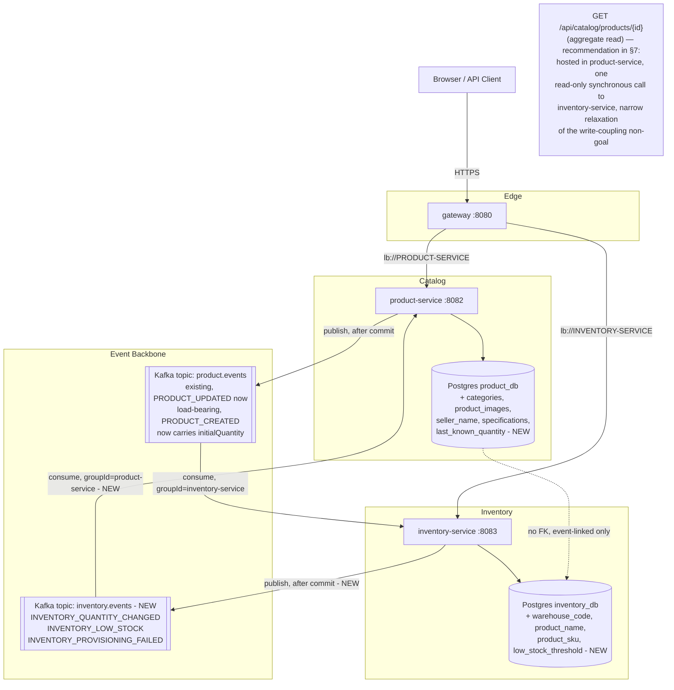

# High Level Design: Catalog Enrichment & Choreographed Creation Saga (Phase 3 slice)

> Extends `docs/HLD-event-driven-inventory.md` (Phase 2). Read that document first — this one
> assumes its Kafka/KRaft topology, its `product.events` topic, its idempotent-consumer pattern, and
> ADR 0002's "duplicated event DTO, no schema registry, no DLQ" decisions as an unchanged foundation.
> This slice does not reopen any of those; it builds on top of them.

## 1. Overview

This feature does three things to the existing product↔inventory slice:

1. **Makes the event flow bidirectional.** `inventory-service` gains its own outbound topic
   (`inventory.events`) so state changes on the inventory side (quantity changes, low-stock
   crossings, provisioning failures) can flow back to product-service — closing Phase 2's open
   question about `PRODUCT_UPDATED`'s load-bearing status (it is now load-bearing: inventory-service
   denormalizes product name/SKU from it) and adding the reverse direction Phase 2 never had.
2. **Enriches both schemas** toward Flipkart/Amazon-ish catalog fidelity: a real `categories` table
   (one level of subcategory), free-text seller attribution, `specifications` as JSONB, product
   images, and a forward-compatible (but still single-) warehouse label on inventory rows.
3. **Adds "create a product with initial stock"** as a single client-facing operation, coordinated
   as a **choreographed saga over Kafka** — not a new orchestrating service, and not a synchronous
   call between product-service and inventory-service.

**The one deliberate pivot from the upstream Feature Planner's plan:** the saga is choreographed, not
orchestrated. The Feature Planner's plan assumed a new coordinating service issuing synchronous
commands with compensation; this document works out what choreography actually implies instead —
concretely, that means no new service, an extended existing endpoint, and compensation triggered by
a new failure event rather than by a coordinator catching a synchronous error. See §7 for the
consistency analysis this pivot implies.

## 2. Goals & Non-Goals

**Goals**

- Extend `POST /api/products` (product-service, existing endpoint, unchanged path) to accept an
  optional `initialQuantity` on `CreateProductRequest`. No new endpoint, no new service for creation.
- Carry `initialQuantity` on the `PRODUCT_CREATED` event payload so inventory-service can provision
  the row with the caller's requested starting quantity instead of always defaulting to zero.
- Add `inventory.events` (new Kafka topic) carrying `INVENTORY_QUANTITY_CHANGED`,
  `INVENTORY_LOW_STOCK`, and `INVENTORY_PROVISIONING_FAILED`, consumed by a new listener in
  product-service.
- Close Phase 2 Open Question #4: `PRODUCT_UPDATED` (and `PRODUCT_CREATED`) become load-bearing —
  inventory-service denormalizes `product_name`/`product_sku` onto `inventory.stock_levels` on
  consumption. This is a confirmed, intentional reversal of `InventoryResponse.java`'s current
  "deliberately shallow" doc comment (see LLD §2.2), not a bug fix.
- Give product-service a narrow, denormalized view of inventory state
  (`Product.lastKnownQuantity`) via `applyInventorySignal`, populated from
  `INVENTORY_QUANTITY_CHANGED` — display-only, never authoritative, never re-published.
- Add `product.categories` (self-referencing `parent_category_id`, one level deep),
  `product.product_images`, `seller_name` (free text), `specifications` (JSONB), and
  `inventory.stock_levels.warehouse_code` (single-warehouse label, forward-compatible).
- Provide `RequiresInitialStockIfActiveRule` as ordinary synchronous request validation on
  `CreateProductRequest` (an `active=true` product needs `initialQuantity >= 1`), enforced before
  the transaction commits — **not** a saga step (see §7).
- Provide a genuine compensation path for the one real saga failure mode: inventory-service fails to
  provision for an infrastructure reason *after* product-service has already committed. Compensation
  reuses existing machinery (`ProductCatalogService.delete`, `PRODUCT_DELETED`,
  `removeIfPresent`) — no bespoke "undo" endpoint.
- Give the aggregate read ("product + its stock in one response") a home — see §7's recommendation.

**Non-Goals**

- No new coordinating service ("saga orchestrator"), and no synchronous call from product-service to
  inventory-service on the **write** path — the Phase 2 non-goal on synchronous write coupling is
  preserved unchanged. (§7 recommends a narrow, explicit, read-only exception for one specific GET
  endpoint — that is the only place this document proposes touching that non-goal at all.)
- No distributed transaction / 2PC / XA across `product_db` and `inventory_db` — still architecturally
  impossible by construction (separate Postgres databases) and still not desired even if it were
  possible.
- No sellers table, no seller RBAC/onboarding — `seller_name` is a free-text column, full stop.
- No multi-warehouse model — `warehouse_code` is a label column on a single conceptual warehouse,
  sized so a real multi-warehouse model doesn't require a column rename later, not so multi-warehouse
  logic works today.
- No structured specifications schema/table — `specifications` is unstructured `JSONB`.
- No generic validation-rules engine — one concrete rule, expressed as ordinary Bean Validation, not
  a new `CatalogSagaValidationRule` abstraction (see §7 for the reasoning).
- Still no schema registry, no DLQ/retry topic, no shared `libs/common-events`, no cross-database FK
  — all Phase 2 / ADR 0002 non-goals carry forward unchanged. `inventory.events` gets the exact same
  treatment `product.events` got: hand-duplicated DTOs, no registry, no DLQ.
- Still no exactly-once semantics; at-least-once + idempotent consumers remains the delivery model,
  now on two topics instead of one.

## 3. Context Diagram

## 4. Major Components

| Component | Responsibility | Status |
|---|---|---|
| product-service | Accepts `initialQuantity` on create; publishes it on `PRODUCT_CREATED`; consumes `inventory.events` (new `InventoryEventListener`); hosts the new aggregate read endpoint (recommended, §7); owns `categories`/`product_images` | Modified |
| inventory-service | Provisions with caller-requested quantity (`provisionWithQuantity`); denormalizes product name/SKU on consumption; publishes `inventory.events`; computes low-stock crossings; publishes `INVENTORY_PROVISIONING_FAILED` on infra failure | Modified |
| Kafka topic `product.events` | Unchanged topic, extended payload (`initialQuantity` on `PRODUCT_CREATED`; `PRODUCT_UPDATED` now load-bearing) | Modified |
| Kafka topic `inventory.events` | New topic, 3 partitions, key = `productId`, mirrors `product.events`' partitioning rationale | New |
| Postgres `product_db` | + `categories`, `product_images`, `products.category_id/seller_name/specifications/last_known_quantity` | Modified |
| Postgres `inventory_db` | + `stock_levels.warehouse_code/product_name/product_sku/low_stock_threshold` | Modified |
| gateway | No route changes — no new service introduced | Untouched |

No new service is introduced by this design. The Feature Planner's plan for a new
saga-orchestrator service is deliberately not carried forward — choreography needs no coordinator.

## 5. Data Flow (Narrative)

**Creation with initial stock (happy path, choreographed).** A caller with `CATALOG_MANAGER`/`ADMIN`
sends `POST /api/products` with `initialQuantity` set (or omitted — defaults to the Phase 2 behavior
of provisioning at 0). `RequiresInitialStockIfActiveRule` (ordinary Bean Validation, see §7) rejects
the request with `400` before anything touches the database if `active=true` and
`initialQuantity` is missing or `0`. On success, `ProductCatalogService.create` commits the product
row, and — strictly after commit, per the existing "after-commit, never inside" discipline — publishes
`PRODUCT_CREATED` carrying `initialQuantity` alongside the existing `ProductResponse` payload
(name, SKU, `active`, etc.). **The HTTP response returns `201` at this point** — the caller does
**not** wait for inventory provisioning. `inventory-service`'s `ProductEventListener` consumes the
event asynchronously and calls `provisionWithQuantity(productId, initialQuantity)`, which denormalizes
`product_name`/`product_sku` onto the new row in the same write.

**This is the named consistency tradeoff of choreography vs. the orchestrated alternative:** creation
and stock provisioning are no longer atomic from the caller's perspective. A caller that reads
`GET /api/products/{id}` immediately after receiving `201` sees the product; a caller that reads
`GET /api/inventory` for that `productId` in the same instant may see `404` for a window bounded by
consumer lag (same order of magnitude as Phase 2's existing `PRODUCT_CREATED` window — sub-second in
this topology). See §7 for the full comparison against what an orchestrated design would have given
the caller instead.

**Compensation (the genuine saga case).** If `provisionWithQuantity` fails for an infrastructure
reason (DB error, unexpected non-idempotent conflict, anything other than the already-handled
"row already exists" redelivery case), `ProductEventListener` catches it, does **not** rethrow, and
publishes `INVENTORY_PROVISIONING_FAILED { productId, requestedQuantity, reason }` on
`inventory.events` as terminal handling for that record (no retry, consistent with the "no DLQ"
posture — see §7). Product-service's new `InventoryEventListener` consumes this and compensates by
calling the existing `ProductCatalogService.delete(productId)`, which publishes `PRODUCT_DELETED`
through the existing, unmodified path; `removeIfPresent` on the inventory side then no-ops safely,
since nothing was ever provisioned there. No bespoke undo path exists anywhere in this design.

**Bidirectional signal back to product-service.** Any quantity-affecting operation in
inventory-service (initial provisioning, `PUT /api/inventory/{id}`, a future adjustment) publishes
`INVENTORY_QUANTITY_CHANGED` after commit. If the resulting quantity is at or below
`low_stock_threshold`, `INVENTORY_LOW_STOCK` also publishes. Product-service's `InventoryEventListener`
consumes `INVENTORY_QUANTITY_CHANGED` and calls a narrow internal method,
`ProductCatalogService.applyInventorySignal(productId, quantity)`, which updates
`Product.lastKnownQuantity` **without** going through `update()` and **without** calling
`ProductEventPublisher` — breaking the ping-pong loop by construction, not by convention.
`INVENTORY_LOW_STOCK` is published but not yet consumed by anything (mirrors Phase 2's original
`PRODUCT_UPDATED`-log-only precedent; flagged in Open Questions, not a gap unique to this design).

**Product update → inventory denormalization (closing Phase 2 Open Question #4).**
`PRODUCT_UPDATED` and `PRODUCT_CREATED` now carry `name`/`sku` inventory-service actually consumes:
`ProductEventListener` calls `InventoryService.denormalizeProductSnapshot(productId, name, sku)`,
which — symmetrically to the above — updates `product_name`/`product_sku` on the `stock_levels` row
**without** publishing `INVENTORY_QUANTITY_CHANGED` (quantity did not change; publishing it would be
both wrong and would restart the ping-pong loop).

## 6. External Dependencies

No new external dependency. `inventory.events` reuses the existing single-broker KRaft Kafka cluster
(ADR 0002 Decision 1, unchanged); no new database, no new cache, no new SaaS integration.

## 7. Consistency & Availability Tradeoffs — the saga redesign

### 7.1 Choreography vs. the orchestrated alternative: what the caller actually gets

The Feature Planner's plan assumed an orchestrated saga: a new coordinating service would call
product-service, then synchronously call inventory-service, and only return `201` once both had
succeeded (with compensation logic living centrally if the second call failed). That gives the caller
an experience that *feels* atomic — a single request, a single response, success meaning "both sides
are done."

Choreography gives up that feeling deliberately, in exchange for **not introducing a new service, a
new failure domain, and a new synchronous coupling** into a platform whose two Phase 2 non-goals were
explicitly "no synchronous call between product-service and inventory-service" and "no distributed
transaction." An orchestrator that synchronously calls both services *is* exactly the coupling those
non-goals were written to avoid — the Feature Planner's plan, however sound as a generic saga pattern,
would have reintroduced the coupling this platform deliberately walked away from in Phase 2.
Concretely, choreography means:

- **The caller gets `201` as soon as the product row commits**, not after inventory provisioning
  completes. State exists — "product created, stock provisioning in flight" — that is real and
  externally observable (a `GET /api/inventory` immediately after `201` can 404) but was never
  observable in the orchestrated design, because the orchestrator would not have returned `201` until
  provisioning had already happened.
- **A window of "phantom active product with no confirmed stock"** exists for every creation with
  `initialQuantity`, bounded by the same consumer-lag order of magnitude as Phase 2's existing
  `PRODUCT_CREATED` → provisioning window (sub-second in this topology, unbounded in the worst case of
  extended inventory-service downtime — same accepted risk as Phase 2, see HLD-event-driven-inventory
  §7's "No DLQ" section, unchanged).
- **Failure recovery is asynchronous, not synchronous.** In the orchestrated design, a provisioning
  failure would have been caught by the orchestrator *before* it told the caller anything succeeded —
  the caller would simply get an error response and the product row would never have needed deleting
  (the orchestrator could roll back before committing, or simply not commit the product until
  inventory confirmed). Here, the product row is **already committed and already returned to the
  caller as a success** by the time a provisioning failure is even detected. Compensation
  (`PRODUCT_DELETED`) happens *after* the caller has already been told the product exists. A caller
  who acts on that `201` in the interim (e.g., links to the product, displays it) can observe a product
  that is deleted moments later. This is a real, user-visible behavioral difference from orchestration,
  not just an internal implementation detail — and the trade this design accepts in exchange for zero
  new services and zero new synchronous coupling.

**This tradeoff is accepted, not defaulted into**, because (a) it was the explicit approval-gate
decision (choreography over orchestration), and (b) the compensating-delete case is expected to be rare
— it fires only on genuine inventory-service infrastructure failure, not on the ordinary paths (missing
event, redelivery, Kafka lag), all of which remain the already-accepted Phase 2 risk, unchanged.

### 7.2 `RequiresInitialStockIfActiveRule`: reclassified, not a saga step

The Feature Planner's plan treated this as saga validation. It is not: `active` and `initialQuantity`
are both fields on the *same inbound request*, available before any transaction opens, needing zero
cross-service data. There is nothing "saga" about it — it is ordinary request validation, and treating
it as a saga step would have meant either a synchronous check against a remote service (unnecessary —
the data isn't remote) or a pre-saga validation phase that adds ceremony around a single
`@AssertTrue`-shaped constraint. **Reclassified as Bean Validation on `CreateProductRequest`,
enforced synchronously at the HTTP boundary, before the transaction commits** (LLD §2.1).

**Call on `CatalogSagaValidationRule`:** does not earn its place. It exists in the Feature Planner's
plan to generalize past a single rule, but there is exactly one rule, it needs no cross-cutting
abstraction to express, and the platform's existing convention (Jakarta Bean Validation directly on
request DTOs — see `CreateProductRequest`'s existing `@NotBlank`/`@Pattern`/`@DecimalMin` usage) already
covers it cleanly. Introducing a named interface for a single implementation, with no second
implementation on the horizon, is exactly the kind of speculative generality ADR 0002 already rejected
once for `libs/common-events` ("a shared library earns its cost the moment a second consumer needs the
same shape") — the same reasoning applies here: a rules abstraction earns its cost the moment a second
rule needs it, not before. If a second cross-cutting product-creation rule materializes later, revisit
then, with that rule's actual shape in hand rather than a guess.

### 7.3 The aggregate read endpoint — recommendation

`GET /api/catalog/products/{id}` (product + its stock, one response) needs a home, and the two
candidates both have a real cost:

- **Gateway response aggregation.** The gateway's own `package-info.java` states, in its own words,
  "Deliberately NOT here: business logic, persistence, request-body inspection, response rewriting. A
  gateway that understands payloads is a gateway that has to be redeployed every time a downstream
  contract changes." Aggregating two JSON bodies into one is exactly "understanding payloads." Putting
  this endpoint at the gateway would mean writing the first business-logic code the gateway has ever
  had, directly contradicting a documented, deliberate architectural stance — not a neutral choice.
- **A synchronous product-service → inventory-service call**, which narrowly relaxes the Phase 2
  non-goal "No synchronous call between product-service and inventory-service, in either direction."

**Recommendation: relax the non-goal narrowly, for this one read-only endpoint only.** The reasoning
the original non-goal was protecting against — a synchronous **write**-path dependency that would
reintroduce distributed-transaction-shaped coupling — does not apply to a `GET`. A read-only,
idempotent, non-mutating fan-out call carries none of the atomicity/compensation baggage the write-path
non-goal exists to avoid; it is the ordinary API-composition pattern (a service calling another
service's read endpoint to compose a response), which is a materially different risk category from
`PRODUCT_CREATED`/`PRODUCT_DELETED` write coupling. Concretely: product-service hosts
`GET /api/catalog/products/{id}`, calling inventory-service's `GET /api/inventory/by-product/{productId}`
(new endpoint, LLD §3) through its own dedicated circuit breaker (`aggregateCb`, separate failure
domain from any other breaker) with a short timeout, and **degrades gracefully** — if inventory-service
is unreachable, slow, or the row genuinely doesn't exist yet (the §7.1 window), the response returns
the product with `inventory: null`, not a `5xx`. This mirrors the general shape of "inventory data is
advisory, not authoritative" that Phase 2's own consistency section already established for the
`/api/inventory` 404 case — this endpoint just composes that same advisory data into one response
instead of requiring two calls.

**This still narrows, not discards, the non-goal:** the amended posture is "no synchronous call for
writes/mutations, in either direction — a single read-only aggregation call from product-service to
inventory-service is permitted, specifically for `GET /api/catalog/products/{id}`, and does not
extend to any other endpoint by default." Because this revises an already-accepted, explicitly-stated
non-goal from a prior approved design, this recommendation is flagged in §11 Open Questions for
approval-gate confirmation — it is a real call, not a punt, but it is exactly the kind of
already-accepted-decision change that constraint requires sign-off on rather than silent revision.

### 7.4 Standing consistency posture (unchanged from Phase 2, restated for completeness)

Everything in `HLD-event-driven-inventory.md` §7 continues to hold: eventual consistency between
product and inventory via events, availability favored over cross-service consistency, no DLQ (an
explicit accepted risk, unchanged), Redis cache staleness posture (untouched by this feature). This
document's new consistency surface is additive: a second topic, a second direction, and the specific
create-with-stock window described in §7.1 above.

## 8. Scalability Plan

- `inventory.events` gets the identical partitioning treatment as `product.events`: 3 partitions,
  key = `productId`, so all events for one product (in either direction, on either topic) stay
  strictly ordered relative to each other *within* their own topic — there is no cross-topic ordering
  guarantee between a `product.events` message and an `inventory.events` message for the same product,
  which is fine: no consumer logic in this design depends on cross-topic ordering (e.g.,
  `applyInventorySignal` does not assume it fires after or before any particular `product.events`
  message).
- Consumer group `product-service` on `inventory.events` scales identically to `groupId=inventory-service`
  on `product.events` did in Phase 2 — up to 3 concurrent instances before a 4th sits idle, standard
  Kafka consumer-group rebalance semantics, no reconfiguration needed to add replicas later.
- The new `GET /api/catalog/products/{id}` endpoint adds one outbound HTTP call per request from
  product-service to inventory-service; it does not change either service's write-path scalability
  profile, and its own circuit breaker (`aggregateCb`) isolates its failure mode from every other
  route.

## 9. Security Model (Summary)

- `POST /api/products`'s auth is unchanged (`CATALOG_MANAGER`/`ADMIN`) — `initialQuantity` is just
  another field on the same gated request; no new role, no new scope.
- The new `GET /api/inventory/by-product/{productId}` endpoint follows the existing inventory read
  posture: authenticated (any role), matching every other `GET` in both services.
- The new `GET /api/catalog/products/{id}` aggregate endpoint: authenticated (any role) — it composes
  two already-authenticated-any-role reads, so it introduces no new authorization surface.
- The internal service-to-service call from product-service to inventory-service for the aggregate
  read reuses the platform's existing "every resource server validates the token independently"
  posture — product-service forwards (or re-derives) a service-appropriate credential; it does not
  invent a new trust mechanism. (Concrete mechanism — forwarded caller JWT vs. a service-to-service
  credential — is an implementation detail for the build stage, not resolved here; either is
  consistent with the existing "no `X-User-*` header trust" posture as long as the call is
  independently authenticated on the inventory-service side like every other request it receives.)
- `inventory.events` payloads carry no bearer credentials, matching `product.events`' existing
  posture — product data and stock counts only.

## 10. Observability

- `inventory-service` gains publish-side logging on `inventory.events` mirroring
  `ProductEventPublisher`'s existing pattern (`eventId`, `eventType`, `productId`, never full payload).
- Product-service's new `InventoryEventListener` mirrors `ProductEventListener`'s consume-side logging
  (fields + outcome: `applied` / `no-op-product-not-found` / `compensating-delete`).
- New metrics: `inventory.events.published` (tagged `eventType`), `inventory.events.consumed` (tagged
  `eventType`, `outcome`) in product-service — same Micrometer convention as Phase 2.
- `INVENTORY_PROVISIONING_FAILED` firing at all is itself a signal worth alerting on in a production
  hardening pass (a genuine saga compensation firing means an infrastructure failure occurred) —
  flagged as a Future Improvement (dedicated alert/counter distinct from ordinary consumed-event
  metrics), not built here.
- Correlation-ID propagation into Kafka headers remains the same open Future Improvement from Phase 2,
  now doubly relevant with two topics and two directions — still out of scope for this slice.

## 11. Open Questions

1. **Aggregate-read non-goal relaxation (§7.3) needs approval-gate confirmation.** This document
   recommends narrowly relaxing "no synchronous call, in either direction" to permit exactly one
   read-only endpoint. Because it revises an already-accepted non-goal from `HLD-event-driven-inventory.md`,
   it should be explicitly re-confirmed rather than treated as silently decided by this document alone.
2. **`INVENTORY_LOW_STOCK` has no consumer yet.** Published for a future notification/UI surface, not
   consumed by anything in this design — mirrors Phase 2's original `PRODUCT_UPDATED`-log-only
   precedent exactly. Not a defect; flagged for the same reason Phase 2 flagged its analog.
3. **`INVENTORY_LOW_STOCK` fires on every write that leaves quantity at/below threshold, not just on
   crossing the threshold** (no edge-detection/hysteresis). A quantity that stays at 3 across five
   separate `PUT` calls publishes five low-stock events. Acceptable for this slice (a consumer that
   cares can de-duplicate); flagged as a Future Improvement to add crossing-only semantics once a real
   consumer exists to specify what it actually needs.
4. **Aggregate-read call's exact credential mechanism** (forwarded JWT vs. service credential) is
   left to the build stage — functionally equivalent for this design's purposes, not an architectural
   fork.
5. **Category depth enforcement is application-level, not DB-level** (see LLD §4) — Postgres has no
   simple `CHECK` for "this row's parent must itself have no parent" without a trigger; this design
   recommends application-level enforcement in the service layer over a trigger, consistent with the
   platform's general preference for logic in Java over logic in the database (matches, e.g., how
   `Product`'s domain invariants live in `Product.java`, not in a Postgres constraint, wherever a
   simple `CHECK` doesn't suffice). Flagged for confirmation, not fully resolved here.

## Future Improvements (out of scope for this design)

- Extract `libs/common-events` once `inventory.events` (or `product.events`) gains a second consumer
  — same trigger condition ADR 0002 already established, now watched on two topics instead of one.
- Add crossing-only semantics (hysteresis) to `INVENTORY_LOW_STOCK`.
- Dedicated alerting on `INVENTORY_PROVISIONING_FAILED` volume, distinct from ordinary consumer-lag
  metrics — a compensation firing is a signal worth paging on eventually, not just logging.
- Correlation-ID propagation into Kafka headers, now relevant on two topics.
- Multi-warehouse model, once `warehouse_code` needs to mean more than a display label.
- Structured `specifications` (a real spec table with typed attributes per category) if JSONB's lack
  of query/index ergonomics becomes a real product requirement (e.g., "filter by RAM size" across a
  JSONB blob does not perform or express as well as a normalized attribute table would).
