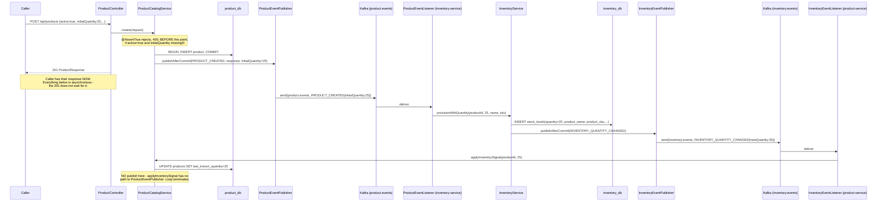
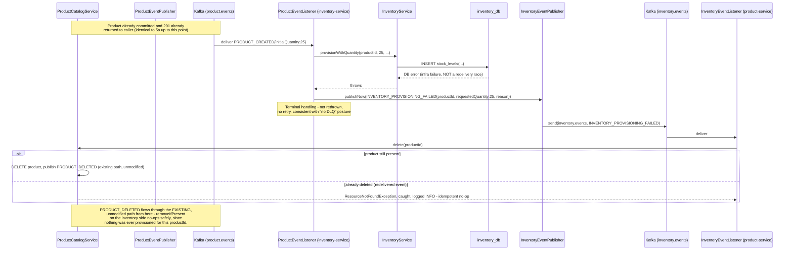

# Low Level Design: Catalog Enrichment & Choreographed Creation Saga (Phase 3 slice)

> Extends `docs/LLD-event-driven-inventory.md`. Class/schema/sequence detail for the goals in
> `docs/HLD-catalog-enrichment-and-saga.md`. Every "current state" description below is grounded in
> the actual code as of this pass: `Product.java`, `Inventory.java`, `ProductEventPublisher.java`,
> `ProductEventListener.java`, `ProductController.java`, `InventoryController.java`,
> `CreateProductRequest.java`, `ProductResponse.java`, `InventoryResponse.java`,
> `ProductCatalogService.java`.

## 1. Scope

- product-service: `Product.java` new columns/mutators, `CreateProductRequest`/`ProductResponse`
  additive fields, `Category.java`/`ProductImage.java` new entities, new
  `GET /api/catalog/products/{id}` aggregate endpoint, new `InventoryEventListener`.
- inventory-service: `Inventory.java` new columns/mutators, `InventoryResponse` additive fields, new
  `GET /api/inventory/by-product/{productId}` endpoint, `provisionWithQuantity`,
  `denormalizeProductSnapshot`, `InventoryEventPublisher` (new), extended `ProductEventListener`.
- Flyway migration column tables for both databases.
- Not authored here (implementation, not design): actual migration files, Gradle changes, the
  `aggregateCb` breaker config file, the client used for the aggregate read's outbound call.

## 2. Class / Module Design

### 2.1 product-service (modified)

**`Product.java` (modified)** — current state (grounded in the actual file): anaemic entity, no
associations by design ("NO ASSOCIATIONS, therefore NO N+1 RISK" is the class's own doc comment),
`create`/`update` take an explicit `now: Instant`, `@Version` for optimistic concurrency. New
columns and one new narrow mutator:

```java
// NEW columns
@Column(name = "category_id")
private UUID categoryId;                 // nullable FK -> product.categories.id, no @ManyToOne
                                          // association (preserves the class's own "NO
                                          // ASSOCIATIONS" invariant — a UUID column, not a
                                          // mapped relationship, so the paged list endpoint
                                          // still costs exactly one SELECT).

@Column(name = "seller_name", length = 200)
private String sellerName;               // nullable, free text, no FK, no sellers table.

@Column(name = "specifications", columnDefinition = "jsonb")
private String specifications;           // NEW — stored as a JSON string at the entity level
                                          // (Hibernate's JSONB support via a converter, not a
                                          // Map field on the entity itself — keeps the entity
                                          // from taking on JSON-library concerns; the converter
                                          // lives in a small `@Converter` class, mapping to/from
                                          // Map<String,Object> only at the boundary
                                          // (ProductCatalogService <-> Product), mirroring how
                                          // this class already avoids doing translation work.

@Column(name = "last_known_quantity")
private Integer lastKnownQuantity;       // NEW — denormalized, display-only, non-authoritative.
                                          // Populated ONLY via applyInventorySignal below; NEVER
                                          // touched by create()/update().

// NEW mutator — deliberately narrow, cannot re-trigger product.events publication.
// Called ONLY from ProductCatalogService.applyInventorySignal, which does NOT call
// ProductEventPublisher — this is the "no ping-pong" guarantee, enforced structurally:
// this method has no access to ProductEventPublisher at all (Product.java has zero
// Kafka/event dependencies, same as today), so there is no code path by which calling
// it could publish anything.
public void applyInventorySignal(Integer quantity, Instant now) {
  this.lastKnownQuantity = quantity;
  this.updatedAt = now;
}
```

`category_id`/`seller_name`/`specifications` ARE touched by `create()`/`update()` (ordinary
enrichment fields, part of the normal write path) — only `last_known_quantity` gets the narrow
`applyInventorySignal` treatment, because it is the one field whose value originates from the *other*
service, not from this service's own callers.

**`Category.java` (new entity)**:

```java
package com.acme.ecommerce.product.domain;

@Entity
@Table(name = "categories")
public class Category {
  @Id @GeneratedValue(strategy = GenerationType.UUID)
  @Column(name = "id", nullable = false, updatable = false)
  private UUID id;

  @Column(name = "name", nullable = false, length = 120)
  private String name;

  // Self-referencing FK, one level deep. NOT a @ManyToOne association for the same
  // "no associations" reason Product.java avoids one — a UUID column, application-
  // enforced depth (see HLD §11 Open Question #5: no DB-level recursive CHECK).
  @Column(name = "parent_category_id")
  private UUID parentCategoryId;

  @Column(name = "created_at", nullable = false, updatable = false)
  private Instant createdAt;

  @Column(name = "updated_at", nullable = false)
  private Instant updatedAt;

  // create()/rename() factory + mutator, same now-as-explicit-parameter shape as Product.java.
  // Depth enforcement (a category whose parent itself has a parent is rejected) lives in
  // CategoryService, checked before insert — NOT a domain invariant inside this class, since
  // checking it requires a repository lookup this entity has no access to.
}
```

**`ProductImage.java` (new entity)**:

```java
package com.acme.ecommerce.product.domain;

@Entity
@Table(name = "product_images")
public class ProductImage {
  @Id @GeneratedValue(strategy = GenerationType.UUID)
  private UUID id;

  @Column(name = "product_id", nullable = false)
  private UUID productId;              // FK -> products.id, ON DELETE CASCADE at the DB level
                                        // (same database, same schema — unlike the product/
                                        // inventory relationship, an ordinary FK is available
                                        // and used here).

  @Column(name = "url", nullable = false, length = 2048)
  private String url;

  @Column(name = "display_order", nullable = false)
  private int displayOrder;

  @Column(name = "created_at", nullable = false, updatable = false)
  private Instant createdAt;
}
```

**`CreateProductRequest.java` (modified)** — current state: 5-field record with `@NotBlank`/
`@Pattern`/`@DecimalMin` constraints, no cross-field validation today. New fields, and the
`RequiresInitialStockIfActiveRule` reclassified as an `@AssertTrue` method (§HLD 7.2 — no
`CatalogSagaValidationRule` interface):

```java
public record CreateProductRequest(
    @NotBlank @Size(max = 64) String sku,
    @NotBlank @Size(max = 200) String name,
    @NotNull @DecimalMin("0.00") BigDecimal priceAmount,
    @NotBlank @Pattern(regexp = "^[A-Z]{3}$") String priceCurrency,
    boolean active,
    @Min(0) Integer initialQuantity,             // NEW, optional; null == Phase 2 behavior (0)
    UUID categoryId,                              // NEW, optional FK
    @Size(max = 200) String sellerName,           // NEW, optional free text
    Map<String, Object> specifications,           // NEW, optional, arbitrary JSON-shaped map
    @Valid List<ProductImageRequest> images        // NEW, optional
) {
  /**
   * RequiresInitialStockIfActiveRule, reclassified as ordinary Bean Validation (HLD §7.2) — not
   * a saga step: both fields it reads are already present on this request, before any
   * transaction opens, needing no cross-service data.
   */
  @AssertTrue(message = "initialQuantity must be >= 1 when active=true")
  public boolean isInitialStockValidWhenActive() {
    return !active || (initialQuantity != null && initialQuantity >= 1);
  }
}

public record ProductImageRequest(@NotBlank @Size(max = 2048) String url,
                                   @Min(0) int displayOrder) {}
```

**`ProductResponse.java`** (in `product-service-api`, the published outbound contract — modified,
additive only, existing 7 fields unchanged):

```java
public record ProductResponse(
    UUID id, String sku, String name, BigDecimal priceAmount, String priceCurrency,
    boolean active, Long version,
    UUID categoryId, String sellerName, Map<String, Object> specifications,      // NEW
    List<ProductImageResponse> images,                                          // NEW
    Integer lastKnownQuantity) {}                                                // NEW, nullable

public record ProductImageResponse(UUID id, String url, int displayOrder) {}
```

**`ProductCatalogService.java` (modified)** — current state: class-level `readOnly=true`,
`create`/`update`/`delete` each open their own `@Transactional`, `create` already calls
`saveAndFlush` (to surface the duplicate-`sku` `DataIntegrityViolationException` inside the catch
block rather than at commit — this matters for the new `initialQuantity` path too, unchanged). Two
additions:

```java
@Transactional
public ProductResponse create(CreateProductRequest request) {
  Instant now = timeProvider.now();
  Product product = Product.create(request.sku(), request.name(), request.priceAmount(),
      request.priceCurrency(), request.active(), request.categoryId(), request.sellerName(),
      request.specifications(), now);
  try {
    product = products.saveAndFlush(product);
  } catch (DataIntegrityViolationException e) {
    throw new ResourceConflictException("Product sku already exists: " + request.sku(), e);
  }
  images.saveAll(toImageEntities(product.getId(), request.images()));   // new, images repo
  ProductResponse response = toResponse(product);
  // initialQuantity now rides on the PRODUCT_CREATED payload — see ProductEvent below.
  events.publishAfterCommit(ProductEventType.PRODUCT_CREATED, response, request.initialQuantity());
  return response;
}

/**
 * Applies a denormalized inventory signal. Called ONLY by InventoryEventListener, in reaction
 * to INVENTORY_QUANTITY_CHANGED. Deliberately does NOT call ProductEventPublisher — this is
 * the "no ping-pong" guarantee's service-layer half (Product.applyInventorySignal is the
 * domain-layer half). If the product no longer exists (e.g., the compensating delete raced
 * ahead of a lagging quantity-changed event for the same productId), this is a silent no-op,
 * not an error — the event describes a product that is legitimately gone.
 */
@Transactional
public void applyInventorySignal(UUID productId, int quantity) {
  products.findById(productId).ifPresent(p -> p.applyInventorySignal(quantity, timeProvider.now()));
}
```

**`ProductEvent.java` (product-service-app internal, modified)** — gains one field:

```java
public record ProductEvent(
    UUID eventId, ProductEventType eventType, UUID productId, Instant occurredAt,
    ProductResponse payload,
    Integer initialQuantity) {}   // NEW — set only for PRODUCT_CREATED, null otherwise
```

**`ProductEventPublisher.java` (modified)** — the existing `publishAfterCommit` overloads gain a
variant carrying `initialQuantity`; the "after commit, never inside" / "catch, never rethrow"
discipline is unchanged, byte-for-byte, from the existing implementation:

```java
public void publishAfterCommit(ProductEventType type, ProductResponse product, Integer initialQuantity) {
  // identical TransactionSynchronizationManager registration as today; only the
  // ProductEvent construction differs (adds initialQuantity).
}
```

**`InventoryEventListener.java` (new)** — the reverse-direction consumer, mirroring
`ProductEventListener`'s existing shape (exhaustive switch, no default branch, dispatches to
service methods it alone calls):

```java
package com.acme.ecommerce.product.event;

@Component
public class InventoryEventListener {

  private final ProductCatalogService catalog;

  @KafkaListener(topics = "inventory.events", groupId = "product-service")
  public void onInventoryEvent(InventoryEvent event) {
    switch (event.eventType()) {
      case INVENTORY_QUANTITY_CHANGED ->
          catalog.applyInventorySignal(event.productId(), event.newQuantity());
      case INVENTORY_LOW_STOCK ->
          // Not yet consumed for a write — reserved for a future notification/UI surface.
          // Mirrors Phase 2's original PRODUCT_UPDATED-log-only precedent (HLD §11 Open Q #2).
          log.debug("Received INVENTORY_LOW_STOCK productId={} (no-op)", event.productId());
      case INVENTORY_PROVISIONING_FAILED -> {
        try {
          catalog.delete(event.productId());   // reuses existing delete() -> PRODUCT_DELETED
        } catch (ResourceNotFoundException e) {
          // Idempotent no-op: already compensated by a prior (possibly redelivered)
          // INVENTORY_PROVISIONING_FAILED, or the product was independently deleted.
          // The "row is already gone" check IS the idempotency mechanism here — same
          // role findByProductId's existence check plays for provisionIfAbsent, just
          // expressed as catch-not-found instead of check-then-insert, because delete's
          // natural idempotent signal is "already absent," not a UNIQUE constraint.
          log.info("Compensating delete no-op, product {} already absent", event.productId());
        }
      }
    }
  }
}
```

**`InventoryEvent.java` (new, product-service-app internal, duplicated per ADR 0002's established
pattern — no shared library)**:

```java
package com.acme.ecommerce.product.event;

public record InventoryEvent(
    UUID eventId, InventoryEventType eventType, UUID productId,
    Integer newQuantity, Integer requestedQuantity, String reason, Instant occurredAt) {}

public enum InventoryEventType {
  INVENTORY_QUANTITY_CHANGED, INVENTORY_LOW_STOCK, INVENTORY_PROVISIONING_FAILED
}
```

**`ProductController.java` (modified)** — one new endpoint, thin, matching the existing controller's
posture exactly:

```java
@GetMapping("/catalog/products/{id}")   // note: distinct path prefix per HLD §7.3
public ProductCatalogAggregateResponse getAggregate(@PathVariable UUID id) {
  return catalogAggregateService.getAggregate(id);
}
```

**`CatalogAggregateService.java` (new)** — the only new class introducing a synchronous outbound
call in this design, scoped exactly to HLD §7.3's narrow relaxation:

```java
@Service
public class CatalogAggregateService {
  private final ProductCatalogService products;
  private final InventoryClient inventory;    // REST client, own aggregateCb breaker + timeout

  public ProductCatalogAggregateResponse getAggregate(UUID id) {
    ProductResponse product = products.findById(id);           // throws 404 if absent, as today
    InventoryResponse stock = inventory.findByProductIdOrNull(id);  // null on 404, timeout, or
                                                                     // breaker-open — never throws
    return new ProductCatalogAggregateResponse(product, stock); // stock == null is a valid,
                                                                 // documented response shape
  }
}
```

### 2.2 inventory-service (modified)

**`Inventory.java` (modified)** — current state (grounded in the actual file): no
`@PrePersist`/`@PreUpdate` from day one (deliberately, per its own doc comment), `provision`/
`adjustQuantity` take explicit `now`. New columns and two new narrow mutators:

```java
// NEW columns
@Column(name = "warehouse_code", length = 32)
private String warehouseCode;             // nullable, forward-compatible single-warehouse label.

@Column(name = "product_name", length = 200)
private String productName;               // NEW — denormalized, populated only via
                                          // applyProductSnapshot below.

@Column(name = "product_sku", length = 64)
private String productSku;                // NEW — denormalized, same source.

@Column(name = "low_stock_threshold", nullable = false)
private int lowStockThreshold = 10;       // NEW, sensible default; overridable via
                                          // CreateInventoryRequest/UpdateInventoryRequest.

// NEW mutator — deliberately narrow, cannot re-trigger inventory.events publication (same
// structural guarantee as Product.applyInventorySignal: this class has zero Kafka
// dependencies, so there is no code path by which calling it could publish anything).
public void applyProductSnapshot(String name, String sku, Instant now) {
  this.productName = name;
  this.productSku = sku;
  this.updatedAt = now;
}
```

**`InventoryService.java` (modified)** — current state: `provisionIfAbsent(productId)` always
provisions at quantity 0; `removeIfPresent`/`update`/`create` unchanged in spirit. Parameterizes
provisioning and adds the denormalization + publish paths:

```java
/**
 * Replaces provisionIfAbsent. Same idempotency mechanism (existence check + catch
 * DataIntegrityViolationException on a concurrent-delivery race) — just parameterized by
 * quantity. A null/absent quantity on the event defaults to 0, preserving today's exact
 * existing behavior for callers who don't set initialQuantity.
 */
@Transactional
public void provisionWithQuantity(UUID productId, Integer quantity, String name, String sku) {
  if (inventory.findByProductId(productId).isPresent()) {
    return; // idempotent no-op, identical to provisionIfAbsent today
  }
  int startingQuantity = quantity != null ? quantity : 0;
  Instant now = timeProvider.now();
  Inventory row = Inventory.provision(productId, now);
  row.adjustQuantity(startingQuantity, now);
  row.applyProductSnapshot(name, sku, now);   // denormalize at creation time, no separate event needed
  try {
    row = inventory.save(row);
  } catch (DataIntegrityViolationException e) {
    return; // lost the race to a concurrent delivery — identical to today's behavior
  }
  events.publishAfterCommit(InventoryEventType.INVENTORY_QUANTITY_CHANGED, row);
  maybePublishLowStock(row);
}

/**
 * Called ONLY by ProductEventListener on PRODUCT_UPDATED (and PRODUCT_CREATED, redundantly
 * safe) consumption. Does NOT call InventoryEventPublisher — quantity did not change, so
 * publishing INVENTORY_QUANTITY_CHANGED here would be both incorrect and would restart the
 * ping-pong loop this design is explicit about avoiding.
 */
@Transactional
public void denormalizeProductSnapshot(UUID productId, String name, String sku) {
  inventory.findByProductId(productId)
      .ifPresent(row -> row.applyProductSnapshot(name, sku, timeProvider.now()));
}

// update()/create() (direct-write paths, unchanged in shape) now also call
// events.publishAfterCommit(INVENTORY_QUANTITY_CHANGED, ...) + maybePublishLowStock(...)
// after any quantity mutation — same after-commit discipline as product-service's publisher.

private void maybePublishLowStock(Inventory row) {
  if (row.getQuantity() <= row.getLowStockThreshold()) {
    events.publishAfterCommit(InventoryEventType.INVENTORY_LOW_STOCK, row);
  }
}
```

**`InventoryEventPublisher.java` (new)** — structurally identical to `ProductEventPublisher.java`
(the "after commit, never inside," `TransactionSynchronizationManager`-based, catch-log-never-rethrow
pattern is copy-for-copy the same design, applied to the new topic; not reproduced in full here since
it is a mechanical mirror of the existing, already-reviewed class).

**`ProductEventListener.java` (modified)** — the PRODUCT_CREATED branch changes; PRODUCT_UPDATED
becomes load-bearing; the compensation trigger is added:

```java
@KafkaListener(topics = "product.events", groupId = "inventory-service")
public void onProductEvent(ProductEvent event) {
  switch (event.eventType()) {
    case PRODUCT_CREATED -> {
      try {
        inventoryService.provisionWithQuantity(
            event.productId(), event.initialQuantity(),
            event.payload().name(), event.payload().sku());
        log.info("Provisioned inventory row productId={} quantity={}",
            event.productId(), event.initialQuantity());
      } catch (RuntimeException e) {
        // Genuine infrastructure failure (NOT the redelivery/race case, which
        // provisionWithQuantity already absorbs internally without throwing). This IS
        // the saga's compensation trigger (HLD §7 "real saga failure mode," distinct
        // from ordinary message loss/lag, which is still just "resume from offset").
        // Terminal handling for this record: publish, do not rethrow, do not rely on
        // Kafka's default retry — consistent with the platform's "no DLQ/retry topic"
        // posture (ADR 0002), just made explicit here via a signal instead of a
        // silent log-and-skip.
        log.error("Provisioning failed productId={} reason={}", event.productId(), e.getMessage());
        inventoryEvents.publishAfterCommit(InventoryEventType.INVENTORY_PROVISIONING_FAILED,
            event.productId(), event.initialQuantity(), e.getMessage());
      }
    }
    case PRODUCT_UPDATED -> {
      // NOW LOAD-BEARING (Phase 2 Open Question #4, closed): denormalizes name/sku.
      // Reverses InventoryResponse's "deliberately shallow" doc comment — intentional,
      // confirmed at the approval gate, not a bug.
      inventoryService.denormalizeProductSnapshot(
          event.productId(), event.payload().name(), event.payload().sku());
      log.info("Denormalized product snapshot productId={}", event.productId());
    }
    case PRODUCT_DELETED -> {
      inventoryService.removeIfPresent(event.productId());   // unchanged
      log.info("Removed inventory row productId={}", event.productId());
    }
  }
}
```

Note: `InventoryEventPublisher.publishAfterCommit` for `INVENTORY_PROVISIONING_FAILED` is called
from *inside* the `catch` block of a Kafka listener method, not inside a `@Transactional` service
method — there is no open transaction to hang an `afterCommit` callback off in this branch (the
persistence attempt that failed never got far enough to have one, or already rolled back). This one
call site publishes **immediately, best-effort**, not gated on a commit — consistent with there being
nothing left to protect against a race with, since nothing committed. (`InventoryEventPublisher`
exposes a second, ungated `publishNow(...)` method for exactly this case, distinct from
`publishAfterCommit`, and documented as such.)

**`InventoryController.java` (modified)** — one new read endpoint:

```java
@GetMapping("/by-product/{productId}")
public InventoryResponse findByProductId(@PathVariable UUID productId) {
  return inventory.findByProductId(productId);   // throws ResourceNotFoundException -> 404, as
                                                  // every other lookup does; CatalogAggregateService
                                                  // is responsible for turning that 404 into a
                                                  // null in the composed response, not this endpoint.
}
```

**`InventoryResponse.java`** (modified, additive; existing 4 fields — `id`, `productId`,
`quantity`, `version` — unchanged):

```java
public record InventoryResponse(
    UUID id, UUID productId, int quantity, Long version,
    String warehouseCode, String productName, String productSku,   // NEW
    int lowStockThreshold) {}                                       // NEW
```

The class-level doc comment's "DELIBERATELY SHALLOW ... this service has no dependency on
product-service" claim is now **false and must be corrected** in the same changeset — the comment
itself needs updating to state the reversal explicitly (HLD §2's confirmed decision), not just the
code.

## 3. API Contract

| Method | Path | Request | Response | Auth |
|---|---|---|---|---|
| `POST` | `/api/products` | `CreateProductRequest` (+ `initialQuantity`, `categoryId`, `sellerName`, `specifications`, `images` — all additive) | `201 ProductResponse` / `400` (incl. new `@AssertTrue` failure) / `409` | `CATALOG_MANAGER`/`ADMIN` — unchanged |
| `GET` | `/api/catalog/products/{id}` | — | `200 ProductCatalogAggregateResponse{product, inventory: nullable}` / `404` (product not found) | Authenticated (any role) — **NEW** |
| `GET` | `/api/inventory/by-product/{productId}` | — | `200 InventoryResponse` / `404` | Authenticated (any role) — **NEW** |

All other existing rows from `LLD-event-driven-inventory.md` §3 are unchanged; not reproduced here.

## 4. Database Schema Changes

### product_db (schema `product`)

| Table | Column | Type | Constraint | Migration |
|---|---|---|---|---|
| `product.categories` | `id` | `uuid` | `PRIMARY KEY DEFAULT gen_random_uuid()` | **New** table |
| `product.categories` | `name` | `varchar(120)` | `NOT NULL` | New |
| `product.categories` | `parent_category_id` | `uuid` | `NULL`, `REFERENCES product.categories(id)` (self-FK; depth enforced in app layer, not DB — HLD §11 Open Q #5) | New |
| `product.categories` | `created_at`/`updated_at` | `timestamptz` | `NOT NULL DEFAULT now()` | New |
| `product.product_images` | `id` | `uuid` | `PRIMARY KEY DEFAULT gen_random_uuid()` | **New** table |
| `product.product_images` | `product_id` | `uuid` | `NOT NULL REFERENCES product.products(id) ON DELETE CASCADE` | New |
| `product.product_images` | `url` | `varchar(2048)` | `NOT NULL` | New |
| `product.product_images` | `display_order` | `integer` | `NOT NULL DEFAULT 0` | New |
| `product.product_images` | `created_at` | `timestamptz` | `NOT NULL DEFAULT now()` | New |
| `product.products` | `category_id` | `uuid` | `NULL REFERENCES product.categories(id)` (ordinary same-DB FK, unlike the product/inventory relationship) | **New** — additive column |
| `product.products` | `seller_name` | `varchar(200)` | `NULL` | New |
| `product.products` | `specifications` | `jsonb` | `NULL` | New |
| `product.products` | `last_known_quantity` | `integer` | `NULL` (denormalized, non-authoritative — see §2.1) | New |

Existing `product.products` columns (`id`, `sku`, `name`, `price_amount`, `price_currency`, `active`,
`created_at`, `updated_at`, `version`) are unchanged — verified against the actual `Product.java`.

### inventory_db (schema `inventory`)

| Table | Column | Type | Constraint | Migration |
|---|---|---|---|---|
| `inventory.stock_levels` | `warehouse_code` | `varchar(32)` | `NULL` | **New** — additive column |
| `inventory.stock_levels` | `product_name` | `varchar(200)` | `NULL` (denormalized) | New |
| `inventory.stock_levels` | `product_sku` | `varchar(64)` | `NULL` (denormalized) | New |
| `inventory.stock_levels` | `low_stock_threshold` | `integer` | `NOT NULL DEFAULT 10` | New |

Existing `inventory.stock_levels` columns (`id`, `product_id` UNIQUE, `quantity`, `version`,
`created_at`, `updated_at`) are unchanged — verified against the actual `Inventory.java`.

No cross-database foreign key is introduced by any of the above — `product.categories`/
`product.product_images` are same-database, ordinary FKs; `product_name`/`product_sku` on
`inventory.stock_levels` remain event-linked-only denormalization, explicitly not FK-backed,
consistent with `HLD-event-driven-inventory.md` §4a's already-accepted posture.

## 5. Sequence of Operations

### 5a. Choreographed happy path: create with initial stock



### 5b. Compensation path: provisioning fails



### 5c. Existing sequences unchanged

`LLD-event-driven-inventory.md` §5a (product write → publish, for `PUT`/`DELETE`) and §5b (login/Redis)
are unmodified by this feature; not reproduced here.

## 6. Edge Cases

| Case | Expected Behavior |
|---|---|
| Caller reads `GET /api/inventory` (or the new `GET /api/catalog/products/{id}`) immediately after `201` from `POST /api/products` with `initialQuantity` set | Product exists; inventory row does not yet exist (window bounded by consumer lag, §HLD 7.1). `GET /api/inventory` → `404` (unchanged Phase 2 behavior). `GET /api/catalog/products/{id}` → `200` with `inventory: null` (this design's new, explicit degradation contract — never a `5xx` for this reason). |
| `INVENTORY_PROVISIONING_FAILED` redelivered (Kafka at-least-once) for a `productId` already compensated | `ProductCatalogService.delete` throws `ResourceNotFoundException`; `InventoryEventListener` catches it and logs an idempotent no-op — no second `PRODUCT_DELETED` publishes, no error surfaces. |
| `INVENTORY_PROVISIONING_FAILED` for a `productId` whose product was, coincidentally, already deleted by an unrelated direct `DELETE /api/products/{id}` before the failure event arrives | Same idempotent no-op path — the listener cannot distinguish "already compensated" from "already deleted for an unrelated reason," and does not need to; both resolve to "product is correctly absent." |
| `PRODUCT_CREATED` redelivered with `initialQuantity` set | `provisionWithQuantity`'s existence check finds the already-provisioned row and no-ops — the second delivery's `initialQuantity` is never re-applied (matches Phase 2's redelivery-is-a-no-op posture for `provisionIfAbsent` exactly; quantity is set once, at first successful provisioning, never on redelivery). |
| `INVENTORY_QUANTITY_CHANGED` arrives for a `productId` whose product row was deleted moments earlier (either ordinary delete or compensating delete, racing ahead of a lagging quantity-changed event) | `ProductCatalogService.applyInventorySignal`'s `findById` returns empty; silent no-op (§2.1) — not an error, since the event describes a product state that has legitimately since changed. |
| `GET /api/catalog/products/{id}` when inventory-service is down or `aggregateCb` is open | `200` with `inventory: null`, not `503`/`5xx` — `CatalogAggregateService` catches the breaker-open/timeout case exactly like a `404`, per HLD §7.3's graceful-degradation design; inventory data remains advisory here exactly as it already is everywhere else in this platform. |
| `POST /api/products` with `active=true` and `initialQuantity` omitted or `0` | Rejected at `400` by the new `@AssertTrue` constraint, before any DB write — not a saga/compensation case at all (HLD §7.2). |
| `PRODUCT_UPDATED` consumed, now load-bearing | Denormalizes `product_name`/`product_sku` onto the matching `inventory.stock_levels` row; does **not** publish `INVENTORY_QUANTITY_CHANGED` (quantity unaffected) — breaking the reverse-direction ping-pong the same way `applyInventorySignal` breaks the forward one. |
| Category with `parent_category_id` pointing at a category that itself has a `parent_category_id` set (attempted two-level nesting) | Rejected at the service layer (`CategoryService`, application-level check — HLD §11 Open Q #5) before insert; not enforced by a DB constraint. |

## 7. Error Handling

Reuses the existing RFC 9457 problem+json convention and `ErrorCode` vocabulary from
`LLD-event-driven-inventory.md` §7, unchanged. One addition:

| Condition | `ErrorCode` | HTTP Status |
|---|---|---|
| `CreateProductRequest`'s `@AssertTrue` (`RequiresInitialStockIfActiveRule`) fails | `VALIDATION_FAILED` | 400 |
| `INVENTORY_PROVISIONING_FAILED` publish itself fails (Kafka unreachable at that moment) | Logged, not rethrown — same fail-open posture as every other publish in this platform; the compensation simply does not happen until/unless a future retry mechanism exists (none does today — accepted gap, same category as "no DLQ") | n/a, not HTTP-facing |
| `GET /api/catalog/products/{id}` when the product itself doesn't exist | `RESOURCE_NOT_FOUND` | 404 (unaffected by inventory reachability — the product lookup and the inventory lookup fail independently) |

## 8. Performance Considerations

- `product.categories`/`product.product_images` add ordinary same-database FKs and indexes;
  `GET /api/products`'s existing "one query per page, no N+1" property (`Product.java`'s own stated
  invariant) is preserved because `category_id` stays a plain UUID column, not a mapped association —
  listing products still does not join categories or images.
- `specifications` as `JSONB` (not a structured table) means no query/filter ergonomics on individual
  spec fields today (HLD Future Improvements) — acceptable because nothing in this design's scope
  needs to filter by a spec value yet.
- `GET /api/catalog/products/{id}`'s outbound call to inventory-service adds one network hop per
  request; `aggregateCb`'s short timeout + graceful-degradation-to-null keeps a slow/down
  inventory-service from ever becoming a slow product-service response beyond that timeout.
- `inventory.stock_levels.product_id`'s existing `UNIQUE` index continues to serve
  `provisionWithQuantity`/`denormalizeProductSnapshot`/the new `by-product` lookup — no new index
  needed for any of this feature's added read paths.
- `INVENTORY_LOW_STOCK`'s lack of edge-detection (§HLD Open Q #3) means a sustained low-stock
  condition across many small quantity updates publishes proportionally many events — acceptable at
  this prototype's volume; flagged, not solved, here.

## 9. Test Plan Reference

Defer to the Test Planner stage. Seams this LLD deliberately exposes: `Product.applyInventorySignal`
and `Inventory.applyProductSnapshot` are directly unit-testable in isolation to assert they mutate
only their own narrow field set and touch nothing event-publishing-related (the "no ping-pong"
guarantee should have a dedicated test asserting `ProductEventPublisher`/`InventoryEventPublisher`
are never invoked from these two call paths — mirroring how Phase 2 flagged
`ProductEventPublisher.publishAfterCommit`'s rollback behavior as needing a dedicated test rather
than only an integration smoke test). `InventoryEventListener`'s `INVENTORY_PROVISIONING_FAILED`
branch needs an explicit redelivery-idempotency test (`ResourceNotFoundException` caught, no
duplicate `PRODUCT_DELETED`). The choreographed happy-path and compensation sequences (§5a/§5b) are
natural targets for an end-to-end test using an embedded/test Kafka broker, asserting the full event
chain rather than any single hop in isolation.
