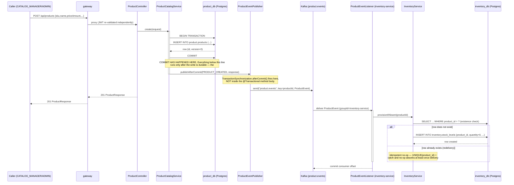
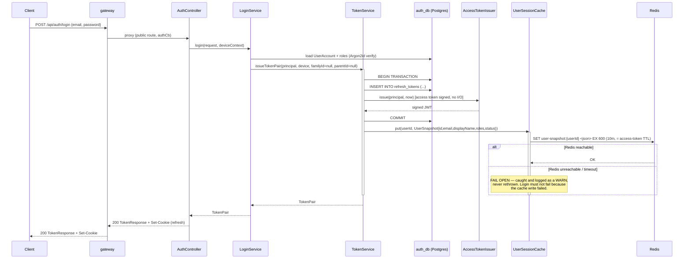

# Low Level Design: Event-Driven Inventory (Phase 2 slice)

## 1. Scope

Elaborates the HLD (`docs/HLD-event-driven-inventory.md`) into concrete module/class design,
API contracts, DB schema changes, and sequences for:
- product-service: new write endpoints on `Product`, `version` column, `ProductEventPublisher`.
- inventory-service (new module): full CRUD on `inventory.stock_levels`, `ProductEventListener`.
- auth-service: `UserSessionCache` write from `TokenService.issueTokenPair()`.

Infra artifacts (docker-compose services for kafka/redis/inventory-service, gateway route YAML,
Flyway migration *files* themselves) are diagrammed/described here for accuracy but are **not**
authored by this document — they belong to implementation, not design.

## 2. Class / Module Design

### 2.1 product-service (modified)

**`Product.java` (modified)** — current state: anaemic entity, no `version`, no `update()` method,
`@PrePersist`/`@PreUpdate` call `Instant.now()` directly (a documented violation of the repo's
`TimeProvider` convention).

```java
package com.acme.ecommerce.product.domain;

@Entity
@Table(name = "products")
public class Product {

  @Id @GeneratedValue(strategy = GenerationType.UUID)
  @Column(name = "id", nullable = false, updatable = false)
  private UUID id;

  @Column(name = "sku", nullable = false, length = 64, unique = true)
  private String sku;

  @Column(name = "name", nullable = false, length = 200)
  private String name;

  @Column(name = "price_amount", nullable = false)
  private BigDecimal priceAmount;

  @Column(name = "price_currency", nullable = false, length = 3)
  private String priceCurrency;

  @Column(name = "active", nullable = false)
  private boolean active;

  @Column(name = "created_at", nullable = false, updatable = false)
  private Instant createdAt;

  @Column(name = "updated_at", nullable = false)
  private Instant updatedAt;

  // NEW — mirrors auth.users.version exactly: optimistic concurrency via
  // JPA's own @Version, not a hand-rolled counter.
  @Version
  @Column(name = "version", nullable = false)
  private Long version;

  // NEW — the update() mutation surface the write endpoints need.
  public void update(String name, BigDecimal priceAmount, String priceCurrency, boolean active, Instant now) {
    this.name = Objects.requireNonNull(name, "name");
    this.priceAmount = Objects.requireNonNull(priceAmount, "priceAmount");
    this.priceCurrency = Objects.requireNonNull(priceCurrency, "priceCurrency");
    this.active = active;
    this.updatedAt = now;
  }

  // MODIFIED — TimeProvider fix. JPA lifecycle callbacks cannot receive
  // constructor-injected dependencies, so the timestamp assignment moves OUT
  // of @PrePersist/@PreUpdate and INTO the service layer, which already
  // holds a TimeProvider. createdAt/updatedAt become explicit parameters on
  // create()/update() rather than implicit callback side effects.
  // (Alternative considered and rejected: an EntityListener with
  // statically-injected TimeProvider — rejected because it reintroduces
  // global mutable state to fix a global-mutable-state problem.)

  public Long getVersion() { return version; }
  // ... existing accessors unchanged
}
```

**`CreateProductRequest` / `UpdateProductRequest`** (new, in `product-service-app`, not the `-api`
module — these are inbound-only, unlike `ProductResponse` which is the published outbound contract):

```java
package com.acme.ecommerce.product.web.dto;

public record CreateProductRequest(
    @NotBlank @Size(max = 64) String sku,
    @NotBlank @Size(max = 200) String name,
    @NotNull @DecimalMin("0.00") BigDecimal priceAmount,
    @NotBlank @Pattern(regexp = "^[A-Z]{3}$") String priceCurrency,
    boolean active) {}

public record UpdateProductRequest(
    @NotBlank @Size(max = 200) String name,
    @NotNull @DecimalMin("0.00") BigDecimal priceAmount,
    @NotBlank @Pattern(regexp = "^[A-Z]{3}$") String priceCurrency,
    boolean active,
    // Optimistic-concurrency token; the client must echo the version it read.
    @NotNull Long version) {}
```

**`ProductController.java` (modified)** — current state is deliberately thin (`list`, `findById`
only, no `@PreAuthorize`, authorization lives entirely in `SecurityConfig`'s
`anyRequest().authenticated()`). Adding role-scoped write endpoints means the controller now needs
per-method `@PreAuthorize` — a deliberate departure from the existing "one place expresses one rule"
posture, flagged in HLD Open Questions #1. New methods:

```java
@PostMapping
@ResponseStatus(HttpStatus.CREATED)
@PreAuthorize("hasAnyRole('CATALOG_MANAGER','ADMIN')")
public ProductResponse create(@Valid @RequestBody CreateProductRequest request) { ... }

@PutMapping("/{id}")
@PreAuthorize("hasAnyRole('CATALOG_MANAGER','ADMIN')")
public ProductResponse update(@PathVariable UUID id, @Valid @RequestBody UpdateProductRequest request) { ... }

@DeleteMapping("/{id}")
@ResponseStatus(HttpStatus.NO_CONTENT)
@PreAuthorize("hasAnyRole('CATALOG_MANAGER','ADMIN')")
public void delete(@PathVariable UUID id) { ... }
```

`@PreAuthorize` requires enabling `@EnableMethodSecurity` in product-service's `SecurityConfig`
(not present today — Phase 1E has no per-method rules anywhere in the platform; this is a new
pattern for the codebase, justified here because role differs by HTTP method on the same resource,
which a single `authorizeHttpRequests` matcher cannot express as cleanly as method-level annotations
without duplicating the path).

**`ProductCatalogService.java` (modified)** — current state is `@Transactional(readOnly = true)`
at the class level with `list`/`findById` only. New write methods need their own `@Transactional`
(overriding the class-level `readOnly = true`), and must inject `TimeProvider` and
`ProductEventPublisher`:

```java
@Service
@Transactional(readOnly = true)
public class ProductCatalogService {

  private final ProductRepository products;
  private final TimeProvider timeProvider;
  private final ProductEventPublisher events;

  // existing list()/findById() unchanged

  @Transactional
  public ProductResponse create(CreateProductRequest request) {
    Instant now = timeProvider.now();
    Product product = Product.create(
        request.sku(), request.name(), request.priceAmount(), request.priceCurrency(),
        request.active(), now); // now passed explicitly — TimeProvider fix
    try {
      product = products.save(product);
    } catch (DataIntegrityViolationException e) {
      throw new ResourceConflictException("Product", "sku", request.sku());
    }
    ProductResponse response = toResponse(product);
    // Registered to fire AFTER this @Transactional method's transaction
    // commits — see §5 sequence diagram and ProductEventPublisher below.
    events.publishAfterCommit(ProductEventType.PRODUCT_CREATED, response);
    return response;
  }

  @Transactional
  public ProductResponse update(UUID id, UpdateProductRequest request) {
    Product product = products.findById(id)
        .orElseThrow(() -> new ResourceNotFoundException("Product", id));
    if (!Objects.equals(product.getVersion(), request.version())) {
      // JPA's own @Version check on flush would also catch this
      // (OptimisticLockException), but checking explicitly up front produces
      // a clean RESOURCE_CONFLICT before any column is touched.
      throw new ResourceConflictException("Product", "version", request.version());
    }
    product.update(request.name(), request.priceAmount(), request.priceCurrency(), request.active(),
        timeProvider.now());
    ProductResponse response = toResponse(product);
    events.publishAfterCommit(ProductEventType.PRODUCT_UPDATED, response);
    return response;
  }

  @Transactional
  public void delete(UUID id) {
    Product product = products.findById(id)
        .orElseThrow(() -> new ResourceNotFoundException("Product", id));
    products.delete(product);
    events.publishAfterCommit(ProductEventType.PRODUCT_DELETED, id, null);
  }
}
```

**`ProductEventPublisher.java` (new)** — the component that owns the "after commit, never inside"
rule (HLD's #1 risk). Uses `TransactionSynchronizationManager` to register a callback that fires
only in `afterCommit`, and does nothing (not even attempt to publish) if the transaction rolls back:

```java
package com.acme.ecommerce.product.event;

@Component
public class ProductEventPublisher {

  private final KafkaTemplate<String, ProductEvent> kafka;
  private final TimeProvider timeProvider;
  private static final String TOPIC = "product.events";

  public void publishAfterCommit(ProductEventType type, ProductResponse product) {
    publishAfterCommit(type, product.id(), product);
  }

  public void publishAfterCommit(ProductEventType type, UUID productId, ProductResponse payloadOrNull) {
    if (!TransactionSynchronizationManager.isSynchronizationActive()) {
      // Defensive: this method must only ever be called from inside the
      // @Transactional service method. No synchronization active means no
      // commit to hang the publish off of — fail loudly rather than publish
      // an event for a write that has not committed.
      throw new IllegalStateException("publishAfterCommit called outside an active transaction");
    }
    TransactionSynchronizationManager.registerSynchronization(
        new TransactionSynchronization() {
          @Override
          public void afterCommit() {
            ProductEvent event = new ProductEvent(
                UUID.randomUUID(), type, productId, timeProvider.now(), payloadOrNull);
            kafka.send(TOPIC, productId.toString(), event);
          }
          // afterCompletion(int status) intentionally NOT overridden for
          // ROLLED_BACK — the default no-op is exactly correct: a rolled-back
          // write must never publish, and doing nothing is how that is
          // guaranteed rather than merely intended.
        });
  }
}
```

**`ProductEvent.java` (new, product-service-app internal, NOT `product-service-api`)** —
deliberately duplicated (not shared) per the plan's explicit scope decision:

```java
package com.acme.ecommerce.product.event;

public record ProductEvent(
    UUID eventId,
    ProductEventType eventType,
    UUID productId,
    Instant occurredAt,
    ProductResponse payload) {} // null for PRODUCT_DELETED

public enum ProductEventType { PRODUCT_CREATED, PRODUCT_UPDATED, PRODUCT_DELETED }
```

**`KafkaTopicConfig.java` (new)**:

```java
@Configuration
public class KafkaTopicConfig {
  @Bean
  public NewTopic productEventsTopic() {
    return TopicBuilder.name("product.events")
        .partitions(3)
        .replicas(1) // single-broker KRaft prototype — see HLD §8
        .build();
  }
}
```

### 2.2 inventory-service (new module — mirrors product-service exactly)

New Gradle modules `inventory-service-api` / `inventory-service-app`, wired into `settings.gradle`
alongside the existing `product-service-api`/`product-service-app` lines (not written by this
design stage).

```
services/inventory-service/
├── inventory-service-api/    Published contract (InventoryClient, InventoryResponse — mirrors
│                              ProductClient/ProductResponse shape)
└── inventory-service-app/    Own port 8083, own SecurityConfig/InventoryProperties/
                               ProblemResponseWriter (byte-for-byte mirrors product-service's,
                               only the package root changes), Flyway V1__inventory_baseline.sql
```

**`Inventory.java` (new domain entity)**:

```java
package com.acme.ecommerce.inventory.domain;

@Entity
@Table(name = "stock_levels")
public class Inventory {

  @Id @GeneratedValue(strategy = GenerationType.UUID)
  @Column(name = "id", nullable = false, updatable = false)
  private UUID id;

  // UNIQUE — this constraint IS the idempotency mechanism for PRODUCT_CREATED
  // redelivery (see edge-case table below).
  @Column(name = "product_id", nullable = false, unique = true)
  private UUID productId;

  @Column(name = "quantity", nullable = false)
  private int quantity;

  @Version
  @Column(name = "version", nullable = false)
  private Long version;

  @Column(name = "created_at", nullable = false, updatable = false)
  private Instant createdAt;

  @Column(name = "updated_at", nullable = false)
  private Instant updatedAt;

  protected Inventory() {}

  private Inventory(UUID productId, int quantity, Instant now) {
    this.productId = productId;
    this.quantity = quantity;
    this.createdAt = now;
    this.updatedAt = now;
  }

  // Explicit `now` parameter from day one — this entity does NOT repeat
  // Product.java's Instant.now()-in-@PrePersist anti-pattern (should not
  // propagate into new code). No @PrePersist/@PreUpdate at all; timestamps
  // are set by the service layer, which holds the injected TimeProvider.
  public static Inventory provision(UUID productId, Instant now) {
    return new Inventory(productId, 0, now);
  }

  public void adjustQuantity(int newQuantity, Instant now) {
    if (newQuantity < 0) {
      throw new DomainRuleViolationException("Quantity cannot be negative");
    }
    this.quantity = newQuantity;
    this.updatedAt = now;
  }

  // accessors: getId, getProductId, getQuantity, getVersion, getCreatedAt, getUpdatedAt
}
```

**`InventoryRepository.java` (new)**:

```java
public interface InventoryRepository extends JpaRepository<Inventory, UUID> {
  Optional<Inventory> findByProductId(UUID productId);
}
```

**`InventoryService.java` (new)** — mirrors `ProductCatalogService`'s layering (controller never
sees the entity), with an added idempotent-provisioning method used only by the Kafka listener:

```java
@Service
@Transactional(readOnly = true)
public class InventoryService {

  private final InventoryRepository inventory;
  private final TimeProvider timeProvider;

  public Page<InventoryResponse> list(Pageable pageable) { ... }
  public InventoryResponse findById(UUID id) { ... }

  @Transactional
  public InventoryResponse create(CreateInventoryRequest request) {
    if (inventory.findByProductId(request.productId()).isPresent()) {
      throw new ResourceConflictException("Inventory", "productId", request.productId());
    }
    Inventory row = Inventory.provision(request.productId(), timeProvider.now());
    row.adjustQuantity(request.quantity(), timeProvider.now());
    return toResponse(inventory.save(row));
  }

  @Transactional
  public InventoryResponse update(UUID id, UpdateInventoryRequest request) {
    Inventory row = inventory.findById(id).orElseThrow(() -> new ResourceNotFoundException("Inventory", id));
    if (!Objects.equals(row.getVersion(), request.version())) {
      throw new ResourceConflictException("Inventory", "version", request.version());
    }
    row.adjustQuantity(request.quantity(), timeProvider.now());
    return toResponse(row);
  }

  @Transactional
  public void delete(UUID id) {
    Inventory row = inventory.findById(id).orElseThrow(() -> new ResourceNotFoundException("Inventory", id));
    inventory.delete(row);
  }

  /**
   * Called ONLY by ProductEventListener. Idempotent by construction: a
   * second PRODUCT_CREATED for the same productId (Kafka at-least-once
   * redelivery) is a no-op, not an error — the UNIQUE(product_id) constraint
   * makes a race between two concurrent deliveries safe even without this
   * existence check, but the check avoids a noisy constraint-violation log
   * line on the (overwhelmingly common) sequential-redelivery case.
   */
  @Transactional
  public void provisionIfAbsent(UUID productId) {
    if (inventory.findByProductId(productId).isPresent()) {
      return; // idempotent no-op
    }
    try {
      inventory.save(Inventory.provision(productId, timeProvider.now()));
    } catch (DataIntegrityViolationException e) {
      // Lost the race to a concurrent delivery of the same event (two
      // partitions cannot both hold events for the same productId key, but a
      // rebalance/retry can still produce two near-simultaneous consumer
      // threads). No-op: the other delivery already created the row.
    }
  }

  @Transactional
  public void removeIfPresent(UUID productId) {
    inventory.findByProductId(productId).ifPresent(inventory::delete); // idempotent no-op if absent
  }
}
```

**`InventoryController.java` (new)** — mirrors `ProductController`'s thin-controller posture;
writes are role-gated the same way as product writes (confirmed at the approval gate — reuses
`CATALOG_MANAGER`/`ADMIN`, no new role):

```java
@RestController
@RequestMapping(InventoryClient.BASE_PATH) // "/api/inventory"
public class InventoryController {
  @GetMapping public PagedModel<InventoryResponse> list(@PageableDefault(...) Pageable pageable) { ... }
  @GetMapping("/{id}") public InventoryResponse findById(@PathVariable UUID id) { ... }

  @PostMapping @ResponseStatus(HttpStatus.CREATED)
  @PreAuthorize("hasAnyRole('CATALOG_MANAGER','ADMIN')")
  public InventoryResponse create(@Valid @RequestBody CreateInventoryRequest r) { ... }

  @PutMapping("/{id}")
  @PreAuthorize("hasAnyRole('CATALOG_MANAGER','ADMIN')")
  public InventoryResponse update(@PathVariable UUID id, @Valid @RequestBody UpdateInventoryRequest r) { ... }

  @DeleteMapping("/{id}") @ResponseStatus(HttpStatus.NO_CONTENT)
  @PreAuthorize("hasAnyRole('CATALOG_MANAGER','ADMIN')")
  public void delete(@PathVariable UUID id) { ... }
}
```

**`ProductEventListener.java` (new)** — the consumer, and the class that carries the idempotency
and no-DLQ decisions from the HLD:

```java
package com.acme.ecommerce.inventory.event;

@Component
public class ProductEventListener {

  private final InventoryService inventoryService;
  private static final Logger log = LoggerFactory.getLogger(ProductEventListener.class);

  @KafkaListener(topics = "product.events", groupId = "inventory-service")
  public void onProductEvent(ProductEvent event) {
    switch (event.eventType()) {
      case PRODUCT_CREATED -> {
        inventoryService.provisionIfAbsent(event.productId());
        log.info("Provisioned inventory row productId={} eventId={}", event.productId(), event.eventId());
      }
      case PRODUCT_UPDATED ->
          // Log-only. See HLD Open Question #4 — flagged as possibly
          // non-load-bearing; name/price/active do not affect quantity.
          log.debug("Received PRODUCT_UPDATED productId={} eventId={} (no-op)", event.productId(), event.eventId());
      case PRODUCT_DELETED -> {
        inventoryService.removeIfPresent(event.productId());
        log.info("Removed inventory row productId={} eventId={}", event.productId(), event.eventId());
      }
    }
    // No throw on an unexpected eventType — Jackson would already have
    // failed deserialization before this method is reached for a genuinely
    // unknown shape; an exhaustive switch over the enum is the exhaustiveness
    // check, compile-time enforced by Java's enhanced switch.
  }
}
```

**`ProductEvent.java` (new, inventory-service-app internal)** — the consumer-side duplicate DTO,
structurally identical to product-service's producer-side one, but a *separate* class per module
(explicit scope decision, not an oversight — see HLD Non-Goals and Future Improvements):

```java
package com.acme.ecommerce.inventory.event;

public record ProductEvent(
    UUID eventId, ProductEventType eventType, UUID productId, Instant occurredAt, Object payload) {}

public enum ProductEventType { PRODUCT_CREATED, PRODUCT_UPDATED, PRODUCT_DELETED }
```

*(`payload` typed `Object`/`Map<String,Object>` on the consumer side, not `ProductResponse` —
inventory-service has no dependency on `product-service-api`, deliberately, since the event
contract is the only coupling between the two services; the consumer does not need product fields
today per Open Question #4, and Jackson can deserialize the untyped payload if a future consumer
needs it.)*

### 2.3 auth-service (modified)

**`TokenService.java` (modified)** — current state: `issueTokenPair()` is the "convergence point"
(login, refresh, Google login all funnel through it), `@Transactional`, persists the refresh token,
signs the access token, and returns. New step: after both are done but still inside the same method
(the cache write is not financial/DB state, so it does not need the same after-commit discipline as
the Kafka publish — a cache write that races a rollback is at worst a stale/orphaned cache entry
that expires in 10 minutes, not a correctness bug):

```java
@Transactional
public TokenPair issueTokenPair(
    AuthenticatedPrincipal principal, DeviceContext device, UUID familyId, UUID parentId) {

  // ... existing body unchanged through refreshTokens.save(refreshToken) and
  // accessTokenIssuer.issue(...) ...

  // NEW — cache write. Best-effort: a Redis outage must not fail login/refresh
  // (see UserSessionCache below for the fail-open contract).
  sessionCache.put(principal.userId(), UserSnapshot.from(principal, userAccount));

  return new TokenPair(...);
}
```

Note: `AuthenticatedPrincipal` carries `userId`, `email`, `roles`, `authMethod` but **not**
`displayName` or `status` — those live on `UserAccount`. `TokenService` does not currently load
`UserAccount`; the caller (`LoginService`/`RefreshTokenService`/`FederatedLoginService`) does.
**Design decision:** either (a) widen `AuthenticatedPrincipal` to carry `displayName`/`status` so
`TokenService` can build the full snapshot without a new query, or (b) have `TokenService` accept an
additional `UserSnapshot` parameter supplied by the caller (which already has the loaded
`UserAccount`). This LLD recommends **(b)** — extending `issueTokenPair`'s signature with a
`UserSnapshot snapshot` parameter — over widening `AuthenticatedPrincipal`, because
`AuthenticatedPrincipal` is explicitly documented as "everything token issuance needs to know" for
the *JWT claims*, and `displayName`/`status` are not JWT claims; conflating the two would let a
field silently leak into the token later. Flagged for confirmation alongside the RBAC assumptions —
not as high-stakes, but a real interface decision no one has signed off on yet.

**`UserSnapshot.java` (new)**:

```java
package com.acme.ecommerce.auth.cache;

public record UserSnapshot(UUID id, String email, String displayName, Set<String> roles, String status) {
  public static UserSnapshot from(AuthenticatedPrincipal principal, UserAccount account) {
    return new UserSnapshot(
        principal.userId(), principal.email(), account.getDisplayName(),
        principal.roles(), account.getStatus().name());
  }
}
```

**`UserSessionCache.java` (new)**:

```java
package com.acme.ecommerce.auth.cache;

@Component
public class UserSessionCache {

  private static final String KEY_PREFIX = "user-snapshot:";
  private final StringRedisTemplate redis; // auth-service is a blocking MVC
                                            // app like product-service, so the
                                            // blocking template is consistent
                                            // with its stack.
  private final ObjectMapper objectMapper;
  private final Duration ttl; // = access-token TTL, sourced from the SAME
                               // AuthProperties.Jwt.accessTokenTtl config the
                               // access token issuer already reads — not a
                               // second, independently-configured constant.
  private static final Logger log = LoggerFactory.getLogger(UserSessionCache.class);

  public void put(UUID userId, UserSnapshot snapshot) {
    try {
      String json = objectMapper.writeValueAsString(snapshot);
      redis.opsForValue().set(KEY_PREFIX + userId, json, ttl);
    } catch (Exception e) {
      // FAIL OPEN. The cache is a performance aid, not a dependency of the
      // login/refresh path. A Redis outage must never turn into a 500 on
      // login — that would make an optional cache a hard dependency, which
      // is the same class of mistake the gateway's lazy JWKS fetch and the
      // outage-tolerant token verification were built specifically to avoid
      // elsewhere in this platform.
      log.warn("Failed to write user-snapshot cache for userId={}: {}", userId, e.getMessage());
    }
  }
}
```

## 3. API Contract

| Method | Path | Request | Response | Auth |
|---|---|---|---|---|
| `GET` | `/api/products` | `Pageable` (query params) | `200 PagedModel<ProductResponse>` | Authenticated (any role) — unchanged |
| `GET` | `/api/products/{id}` | — | `200 ProductResponse` / `404` | Authenticated (any role) — unchanged |
| `POST` | `/api/products` | `CreateProductRequest` | `201 ProductResponse` / `400` / `409` (dup sku) | `CATALOG_MANAGER` or `ADMIN` — **NEW, confirmed** |
| `PUT` | `/api/products/{id}` | `UpdateProductRequest` (includes `version`) | `200 ProductResponse` / `400` / `404` / `409` (stale version) | `CATALOG_MANAGER` or `ADMIN` — **NEW, confirmed** |
| `DELETE` | `/api/products/{id}` | — | `204` / `404` | `CATALOG_MANAGER` or `ADMIN` — **NEW, confirmed** |
| `GET` | `/api/inventory` | `Pageable` | `200 PagedModel<InventoryResponse>` | Authenticated (any role) — **NEW** |
| `GET` | `/api/inventory/{id}` | — | `200 InventoryResponse` / `404` | Authenticated (any role) — **NEW** |
| `POST` | `/api/inventory` | `CreateInventoryRequest{productId, quantity}` | `201 InventoryResponse` / `400` / `409` (dup productId) | `CATALOG_MANAGER` or `ADMIN` — **NEW, confirmed** |
| `PUT` | `/api/inventory/{id}` | `UpdateInventoryRequest{quantity, version}` | `200 InventoryResponse` / `400` / `404` / `409` (stale version) | `CATALOG_MANAGER` or `ADMIN` — **NEW, confirmed** |
| `DELETE` | `/api/inventory/{id}` | — | `204` / `404` | `CATALOG_MANAGER` or `ADMIN` — **NEW, confirmed** |

All error responses follow the platform's existing RFC 9457 problem+json shape (see §7 below);
no endpoint above has an implicit/unstated auth requirement — every row's Auth column is filled.

## 4. Database Schema Changes

| Table | Column | Type | Constraint | Migration |
|---|---|---|---|---|
| `product.products` | `version` | `bigint` | `NOT NULL DEFAULT 0` | **New** — `V2__product_writes.sql` (product-service; additive column on the existing table) |
| `inventory.stock_levels` | `id` | `uuid` | `PRIMARY KEY DEFAULT gen_random_uuid()` | **New** — `V1__inventory_baseline.sql` (inventory-service) |
| `inventory.stock_levels` | `product_id` | `uuid` | `UNIQUE NOT NULL` (no FK — separate database, event-linked only, per HLD Non-Goals) | New |
| `inventory.stock_levels` | `quantity` | `integer` | `NOT NULL DEFAULT 0`, `CHECK (quantity >= 0)` | New |
| `inventory.stock_levels` | `version` | `bigint` | `NOT NULL DEFAULT 0` | New |
| `inventory.stock_levels` | `created_at` | `timestamptz` | `NOT NULL DEFAULT now()` | New |
| `inventory.stock_levels` | `updated_at` | `timestamptz` | `NOT NULL DEFAULT now()` | New |

Existing (unchanged): `product.products.id` (uuid PK), `.sku` (varchar(64) UNIQUE), `.name`
(varchar(200)), `.price_amount` (numeric(19,2), CHECK >= 0), `.price_currency` (char(3), CHECK
regex), `.active` (boolean), `.created_at`/`.updated_at` (timestamptz). The `version` column is
strictly additive — no existing column is widened or renamed.

`inventory.stock_levels` is a **new table in a new schema in a new database** (`inventory_db`,
schema `inventory`, owned by an `inventory_service` role — same provisioning pattern
`infra/postgres/init/01-schemas.sql` already uses for `auth_db`/`product_db`; the init script itself
is an infra artifact, not written here). `product.products` and `inventory.stock_levels` share no
foreign key, no schema, and no database — see §4a below.

### 4a. Event-linked, not foreign-keyed

```mermaid
erDiagram
    "product.products" {
        uuid id PK
        varchar sku UK
        varchar name
        numeric price_amount
        char price_currency
        boolean active
        bigint version
    }
    "inventory.stock_levels" {
        uuid id PK
        uuid product_id UK "no FK - separate database"
        integer quantity
        bigint version
    }
    "product.products" ..|{ "inventory.stock_levels" : "PRODUCT_CREATED / PRODUCT_UPDATED / PRODUCT_DELETED via Kafka topic product.events (NOT a foreign key)"
```

`product_db` and `inventory_db` are separate Postgres databases (separate connection pools, separate
Flyway histories, separate owner roles) — a cross-database foreign key is not physically possible in
Postgres in the first place, which is precisely why the coupling has to be an event, not a
constraint. The `UNIQUE(product_id)` constraint on `inventory.stock_levels` prevents *duplicate*
inventory rows for one product; it says nothing about whether that `product_id` still exists in
`product.products` — a hard delete on the product side with no corresponding `PRODUCT_DELETED`
consumption (e.g., the event was lost before this feature existed, or a manual `DELETE` bypassed the
application) leaves an orphaned inventory row with no referential guard. Documented as an accepted
prototype gap.

## 5. Sequence of Operations

### 5a. Product write → commit → publish → consume → inventory write (after-commit timing explicit)



### 5b. Login/refresh → token issuance → Redis cache write



(The refresh and Google-login flows follow the identical shape from the `TokenService.
issueTokenPair()` call onward — `LoginService`, `RefreshTokenService`, and `FederatedLoginService`
are three different front doors that all converge on the same `issueTokenPair()` → `UserSessionCache.
put()` sequence, per `TokenService`'s own "convergence point" documentation.)

## 6. Edge Cases

| Case | Expected Behavior |
|---|---|
| `PRODUCT_CREATED` redelivered (Kafka at-least-once) | `provisionIfAbsent` finds the existing row by `product_id` and no-ops; if two concurrent deliveries race past the existence check, the `UNIQUE(product_id)` constraint rejects the second `INSERT`, caught as `DataIntegrityViolationException` and swallowed as a no-op. No error surfaces to any caller — this is entirely internal to the consumer. |
| inventory-service offline when `product.events` publishes | Kafka retains the topic (broker default retention, no override configured in this prototype — HLD Open Question #5). On restart, `inventory-service` resumes from its last committed offset (`groupId=inventory-service`) and processes the backlog in partition order. No DLQ; no alerting configured in this iteration. |
| Concurrent `PUT /api/inventory/{id}` with a stale `version` | Second writer's `UpdateInventoryRequest.version` no longer matches the persisted row's current `@Version` value. `InventoryService.update` throws `ResourceConflictException` before even attempting the update (explicit pre-check) — Hibernate's own `OptimisticLockException` on flush would produce the same *outcome* but a less immediately attributable exception, so the explicit check is preferred. Caller receives `409` with `ErrorCode.RESOURCE_CONFLICT`. |
| `DELETE /api/products/{id}` for a product that has an existing `inventory.stock_levels` row | Product row is deleted; `PRODUCT_DELETED` publishes after commit; `ProductEventListener` removes the corresponding inventory row via `removeIfPresent`. If the delete-consumption never happens (consumer down, event lost pre-feature), the inventory row survives as an orphan with no referential guard — see §4a, accepted prototype gap. |
| `PRODUCT_UPDATED` consumed | Logged only; no write to `inventory.stock_levels` (name/price/active do not affect `quantity` — HLD Open Question #4). |
| `POST /api/inventory` for a `productId` with no corresponding row in `product.products` at all (never published, or published to a different environment) | Succeeds — `inventory.stock_levels.product_id` carries no FK, so `InventoryService.create` has no way to detect this, by design (HLD Non-Goals: no cross-service synchronous call). This is the same accepted gap as the delete-orphan case, mirrored for creates. |
| `PUT /api/products/{id}` with a stale `version` | Mirrors the inventory case: explicit pre-check in `ProductCatalogService.update`, `409 RESOURCE_CONFLICT`, no partial write. |
| Duplicate `sku` on `POST /api/products` | `DataIntegrityViolationException` from the `products_sku_key` UNIQUE constraint, caught and translated to `ResourceConflictException` → `409`. |
| Redis unavailable during login/refresh | `UserSessionCache.put` fails open (caught, logged at WARN, not rethrown) — login/refresh succeed and return tokens normally; no snapshot is cached until Redis recovers and the next issuance succeeds. |

## 7. Error Handling

All new endpoints reuse the platform's existing RFC 9457 problem+json convention — no new error
vocabulary is introduced. Per `libs/common-core`'s `ErrorCode`, every error maps to one of the
existing constants:

| Condition | `ErrorCode` | HTTP Status |
|---|---|---|
| Bean-validation failure on `CreateProductRequest`/`UpdateProductRequest`/`CreateInventoryRequest`/`UpdateInventoryRequest` | `VALIDATION_FAILED` | 400 |
| Negative `quantity` reaching `Inventory.adjustQuantity` (defense-in-depth beyond the DB `CHECK`) | `DOMAIN_RULE_VIOLATION` | 422 |
| No/invalid bearer token | `UNAUTHENTICATED` | 401 |
| Authenticated but missing `CATALOG_MANAGER`/`ADMIN` on a product write | `FORBIDDEN` | 403 |
| Unknown `productId`/`id` on any `GET`/`PUT`/`DELETE` | `RESOURCE_NOT_FOUND` | 404 |
| Duplicate `sku` (product) / duplicate `productId` (inventory) / stale `version` on either | `RESOURCE_CONFLICT` | 409 |
| Kafka broker unreachable at publish time (`KafkaTemplate.send` fails) | Not surfaced to the HTTP caller — the write already committed; the publish failure is logged, not thrown, so a Kafka outage does not turn a successful product write into an HTTP error. This is a direct consequence of the after-commit design (§5a): by the time the publish is attempted, the response has not yet been returned, but the write's correctness no longer depends on it. Flagged for observability (HLD §10 metrics) rather than error-handling, since there is no user-facing error to emit. |
| Redis unreachable at cache-write time | Not surfaced — see §6, fail-open. |

Both new/modified controllers rely on the shared `common-web` `GlobalExceptionHandler` for MVC-level
translation and each service's own `ProblemResponseWriter` (mirroring product-service's) for the
Spring-Security-filter-chain-level `AuthenticationEntryPoint`/`AccessDeniedHandler` cases that never
reach the `@RestControllerAdvice`. `inventory-service` gets its own copy of `ProblemResponseWriter`
(byte-for-byte the same pattern, new package) rather than a shared one, matching the existing
per-service duplication convention product-service already uses instead of pulling this into
`common-web`.

## 8. Performance Considerations

- `inventory.stock_levels.product_id` is `UNIQUE`, which Postgres backs with a unique index — the
  `findByProductId` lookup used by both `provisionIfAbsent`/`removeIfPresent` (Kafka consumer hot
  path) and any future direct query is index-served, not a sequential scan.
- `GET /api/inventory` follows the exact same paging convention as `GET /api/products` — default
  page size 20, deterministic `ORDER BY` (recommend `product_id ASC`, matching `sku ASC`'s role for
  product-service — a unique column keeps page boundaries stable across concurrent writes).
- `ProductEventPublisher.publishAfterCommit` adds a `TransactionSynchronization` registration, which
  is in-JVM bookkeeping only — no additional I/O inside the transaction boundary, so it does not
  extend lock hold time on `product.products`. The actual Kafka `send()` happens strictly after the
  Postgres transaction has already released its locks.
- `UserSessionCache.put` happens inline before `TokenService`'s `@Transactional` method returns
  (per §2.3) — acceptable because a cache-write failure is fail-open and non-authoritative, unlike
  the Kafka publish which must never race a rollback. If login latency under Redis slowness becomes
  a concern, `UserSessionCache.put` should move to an after-commit hook identical in shape to
  `ProductEventPublisher`'s — noted as a Future Improvement, not required for this prototype's scope.
- Kafka consumer `auto-offset-reset=earliest` means a *brand new* `inventory-service` deployment
  (empty consumer-group offset) replays the entire topic history on first start, which could be a
  large backfill in a long-lived environment. Acceptable for a prototype; a production rollout would
  likely seed the group's offset at "current" and backfill `inventory.stock_levels` from
  `product.products` via a one-time reconciliation job instead — out of scope here.

## 9. Test Plan Reference

Defer to the Test Planner stage for this feature. Test-relevant seams this LLD deliberately exposes
for testability: `ProductEventPublisher.publishAfterCommit` is unit-testable via
`TransactionSynchronizationManager`'s test utilities (assert no Kafka `send()` on a rolled-back
transaction — this is the #1 risk and needs a dedicated test, not just an integration smoke test);
`InventoryService.provisionIfAbsent`/`removeIfPresent` are directly unit-testable without a running
Kafka broker; the existing `RouteAuthorizationContractTest` pattern (gateway) should gain a case for
the new `/api/inventory/**` route the moment it is added.
