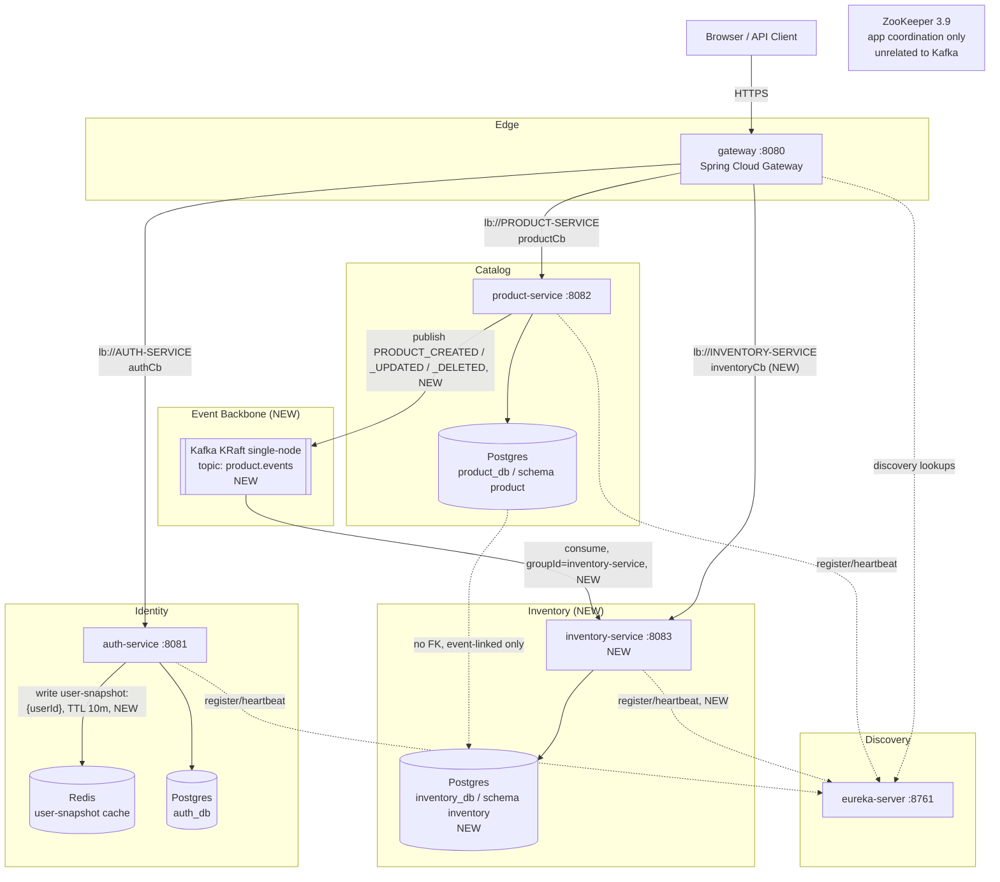

# High Level Design: Event-Driven Inventory (Phase 2 slice)

> **Historical design (Phase 2, 2026-11-10).** What changed later is listed in
> [Phase 2, changed since](../../phases/phase-02-event-driven-inventory.md#changed-since).
> The ZooKeeper container shown here was removed on 2026-11-14.

## 1. Overview

This feature adds a prototype-grade event-driven slice on top of the existing Phase 1 platform:
write endpoints on the existing `product-service` catalog, a new `inventory-service` that owns
stock levels in its own database, and a Kafka topic (`product.events`) that lets inventory-service
provision/retire stock rows asynchronously in reaction to product lifecycle changes — without a
synchronous call between the two services. It also adds a Redis-backed cache of a minimal
logged-in-user snapshot in auth-service, written on every token issuance, purely as a read
performance aid (never consulted for an authorization decision).

## 2. Goals & Non-Goals

**Goals**
- Add `POST`/`PUT`/`DELETE /api/products/{id}` to product-service with optimistic concurrency
  (`version` column) and role-gated writes.
- Stand up `inventory-service` (api/app split, mirrors product-service) with `GET`/`POST`/`PUT`/
  `DELETE /api/inventory` backed by its own Postgres schema (`inventory_db` / `inventory`).
- Introduce Kafka in KRaft mode as the platform's first event broker, independent of the existing
  ZooKeeper container (app-level coordination, unrelated to this feature).
- Publish `product.events` (JSON, single topic, 3 partitions, key = `productId`) from product-service
  strictly **after** the write transaction commits, and consume it idempotently in inventory-service
  to keep `inventory.stock_levels` eventually consistent with `product.products`.
- Cache a minimal `user-snapshot:{userId}` record in Redis on every successful token issuance in
  auth-service (login, refresh, Google login), TTL-aligned to the 10-minute access-token TTL.
- Add a gateway route `/api/inventory/** -> lb://INVENTORY-SERVICE` and a new `inventoryCb` circuit
  breaker, following the existing route/breaker pattern for `product`.

**Non-Goals**
- No schema registry (Avro/Protobuf) — the event DTO is a hand-maintained JSON POJO, duplicated
  independently in producer and consumer.
- No dead-letter queue or retry topic — Kafka retention plus resume-from-committed-offset is the
  accepted prototype answer for a down consumer.
- No exactly-once semantics — the platform accepts at-least-once delivery; idempotency is achieved
  at the consumer via the `product_id` UNIQUE constraint, not via Kafka transactions/EOS.
- No synchronous (REST/Feign) call between product-service and inventory-service, in either
  direction — the only coupling is the event stream.
- No cross-database foreign key or referential guard between `product.products` and
  `inventory.stock_levels` — they live in separate Postgres databases and are event-linked only.
- No shared `libs/common-events` library for the event DTO in this iteration — one producer, one
  consumer; extraction is deferred until a second consumer exists.
- Redis is not a session store — JWT remains the sole authentication mechanism; the cache is never
  read on an authorization decision path.

## 3. Context Diagram

## 4. Major Components

| Component | Responsibility | Owner Layer (Backend/Infra) | Status |
|---|---|---|---|
| gateway | Route `/api/inventory/**` to inventory-service; enforce `inventoryCb` breaker | Backend (Spring Cloud Gateway) | Modified (route table + breaker config) |
| eureka-server | Service discovery for `INVENTORY-SERVICE` registration | Backend | Untouched |
| auth-service | Issue tokens; write `user-snapshot:{userId}` to Redis on every `TokenService.issueTokenPair()` call | Backend | Modified |
| Redis | TTL-bound cache of minimal user snapshots | Infra | New |
| product-service | Catalog CRUD (adds writes); publish `product.events` after commit | Backend | Modified |
| Postgres `product_db` | `product.products` table, +`version` column | Infra | Modified |
| Kafka (KRaft) | Durable, partitioned event log for `product.events` | Infra | New |
| inventory-service | Own stock-level CRUD; consume `product.events`, keep `inventory.stock_levels` eventually consistent | Backend | New |
| Postgres `inventory_db` | `inventory.stock_levels` table | Infra | New |

## 5. Data Flow (Narrative)

**Product write path.** A caller (with `CATALOG_MANAGER`/`ADMIN` role — see Open Questions) sends
`POST`/`PUT`/`DELETE /api/products/{id}` through the gateway. The gateway validates the JWT and
proxies to product-service, which independently re-validates the same token (existing
"gateway-is-a-filter-not-the-trust-boundary" posture). `ProductCatalogService` performs the write
inside `@Transactional`, using the entity's `@Version` column for optimistic concurrency on
update/delete. **After** that transaction has committed (never inside it), `ProductEventPublisher`
serialises a `ProductEvent` (JSON) and sends it to Kafka topic `product.events`, keyed by
`productId` so all events for one product land in the same partition and are delivered to any
single consumer group member in commit order.

**Inventory consumption path.** `inventory-service`'s `ProductEventListener`
(`@KafkaListener(topics = "product.events", groupId = "inventory-service")`,
`auto-offset-reset=earliest`) receives the event. `PRODUCT_CREATED` provisions a
`inventory.stock_levels` row (quantity 0) if one does not already exist for that `product_id`,
relying on the `UNIQUE(product_id)` constraint plus catch-and-no-op on conflict to absorb
redelivery. `PRODUCT_UPDATED` is logged only (name/price/active do not affect stock — flagged as an
open question whether this event type is load-bearing at all). `PRODUCT_DELETED` removes the
inventory row if present, idempotently.

**Direct inventory writes.** Operators can also `POST`/`PUT`/`DELETE /api/inventory` directly
(e.g., to adjust `quantity` after a stock count), independent of the event stream — the event
stream only provisions/retires rows in lockstep with product lifecycle; it does not own `quantity`.

**Redis cache path.** Every successful call to `TokenService.issueTokenPair()` (password login,
refresh rotation, Google login) writes `user-snapshot:{userId}` → `{id, email, displayName, roles,
status}` to Redis with a TTL equal to the access-token TTL (10m). This is a read-side performance
aid for a future consumer (e.g., an admin-facing "who is this user" lookup); it is never read by
any authorization filter — JWT claims remain the sole authorization source.

## 6. External Dependencies

- **Kafka (KRaft mode, single broker)** — new infra dependency, no ZooKeeper coupling (deliberately
  independent of the platform's existing ZooKeeper, which remains reserved for future app-level
  coordination primitives).
- **Redis** — new infra dependency for auth-service's cache only.
- **Postgres 17** — existing dependency; gains a third owned database (`inventory_db`) alongside
  `auth_db` and `product_db`.
- **Eureka** — existing dependency; `inventory-service` registers as `INVENTORY-SERVICE`.
- No third-party/external SaaS dependency changes.

## 7. Consistency & Availability Tradeoffs

**Product ↔ Inventory: eventual consistency via `product.events`, deliberately.** There is no
distributed transaction and no synchronous call between product-service and inventory-service. A
`PRODUCT_CREATED` event that has been committed in `product_db` but not yet consumed leaves a
window — bounded by Kafka consumer lag, typically sub-second in this prototype's single-partition-
per-key, single-consumer topology — during which the product exists in the catalog but has no
`inventory.stock_levels` row. Any caller reading `/api/inventory` for that `product_id` during the
window gets 404, not a stale-but-present row; the inventory side is only ever a **subset** of the
product side, and a missing row is truthfully "not yet provisioned," not silently wrong. This is
acceptable because Phase 2's inventory data is advisory (stock display), not authoritative for the
purchase path — there is no checkout/reservation flow in this slice that would need read-your-writes
across the two services. Availability is favored over cross-service consistency: if Kafka or
inventory-service is down, product writes still succeed (the publish happens after commit, on a
best-effort basis with no synchronous dependency), and inventory-service catches up from its last
committed offset once it is healthy again — at-least-once delivery, absorbed by the idempotent
consumer.

**No DLQ, explicit accepted risk.** If inventory-service is offline for an extended period, Kafka
retains the topic (bounded by its retention policy, not configured to expire in this prototype) and
inventory-service resumes from its committed offset on restart. There is no cap in this design on
how long an event can sit unconsumed; a production hardening pass would add a dead-letter topic and
monitoring on consumer lag. Flagged as a Future Improvement, not in scope now.

**Redis cache: staleness tolerance.** `user-snapshot:{userId}` is written on every token issuance
and read (by future consumers) only as a performance aid; it can be up to 10 minutes stale (its TTL)
relative to `auth.users` — e.g., a `displayName` change made mid-session via an admin action will
not be reflected in the cached snapshot until the next login/refresh re-writes it or the TTL
expires. This is acceptable because the cache is explicitly never used for authorization (the JWT
`roles` claim, verified independently by every resource server, remains authoritative for that),
and the data it holds (display name, cached role list for display purposes) is not security-critical
if briefly stale. There is no explicit invalidation on role change or account disable in this
iteration — a disabled account's stale snapshot could still be read from cache for up to 10 minutes,
but since nothing gates access on the cache, this cannot itself become an authorization bypass.

## 8. Scalability Plan

- **Kafka partitioning.** `product.events` has 3 partitions with `productId` as the message key.
  Kafka guarantees ordering only within a partition, so all events for one product are strictly
  ordered (`PRODUCT_CREATED` before its `PRODUCT_UPDATED`s before its `PRODUCT_DELETED`), which is
  the ordering guarantee the idempotent-consumer logic depends on. Events for *different* products
  may interleave across partitions with no ordering guarantee between them, which is fine — the
  consumer logic never depends on cross-product ordering.
- **Consumer horizontal scaling.** `inventory-service` consumes as `groupId=inventory-service`. With
  3 partitions, up to 3 instances of inventory-service can consume in parallel, each owning a disjoint
  partition set; a 4th instance would sit idle (standard Kafka consumer-group rebalance semantics).
  This is intentionally more headroom than a single-instance prototype needs, sized for straightforward
  horizontal scale-out later without a topic reconfiguration.
- **product-service and inventory-service are both stateless HTTP services** behind Eureka +
  gateway load balancing, matching the existing platform pattern — no session affinity, so either
  can be scaled by adding replicas with no code change.
- **Redis** is a single-instance cache in this prototype (matching the "prototype-grade" scope);
  it holds no data that cannot be reconstructed from Postgres, so it needs no HA/replication to stay
  correct — a Redis outage degrades to a cache-miss-per-lookup pattern with no availability impact.
- **Kafka replication factor is 1** in this prototype (single broker, KRaft mode) — a documented
  durability gap, not a scale gap; production hardening (3+ brokers, `min.insync.replicas`) is
  explicitly out of scope here.

## 9. Security Model (Summary)

- **AuthN unchanged.** JWT bearer tokens issued by auth-service, validated independently by every
  resource server (gateway, product-service, and now inventory-service) against the shared JWKS —
  following the platform's existing "gateway is a filter, not the trust boundary" posture.
  inventory-service's `SecurityConfig` mirrors product-service's exactly: `anyRequest().authenticated()`
  at the filter-chain level, no `X-User-*` header trust, RS256-only, issuer/audience validation.
- **AuthZ, product writes — CONFIRMED.** `POST`/`PUT`/`DELETE /api/products/{id}` are gated to
  `CATALOG_MANAGER`/`ADMIN` via `@PreAuthorize`, mirroring `Roles.CATALOG_MANAGER` / `Roles.ADMIN`
  from `libs/common-security`. Reads (`GET`) stay open to any authenticated caller, matching the
  existing product-service posture.
- **AuthZ, inventory endpoints — CONFIRMED.** `POST`/`PUT`/`DELETE /api/inventory/{id}` reuse the
  same `CATALOG_MANAGER`/`ADMIN` gate as product writes (no new `INVENTORY_MANAGER` role — confirmed
  at the approval gate as unnecessary for this prototype). Reads (`GET`) stay open to any
  authenticated caller, matching product-service's posture.
- **Redis cache is not an authorization surface.** Nothing reads `user-snapshot:{userId}` to make an
  allow/deny decision; it exists purely to avoid a hypothetical future round-trip to `auth.users`
  for display purposes. This must remain true for any consumer built on top of it later.
- **Event stream carries no bearer credentials.** `product.events` payloads contain product data
  only (id, occurredAt, optional product snapshot) — no tokens, no PII beyond what the catalog
  already exposes publicly via `GET /api/products`.

## 10. Observability

- **Correlation ID propagation stops at the Kafka boundary in this prototype.** `CorrelationIdHolder`
  (from `common-core`) is thread/request-scoped and is not currently propagated into Kafka message
  headers or restored on the consumer side — a trace of "which HTTP request caused this inventory
  row" is not possible end-to-end today. Flagged as a Future Improvement (Kafka header propagation +
  MDC restore in the listener) rather than in scope for this slice.
- **Structured logging.** `ProductEventPublisher` logs `eventId`, `eventType`, `productId` (never
  the full payload) at publish time; `ProductEventListener` logs the same fields plus outcome
  (provisioned / no-op / removed) at consume time — enough to reconstruct the event's journey from
  two log lines without a tracing system.
- **Metrics.** Follows the existing Micrometer-counter/timer pattern already used elsewhere in the
  platform: `product.events.published` (tagged by `eventType`), `inventory.events.consumed` (tagged
  by `eventType` and outcome), and standard Spring Kafka consumer-lag metrics exposed via
  actuator/Prometheus — the same `management.endpoints.web.exposure` convention used by every other
  service.
- **Health.** inventory-service exposes `/actuator/health`, `/actuator/health/**`, `/actuator/info`,
  `/actuator/prometheus` unauthenticated (same allow-list shape as product-service's `SecurityConfig`),
  and the gateway's `inventoryCb` breaker health indicator is disabled from affecting gateway
  readiness, matching `productCb`'s existing configuration.

## 11. Open Questions

Resolved at the approval gate (kept here for the record, no longer open):

1. ~~RBAC role gate on product writes~~ — **CONFIRMED**: `CATALOG_MANAGER`/`ADMIN` via `@PreAuthorize`.
2. ~~Inventory endpoint RBAC~~ — **CONFIRMED**: reuses `CATALOG_MANAGER`/`ADMIN`, no new role.
3. ~~New `inventoryCb` gateway circuit breaker~~ — **CONFIRMED**: separate instance from `productCb`,
   mirroring its shape (`slow-call-duration-threshold: 1s`), to avoid coupling the two services'
   failure domains at the breaker level.

Still open:

1. **`PRODUCT_UPDATED` event: load-bearing or not?** Today nothing in inventory-service's consumer
   needs product name/price/active — those don't affect `quantity`. This design treats
   `PRODUCT_UPDATED` as log-only. If a future requirement (e.g., inventory display needs SKU or name
   denormalized) surfaces, this becomes load-bearing and inventory-service would need to store a
   denormalized product snapshot — out of scope now, flagged as a Future Improvement.
2. **Kafka topic retention.** No explicit `retention.ms`/`retention.bytes` override is specified for
   `product.events` — it inherits the broker default. Given "no DLQ, resume from offset" is the
   accepted design for consumer downtime, retention should be set generously (e.g., 7+ days) once a
   downtime SLA is defined; not decided here.

## Future Improvements (out of scope for this design)

- Extract `ProductEvent` into `libs/common-events` once a second consumer of `product.events`
  exists — duplicating the DTO across two modules is a one-time, reviewable cost for a single
  consumer; it stops being one the moment a third module needs the same shape.
- Add a dead-letter topic + retry policy for `product.events` once the "how long can the topic sit
  unconsumed" question above has an answer.
- Propagate `CorrelationIdHolder` into Kafka message headers and restore it in the consumer's MDC,
  so an inventory row can be traced back to the HTTP request that caused it.
- Fix `Product.java`'s `@PrePersist`/`@PreUpdate` callbacks to use the injected `TimeProvider`
  instead of calling `Instant.now()` directly (see LLD §2, "TimeProvider fix") — should ship in the
  same changeset as the new `update()` method, and the same fix should be applied to
  `Inventory.java`'s lifecycle callbacks from day one so the anti-pattern is not propagated into new
  code.
- Redis snapshot invalidation on role change / account disable — today the cache relies solely on
  TTL expiry; an administrative "revoke now" action does not invalidate an already-cached snapshot.
  Acceptable today only because the cache is not read on an authorization path.
