# 1. Component Tree — Vue 3 Component Hierarchy

## Mermaid Diagram

```mermaid
graph TD
    AppRoot["<b>App.vue</b><br/>Root: RouterView"]
    
    subgraph Pages["📄 Pages (Lazy-Loaded Routes)"]
        LoginView["LoginView.vue<br/>Anonymous"]
        RegisterView["RegisterView.vue<br/>Anonymous"]
        AuthCallbackView["AuthCallbackView.vue<br/>OAuth2 Redirect"]
        DashboardView["DashboardView.vue<br/>Authenticated"]
        ProductsView["ProductsView.vue<br/>Products List"]
        NewProductView["NewProductView.vue<br/>Create Product"]
        InventoryView["InventoryView.vue<br/>Stock Management"]
        SettingsView["SettingsView.vue<br/>User Settings"]
    end
    
    subgraph Layout["🏗️ Layout"]
        AppShell["AppShell.vue<br/>Router layout"]
        Sidebar["Sidebar nav<br/>collapsible"]
        Header["Header with<br/>ThemeToggle"]
    end
    
    subgraph Components["🧩 Shared Components"]
        ThemeToggle["ThemeToggle.vue<br/>Theme switcher"]
        ProductFormModal["ProductFormModal.vue<br/>Product CRUD"]
        InventoryFormModal["InventoryFormModal.vue<br/>Inventory edit"]
        ProblemAlert["ProblemAlert.vue<br/>RFC 9457 errors"]
        ConfirmDialog["ConfirmDialog.vue<br/>Delete confirm"]
    end
    
    subgraph Composables["🪝 Composables (Hooks)"]
        useProducts["useProducts()<br/>Pagination + fetch"]
        useProduct["useProduct()<br/>Single product"]
        useProductMutations["useProductMutations()<br/>CRUD mutations"]
        useInventory["useInventory()<br/>Stock list"]
        useInventoryMutations["useInventoryMutations()<br/>Stock mutations"]
        useTheme["useTheme()<br/>Theme state"]
    end
    
    subgraph Stores["🏪 Pinia Stores"]
        AuthStore["useAuthStore<br/>Session + JWT"]
    end
    
    AppRoot --> AppShell
    AppShell --> Pages
    AppShell --> Layout
    Pages --> Components
    Pages --> Composables
    Composables --> Stores
    Components --> Stores
    Layout --> ThemeToggle
    ProductsView --> useProducts
    ProductsView --> useProductMutations
    ProductsView --> AuthStore
    NewProductView --> useProductMutations
    InventoryView --> useInventory
    
    classDef page fill:#e3f2fd,stroke:#1976d2,stroke-width:2px
    classDef layout fill:#f3e5f5,stroke:#7b1fa2,stroke-width:2px
    classDef component fill:#fff3e0,stroke:#f57c00,stroke-width:2px
    classDef composable fill:#e8f5e9,stroke:#388e3c,stroke-width:2px
    classDef store fill:#fce4ec,stroke:#c2185b,stroke-width:2px
    
    class LoginView,RegisterView,AuthCallbackView,DashboardView,ProductsView,NewProductView,InventoryView,SettingsView page
    class AppShell,Sidebar,Header layout
    class ThemeToggle,ProductFormModal,InventoryFormModal,ProblemAlert,ConfirmDialog component
    class useProducts,useProduct,useProductMutations,useInventory,useInventoryMutations,useTheme composable
    class AuthStore store
```

## Narrative Description

### Component Tree Structure

The Vue 3 admin catalog is organized in a strict layering system:

**Root Layer**
- `App.vue` is the application root, hosting only `RouterView` — it delegates all content to the router's matched component.

**Layout Layer**
- `AppShell.vue` is the main authenticated layout wrapping all child pages. It contains:
  - `Sidebar` — collapsible navigation showing Dashboard, Products, Inventory, Settings (visibility gated by role in router guards)
  - `Header` — fixed top bar with user display name, theme toggle, and logout button
- All authenticated routes use AppShell as their parent route

**Page Layer (All Lazy-Loaded)**
- `LoginView.vue` — email/password form, posts to `/api/auth/login`
- `RegisterView.vue` — new account form, posts to `/api/auth/register`
- `AuthCallbackView.vue` — OAuth2 landing page, calls `completeFederatedLogin()` to retrieve tokens
- `DashboardView.vue` — welcome/metrics dashboard
- `ProductsView.vue` — paginated product listing with inline edit/delete modals
- `NewProductView.vue` — standalone product creation page (separate from edit modal for UX clarity)
- `InventoryView.vue` — stock-level management per product
- `SettingsView.vue` — user profile and account settings

**Shared Component Layer**
- `ThemeToggle.vue` — light/dark mode toggle (used in Header), calls `useTheme().toggleTheme()`
- `ProductFormModal.vue` — reusable modal for both create and edit flows; integrates `useProductMutations()`
- `InventoryFormModal.vue` — modal for stock level edits; integrates `useInventoryMutations()`
- `ProblemAlert.vue` — error alert that decodes RFC 9457 `ApiError` and displays message + correlation ID
- `ConfirmDialog.vue` — generic confirmation modal for destructive actions (delete product, etc.)

**Composables Layer (Vue Composition API "Hooks")**
Each composable is a pure data/side-effect function, wired by pages and modals:

- `useProducts()` — manages paginated product list state:
  - State: `loading`, `error`, `empty`, `success` (discriminated union)
  - Methods: `load()`, `goToPage()`, `nextPage()`, `previousPage()`, `reload()`
  - Calls: `apiFetch()` with single-flight dedup
  
- `useProduct()` — fetches a single product by ID for detail views
  
- `useProductMutations()` — manages CRUD operations (create, update, delete):
  - Mutation states: `idle`, `submitting`, `success`, `error`
  - Methods: `create()`, `update()`, `delete()`
  
- `useInventory()` — manages stock list with pagination
  
- `useInventoryMutations()` — stock-level mutations
  
- `useTheme()` — theme toggle state:
  - Current theme: `catalogLight` or `catalogDark`
  - Method: `toggleTheme()`, `setTheme()`
  - Syncs to `document.documentElement.dataset.theme` and localStorage

**Store Layer (Pinia)**
- `useAuthStore()` — single source of truth for session state:
  - `accessToken` (in-memory only, memory-safe against XSS)
  - `user` (UserResponse from `/api/auth/me`)
  - `isAuthenticated` (computed)
  - `canManageCatalog` (computed, checks CATALOG_MANAGER or ADMIN role)
  - Methods: `login()`, `register()`, `logout()`, `refreshAccessToken()` (single-flight), `ensureSession()` (cold-start refresh)

**Data Flow Path**
1. User clicks "Products" in sidebar → router navigates to `ProductsView`
2. `ProductsView` calls `useProducts()` composable in `onMounted`
3. `useProducts()` calls `apiFetch('/api/products', { query: { page, size } })`
4. `apiFetch` reads `accessToken` from `useAuthStore` and attaches Bearer token
5. Response arrives → composable updates state → Vue re-renders `ProductsView`
6. User clicks "Edit" on a product → opens `ProductFormModal` with `useProductMutations()`
7. User submits → mutation calls `apiFetch('PUT /api/products/{id}', ...)`
8. Success → mutation state updates → modal closes → page re-fetches list via `reload()`

**Dependency Direction**
Pages → Composables → Stores (store has no reverse dependency on pages/composables)
Components ↔ Stores (components call store methods directly)
No circular imports; dependency graph is acyclic.

---

## Key Architectural Decisions

1. **No Context Providers** — Pinia stores are used directly without Vue's `provide/inject`, keeping initialization simple and testable.

2. **Lazy-Loaded Routes** — Every route (except login, which is usually first) is code-split, so an anonymous visitor never downloads the ProductsView logic.

3. **Discriminated Union State** — `useProducts()` uses `status: 'loading' | 'error' | 'empty' | 'success'` instead of loose boolean flags, making impossible states unrepresentable.

4. **Memory-Only Tokens** — Access token lives only in `useAuthStore`'s `ref`, never in localStorage/sessionStorage/cookies (client-accessible). Refresh token is HttpOnly, server-set only.

5. **Single-Flight Dedup** — Both token refresh and product fetches use module-level `Promise` latches so concurrent requests share one network call.

6. **Monotonic Request Tickets** — `useProducts()` uses a local counter to discard out-of-order responses when a user pages quickly.

