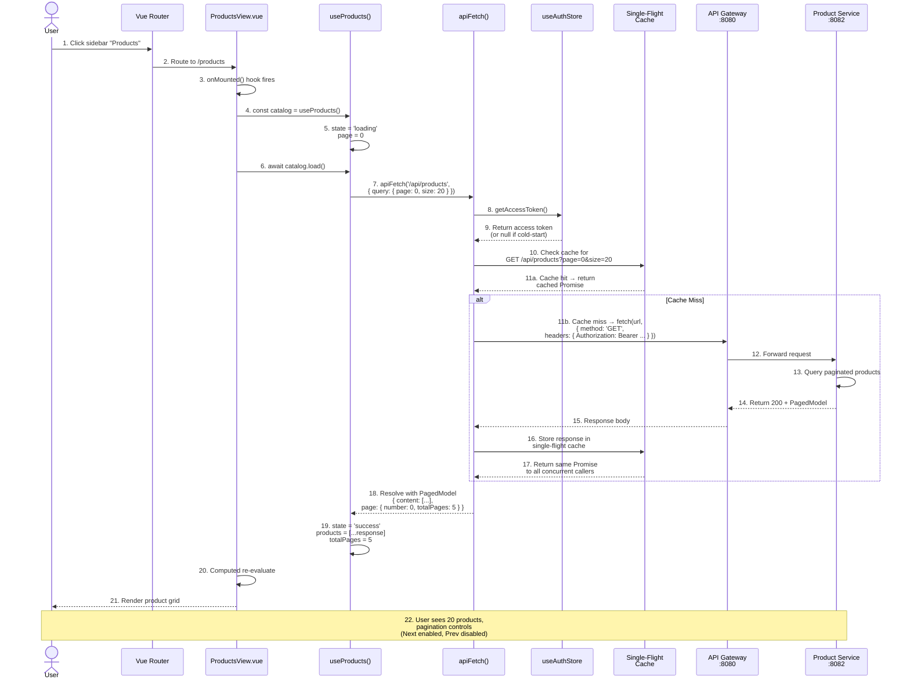

# 2. Data Flow: Catalog Page Load

## Numbered Sequence Diagram



## Narrative Description

### Cold-Start Catalog Load

**Step 1-4: Navigation & Setup**
- User clicks the "Products" nav item in the sidebar
- Vue Router matches the `/products` route → lazy-loads `ProductsView.vue`
- Component mounts → `onMounted()` lifecycle hook executes
- Hook calls `const catalog = useProducts()` to create the composable instance

**Step 5-7: Composable Initialization & Request**
- `useProducts()` initializes state as `{ status: 'loading' }`
- Page number set to 0 (first page)
- `onMounted` calls `await catalog.load()`
- Composable invokes `apiFetch('/api/products', { query: { page: 0, size: 20 } })`

**Step 8-11: Authentication & Cache Check**
- `apiFetch()` reads the access token from `useAuthStore.getAccessToken()`
  - **Cold-start scenario:** Token is `null` because this is a page reload
  - `apiFetch()` will still send the request (no token = no Bearer header)
  - If no token, the request hits `/api/products` anonymously (endpoint is public-read)
  - If token exists (from prior login in same tab), it's attached as `Authorization: Bearer <token>`
- `apiFetch()` checks its internal single-flight cache:
  - **Cache miss** (most likely on first page load)
  - Proceeds to send fetch

**Step 12-17: Network Request & Backend Response**
- `fetch()` is invoked with the built URL and headers
- Browser sends `GET http://localhost:8080/api/products?page=0&size=20`
- API Gateway (:8080) routes to Product Service (:8082) via Eureka service discovery
- Product Service queries the database for products with pagination
- Response: `200 OK + PagedModel<Product>`
  ```json
  {
    "content": [
      { "id": "...", "sku": "...", "name": "...", ... },
      ...
    ],
    "page": {
      "number": 0,
      "size": 20,
      "totalElements": 100,
      "totalPages": 5
    }
  }
  ```
- Response is stored in the single-flight cache with the request URL as key

**Step 18-21: State Update & Render**
- `apiFetch()` resolves with the parsed response
- `useProducts()` receives the `PagedModel`
- Composable updates state:
  - `state.value = { status: 'success', products: [...response.content] }`
  - `totalPages.value = 5`
  - `totalElements.value = 100`
- Vue detects the state change
- `ProductsView` re-renders with the fetched products
- ProductGrid component iterates over the products and renders ProductCard for each

**Step 22: User Sees Results**
- User now sees a table/grid of 20 products
- Pagination controls show: "Prev" (disabled), "Page 1 of 5", "Next" (enabled)
- Each product row shows: SKU, Name, Price, Stock Hint, Edit, Delete buttons

### Single-Flight Cache Behavior

If a second `ProductsView` instance (or any other consumer) calls `apiFetch('/api/products?page=0&size=20')` while the first request is in-flight:

1. **During Flight:** The cache returns the same `Promise` that was started by the first caller
2. **After Response:** All callers get the same parsed response object
3. **Cleanup:** Cache entry is cleared after a configurable TTL (prevents stale data on re-mounts)

This ensures that rapid navigation or multiple mounts of the same page don't spawn duplicate network calls.

### Error Handling (Not Shown in Happy Path)

If the response is 4xx/5xx:
- `readBody()` parses the RFC 9457 problem document
- `apiErrorFrom()` builds an `ApiError` with `.message`, `.code`, `.correlationId`
- `useProducts()` catches the error:
  ```typescript
  state.value = {
    status: 'error',
    message: error.message,
    correlationId: error.correlationId
  }
  ```
- `ProductsView` renders an error alert instead of the grid

### Authorization & Cold-Start Token Refresh

If the page is reloaded while the user is logged in:
1. `useAuthStore.accessToken` is `null` (memory-only token is lost)
2. The **router guard** (before the ProductsView even renders) calls `store.ensureSession()`
3. `ensureSession()` attempts a single silent refresh using the HttpOnly refresh cookie
4. If successful, the access token is restored and the page loads with auth
5. If the refresh fails, the user is redirected to `/login`

---

## Timing Breakdown

| Phase | Duration | Notes |
|-------|----------|-------|
| Navigation & Mount | ~1ms | Instant Router + Vue rendering |
| useProducts() init | <1ms | Composable ref/computed creation |
| apiFetch() prep | ~2ms | URL building, cache check |
| Network roundtrip | ~200-500ms | Typical API latency |
| Response parse | ~5ms | JSON.parse() |
| State update | <1ms | Ref assignment |
| Vue re-render | ~10-50ms | Compiler + DOM painting |
| **Total visible latency** | **~220-560ms** | User sees spinner then grid |

