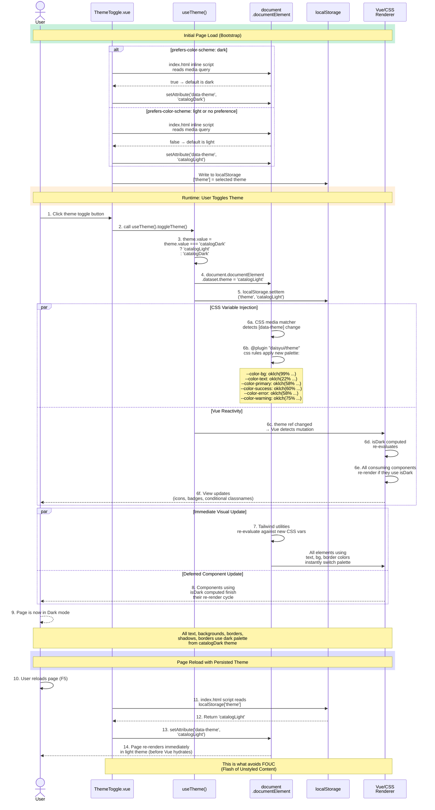

# 3. Theme System Sequence

## Sequence Diagram: Light ↔ Dark Theme Toggle



## Narrative Description

### Phase 1: Bootstrap (Before Vue Hydrates)

An **inline script in `index.html`** runs synchronously before Vue mounts:

```html
<script>
  const stored = localStorage.getItem('theme');
  const preferred = window.matchMedia('(prefers-color-scheme: dark)').matches
    ? 'catalogDark'
    : 'catalogLight';
  const theme = stored ?? preferred;
  document.documentElement.dataset.theme = theme;
</script>
```

This ensures:
- No **FOUC** (Flash of Unstyled Content) — the correct theme's CSS is loaded before paint
- `document.documentElement.dataset.theme` is set before Vue mounts
- Theme persists across reloads (from localStorage)
- System preference is used on first visit (fallback to `prefers-color-scheme`)

### Phase 2: Runtime Toggle

**Sequence when user clicks the theme toggle button:**

1. **User clicks** ThemeToggle component's button in the navbar
2. **Component calls** `useTheme().toggleTheme()`
3. **Composable updates** the `theme` ref:
   - If current is `'catalogDark'` → set to `'catalogLight'`
   - If current is `'catalogLight'` → set to `'catalogDark'`
4. **DOM update** — synchronously mutate `document.documentElement.dataset.theme`
5. **Persistence** — write the new theme to `localStorage['theme']`

### Phase 3: CSS Variable Injection

Two parallel processes handle the visual transition:

**Process A: CSS Auto-Switch (Immediate)**
- Tailwind's theme system uses the `[data-theme]` attribute as a selector
- The daisyUI plugin configures two theme blocks:
  ```css
  @plugin "daisyui/theme" {
    name: 'catalogLight';
    --color-base-100: oklch(99% 0.002 90);
    --color-text: oklch(22% 0.006 90);
    --color-primary: oklch(58% 0.13 205);
    ...
  }
  @plugin "daisyui/theme" {
    name: 'catalogDark';
    --color-base-100: oklch(17% 0.006 260);
    --color-text: oklch(92% 0.005 260);
    --color-primary: oklch(72% 0.12 205);
    ...
  }
  ```
- When `[data-theme=catalogLight]` is set, the browser applies the light palette
- When `[data-theme=catalogDark]` is set, the browser applies the dark palette
- **All elements already using Tailwind utilities** (e.g., `text-base-content`, `bg-base-100`, `border-base-content`) automatically re-compute with the new CSS variables
- **No JavaScript needed** — pure CSS scoping

**Process B: Vue Re-render (Eventual)**
- `useTheme()` is a Pinia-like composition function (module-level ref)
- When `theme.value` is mutated, Vue's reactivity system notifies all subscribers
- Computed property `isDark` re-evaluates
- Any component using `isDark` or `theme` re-renders
- Components conditionally render icons, badges, or className modifiers based on `isDark`
- Example:
  ```typescript
  <ThemeIcon :is-dark="isDark" />
  <span :class="isDark ? 'text-yellow-400' : 'text-yellow-600'">
    Mode: {{ isDark ? 'Dark' : 'Light' }}
  </span>
  ```

**Combined Effect:**
- CSS variable colors switch instantly (~1ms)
- Vue component re-renders follow within the same frame (~10-50ms)
- User perceives a smooth, single-frame theme transition

### Phase 4: Persistence

The new theme is saved to `localStorage['theme']` immediately, so:
- If the user closes the tab and returns later → theme is restored
- If the user reloads the page → the bootstrap script reads localStorage and applies the theme before Vue loads
- If localStorage is cleared → fallback to system preference again

### CSS Custom Properties Reference

The actual CSS variables injected by the two themes:

**catalogLight (Light Mode)**
- `--color-base-100`: off-white background
- `--color-base-content`: near-black text
- `--color-primary`: blue (#2563eb equivalent)
- `--color-success`: green
- `--color-error`: red
- `--color-warning`: orange/yellow
- `--radius-box`: 0.625rem (consistent corner radius)

**catalogDark (Dark Mode)**
- `--color-base-100`: near-black background
- `--color-base-content`: off-white text
- `--color-primary`: lighter blue
- `--color-success`: lighter green
- `--color-error`: lighter red
- `--color-warning`: lighter yellow
- `--radius-box`: 0.625rem (same corner radius)

### File References

- **Bootstrap:** `index.html` `<script>` tag (runs before app loads)
- **Runtime Toggle:** `src/components/ThemeToggle.vue`
- **Composable:** `src/composables/useTheme.ts`
- **CSS Themes:** `src/style.css` (Tailwind + daisyUI themes)

### Browser Support

- `localStorage` — all modern browsers
- `prefers-color-scheme` media query — all modern browsers
- `document.documentElement.dataset` — all modern browsers
- CSS custom properties — all modern browsers
- `@supports` fallback (if needed) — all modern browsers

No polyfills required for the target browsers (Chrome, Safari, Firefox, Edge).

