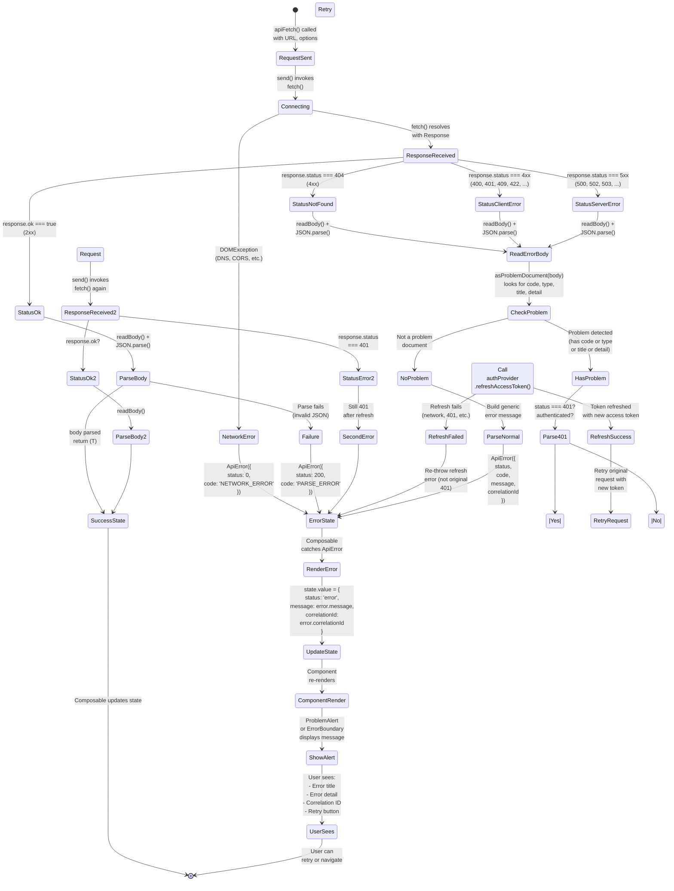

# 6. Error Handling Flow

## State Machine Diagram: Request → Error Response → User-Facing Display



## Narrative Description

### Phase 1: Request Initiation

```typescript
// In a composable or component
try {
  const result = await apiFetch<Product>('/api/products/123');
  state.value = { status: 'success', data: result };
} catch (error: unknown) {
  const apiError = error instanceof ApiError ? error : null;
  state.value = {
    status: 'error',
    message: apiError?.message ?? 'Request failed',
    correlationId: apiError?.correlationId ?? null
  };
}
```

`apiFetch()` is called with a path and options.

### Phase 2: HTTP Send

```typescript
// lib/http.ts: send()
const response = await fetch(url, {
  method: 'GET',
  headers: { Authorization: `Bearer ${token}` },
  credentials: 'include',
  signal: options.signal
});
```

If `fetch()` throws:
- **DOMException (AbortError)** → request was cancelled via AbortSignal
- **DOMException (other)** → network-level failure (DNS, CORS, connection refused)
- **Converted to ApiError** with `status: 0`, `code: 'NETWORK_ERROR'`

### Phase 3: Response Status Check

The HTTP response arrives (even if `response.ok === false`).

**Flow splits by status:**

**2xx (Success):**
- Proceed to body parsing
- If JSON parse fails → `ApiError` with generic message
- If JSON is valid → return parsed object

**4xx (Client Error) / 5xx (Server Error):**
- Proceed to error body parsing

### Phase 4: Error Body Parsing

```typescript
// lib/http.ts: readBody()
let text = await response.text();
if (contentType.includes('json')) {
  return JSON.parse(text);  // May throw, caught and returns undefined
}
return undefined;
```

If the body is empty (204 No Content) or unparseable:
- `problem = null`
- Use a generic error message based on HTTP status

If the body is JSON:
- Try to parse it as **RFC 9457 Problem Document**
- Check for required fields: `code`, `type`, `title`, or `detail`
- If at least one is present → treat as problem document

### Phase 5: RFC 9457 Problem Document Structure

A valid problem document looks like:

```json
{
  "type": "https://catalog.example.com/problems/out-of-stock",
  "title": "Product Out of Stock",
  "status": 409,
  "detail": "SKU ABC123 is no longer available.",
  "instance": "/api/products/abc-id-123",
  "code": "PRODUCT_OUT_OF_STOCK",
  "correlationId": "req-12345-abcdef",
  "timestamp": "2025-11-08T14:30:00Z",
  "availableUnits": 0
}
```

**Parsed into ApiError:**
```typescript
new ApiError(
  message: "SKU ABC123 is no longer available.",  // from detail
  {
    status: 409,
    code: 'PRODUCT_OUT_OF_STOCK',
    problem: { ...full document },
    correlationId: 'req-12345-abcdef'
  }
);
```

### Phase 6: Message Selection (Priority Order)

1. **Server's `detail`** — most specific, this exact occurrence
2. **Code-keyed friendly copy** — fallback for codes without details
   - `AUTH_INVALID_CREDENTIALS` → "That email and password combination is not valid."
   - `AUTH_ACCOUNT_LOCKED` → "This account is temporarily locked after too many failed attempts."
   - `RESOURCE_CONFLICT` → "This product was changed by someone else. Reload and try again."
   - (Full list in `lib/problem.ts`)
3. **Problem `title`** — generic category
4. **Last resort** → "The request failed and the server did not say why. (HTTP 409)"

### Phase 7: 401 Handling (Token Refresh)

```typescript
// lib/http.ts: apiFetch()
if (response.status === 401 && authenticated && isRetryablePath(path)) {
  try {
    const newToken = await authProvider.refreshAccessToken();
    response = await send(url, options, newToken);
  } catch (refreshError) {
    throw refreshError;  // Re-throw refresh failure, not original 401
  }
}
```

**Special handling for 401:**
- Only if the endpoint is retryable (not `/api/auth/login`, `/api/auth/refresh`)
- Call `refreshAccessToken()` (single-flight dedup in auth store)
- **Retry the original request exactly once** with the new token
- If the retry is still 401 → session is lost, throw error (don't retry again)

**Auth Store's Refresh Implementation:**
```typescript
async function refreshAccessToken(): Promise<string> {
  if (refreshPromise !== null) {
    return refreshPromise;  // Another caller already in-flight, share promise
  }
  
  try {
    const tokens = await apiFetch<TokenResponse>('/api/auth/refresh', {
      authenticated: false  // Don't attach bearer or participate in refresh
    });
    accessToken.value = tokens.accessToken;
    return tokens.accessToken;
  } catch (error) {
    // Check if this is AUTH_REFRESH_RACE (concurrent refresh, not a failure)
    if (error instanceof ApiError && error.isRefreshRace) {
      return accessToken.value!;  // Token was refreshed by another caller
    }
    // Otherwise, session is lost
    clearSession();
    throw error;
  } finally {
    refreshPromise = null;  // Clear latch
  }
}
```

### Phase 8: Composable Error Handling

Each composable has its own error state model. Example from `useProducts()`:

```typescript
export type ProductsState =
  | { status: 'loading' }
  | { status: 'error'; message: string; correlationId: string | null }
  | { status: 'empty' }
  | { status: 'success'; products: Product[] };

export function useProducts() {
  const state = shallowRef<ProductsState>({ status: 'loading' });
  
  async function load() {
    try {
      const result = await apiFetch<PagedModel<Product>>('/api/products', ...);
      state.value = { status: 'success', products: result.content };
    } catch (error: unknown) {
      const apiError = error instanceof ApiError ? error : null;
      state.value = {
        status: 'error',
        message: apiError?.message ?? 'Failed to load products',
        correlationId: apiError?.correlationId ?? null
      };
    }
  }
  
  return { state, load, ... };
}
```

**Discriminated union pattern prevents:**
- Rendering a spinner over an error (can't be `loading && error` simultaneously)
- Showing stale data when an error occurs (state is replaced wholesale)

### Phase 9: Component Rendering

```vue
<script setup>
const products = useProducts();
</script>

<template>
  <div v-if="products.state.status === 'loading'">
    <Spinner />
  </div>
  
  <div v-else-if="products.state.status === 'error'" class="alert alert-error">
    <ProblemAlert
      :message="products.state.message"
      :correlation-id="products.state.correlationId"
      @retry="products.load()"
    />
  </div>
  
  <div v-else-if="products.state.status === 'empty'" class="alert alert-info">
    No products found.
  </div>
  
  <div v-else>
    <!-- status === 'success' -->
    <ProductGrid :products="products.state.products" />
  </div>
</template>
```

### Phase 10: ProblemAlert Component

```vue
<template>
  <div class="alert alert-error">
    <div class="alert-title">Error</div>
    <p>{{ message }}</p>
    <p v-if="correlationId" class="text-xs font-mono text-gray-500">
      Reference: {{ correlationId }}
    </p>
    <button @click="$emit('retry')" class="btn btn-sm">
      Retry
    </button>
  </div>
</template>
```

### Common Error Scenarios

**Scenario 1: Network Down**
```
Status: 0
Code: NETWORK_ERROR
Message: "Could not reach the server. Check that the API gateway is running."
User sees: Alert with network troubleshooting text
```

**Scenario 2: Invalid Credentials**
```
Status: 401
Code: AUTH_INVALID_CREDENTIALS
Problem Detail: "Wrong password for user@example.com"
Message (displayed): "Wrong password for user@example.com"
(Detail takes priority over code-keyed friendly copy)
User sees: Alert on login form, can retry
```

**Scenario 3: Product Out of Stock (Conflict)**
```
Status: 409
Code: PRODUCT_OUT_OF_STOCK
Problem Detail: "SKU ABC123 is no longer available. Current stock: 0"
Message: "SKU ABC123 is no longer available. Current stock: 0"
Correlation ID: req-67890
User sees: Alert with detail + correlation ID for support tickets
```

**Scenario 4: Session Expired During Refresh**
```
Status: 401
Code: AUTH_REFRESH_INVALID (or AUTH_REFRESH_REUSE_DETECTED)
Flow: apiFetch() gets 401 → calls refreshAccessToken()
      → Auth Service returns 401 (token expired/revoked)
      → ApiError.isSessionLost === true
      → Auth Store clears session
      → Router guard redirects to /login
User sees: Redirected to login page with message "Your session has expired"
```

**Scenario 5: Service Unavailable**
```
Status: 503
Code: UPSTREAM_UNAVAILABLE
Problem Detail: "Product service is temporarily down"
Message: "A downstream service is unavailable. Please try again shortly."
User sees: Alert with friendly message to retry later
```

### Error Recovery Flows

**User-Initiated Retry**
```
User clicks "Retry" button on error alert
→ Composable's .load() or .reload() method called again
→ apiFetch() sends a fresh request
→ If successful, state updates to 'success'
→ If still failed, state remains 'error' with new message/correlationId
```

**Automatic Retry on 401**
```
Any endpoint returns 401 (except auth endpoints themselves)
→ apiFetch() calls refreshAccessToken()
→ If refresh succeeds, original request retried with new token
→ If refresh fails, error is thrown (no further retry)
→ Composable catches and shows error state
```

**Session Recovery on Cold Start**
```
User reloads page while authenticated
→ useAuthStore.accessToken is null (memory-only token lost)
→ Router guard calls ensureSession()
→ ensureSession() attempts silent refresh via refresh cookie
→ If refresh succeeds, token restored, page loads normally
→ If refresh fails, redirects to /login
```

