# 7. Pagination Algorithm

## Flow Diagram: URL Query → Hook State → Component Render → User Action

```mermaid
flowchart TD
    Start["User navigates to<br/>/products"]
    
    Router["Vue Router matches route<br/>ProductsView.vue"]
    
    MountHook["onMounted() hook runs"]
    
    CreateComposable["catalog = useProducts(size = 20)"]
    
    InitState["Initialize:<br/>state = 'loading'<br/>page = 0<br/>totalPages = 0"]
    
    ReadParams["Check URL query params<br/>?page=N<br/>(useRoute().query)"]
    
    HasPageParam{Has page<br/>param?}
    
    ReadFromUrl["page = parseInt(query.page)<br/>if page > totalPages:<br/>  page = 0"]
    
    DefaultPage["page = 0<br/>(first page)"]
    
    LoadData["await catalog.load(page)"]
    
    FetchRequest["apiFetch('/api/products',<br/>{ query: {<br/>  page: 0,<br/>  size: 20<br/>}})"]
    
    Response["Response: PagedModel<Product> {<br/>  content: [Product, ...],<br/>  page: {<br/>    number: 0,<br/>    totalElements: 100,<br/>    totalPages: 5<br/>  }<br/>}"]
    
    UpdateState["state.value = {<br/>  status: 'success',<br/>  products: [...]<br/>}<br/>totalPages.value = 5<br/>totalElements.value = 100"]
    
    Render["Template renders:<br/>- ProductGrid<br/>- Pagination controls<br/>  (Prev disabled)<br/>  (Page 1 of 5)<br/>  (Next enabled)"]
    
    UserSees["User sees:<br/>- 20 products<br/>- Navigation controls"]
    
    UserClicksNext["User clicks 'Next' button"]
    
    CallNext["catalog.nextPage()"]
    
    CalcNext["pageNumber = page.value + 1<br/>= 0 + 1 = 1"]
    
    ValidatePage{pageNumber valid?<br/>0 <= N <<br/>totalPages}
    
    InvalidPage["User is already<br/>on last page<br/>Do nothing"]
    
    ValidPage["Call goToPage(1)"]
    
    FetchNext["await load(1)"]
    
    FetchRequest2["apiFetch('/api/products',<br/>{ query: {<br/>  page: 1,<br/>  size: 20<br/>}})"]
    
    Response2["Response: PagedModel {<br/>  content: [Product(21-40), ...],<br/>  page: { number: 1, totalPages: 5 }<br/>}"]
    
    UpdateState2["state.value = {<br/>  status: 'success',<br/>  products: [<br/>    Product 21-40<br/>  ]<br/>}<br/>page.value = 1<br/>totalPages.value = 5"]
    
    Render2["Template re-renders<br/>ProductGrid<br/>Pagination controls:<br/>  Prev enabled<br/>  Page 2 of 5<br/>  Next enabled"]
    
    UserSees2["User sees:<br/>- Products 21-40<br/>- Updated pagination"]
    
    UserClicksPrev["User clicks 'Prev'"]
    
    CallPrev["catalog.previousPage()"]
    
    CalcPrev["pageNumber = page.value - 1 = 0"]
    
    FetchPrev["await load(0)"]
    
    FetchRequest3["apiFetch('/api/products',<br/>{ query: { page: 0, ... }})"]
    
    CacheHit["Single-flight cache hit!<br/>Page 0 was already fetched"]
    
    CacheReturn["Return cached Promise<br/>resolve immediately"]
    
    UpdateState3["state.value updates<br/>products = [Product 1-20]<br/>page.value = 0"]
    
    Render3["Template re-renders<br/>Pagination:<br/>  Prev disabled<br/>  Page 1 of 5<br/>  Next enabled"]
    
    UserSees3["User sees:<br/>- Products 1-20 again<br/>- No network delay<br/>(cache hit!)"]
    
    Start --> Router
    Router --> MountHook
    MountHook --> CreateComposable
    CreateComposable --> InitState
    InitState --> ReadParams
    ReadParams --> HasPageParam
    HasPageParam -->|Yes| ReadFromUrl
    HasPageParam -->|No| DefaultPage
    ReadFromUrl --> LoadData
    DefaultPage --> LoadData
    LoadData --> FetchRequest
    FetchRequest --> Response
    Response --> UpdateState
    UpdateState --> Render
    Render --> UserSees
    UserSees --> UserClicksNext
    UserClicksNext --> CallNext
    CallNext --> CalcNext
    CalcNext --> ValidatePage
    ValidatePage -->|Invalid| InvalidPage
    ValidatePage -->|Valid| ValidPage
    InvalidPage --> UserSees
    ValidPage --> FetchNext
    FetchNext --> FetchRequest2
    FetchRequest2 --> Response2
    Response2 --> UpdateState2
    UpdateState2 --> Render2
    Render2 --> UserSees2
    UserSees2 --> UserClicksPrev
    UserClicksPrev --> CallPrev
    CallPrev --> CalcPrev
    CalcPrev --> FetchPrev
    FetchPrev --> FetchRequest3
    FetchRequest3 --> CacheHit
    CacheHit --> CacheReturn
    CacheReturn --> UpdateState3
    UpdateState3 --> Render3
    Render3 --> UserSees3
    
    style Start fill:#e3f2fd
    style UserSees fill:#c8e6c9
    style UserSees2 fill:#c8e6c9
    style UserSees3 fill:#c8e6c9
    style CacheHit fill:#fff9c4
```



## Narrative Description

### Initial Load (URL → Page)

**Step 1: Navigation**
User navigates to `/products` (cold start or from sidebar)

**Step 2: Router Matching**
Vue Router matches the route → ProductsView.vue lazy-loads

**Step 3: Component Mount**
ProductsView's `onMounted()` hook executes

**Step 4: Composable Creation**
```typescript
const catalog = useProducts(DEFAULT_PAGE_SIZE /* 20 */)
```

Composable initializes:
- `state = { status: 'loading' }`
- `page = 0`
- `totalPages = 0` (unknown until first response)

**Step 5: Check URL Query Parameters**
```typescript
const route = useRoute();
const pageFromUrl = parseInt(route.query.page as string, 10) || 0;
```

- If URL has `?page=2` → start at page 2
- If URL has no page param → default to page 0
- If page > totalPages (shouldn't happen) → reset to 0

**Step 6: Load First Page**
```typescript
await catalog.load(0)  // or catalog.load(2) if query.page=2
```

Composable calls:
```typescript
const result = await apiFetch<PagedModel<Product>>('/api/products', {
  query: { page: 0, size: 20 }
});
```

**Step 7: API Response**
```json
{
  "content": [
    { "id": "1", "sku": "...", "name": "Product 1", ... },
    ...
    { "id": "20", "sku": "...", "name": "Product 20", ... }
  ],
  "page": {
    "number": 0,
    "size": 20,
    "totalElements": 100,
    "totalPages": 5
  }
}
```

**Step 8: Update Composable State**
```typescript
state.value = {
  status: 'success',
  products: [...content]
}
page.value = 0
totalPages.value = 5
totalElements.value = 100
```

**Step 9: Computed Properties Update**
```typescript
hasNext = computed(() => page.value + 1 < totalPages.value)
        = 0 + 1 < 5 = true

hasPrevious = computed(() => page.value > 0)
            = 0 > 0 = false
```

**Step 10: Component Renders**
ProductsView template shows:
- Product grid with 20 items
- Pagination controls:
  - "Previous" button (disabled, because hasPrevious = false)
  - "Page 1 of 5" text
  - "Next" button (enabled, because hasNext = true)

### User Clicks Next

**Step 1: Button Click**
```vue
<button @click="catalog.nextPage()" :disabled="!catalog.hasNext">
  Next
</button>
```

**Step 2: Method Called**
```typescript
async nextPage(): Promise<void> {
  await goToPage(page.value + 1)  // goToPage(1)
}
```

**Step 3: Validation**
```typescript
async function goToPage(pageNumber: number): Promise<void> {
  if (pageNumber < 0 || pageNumber >= totalPages.value) {
    return;  // Don't go past bounds
  }
  await load(pageNumber);
}
```

- pageNumber = 1
- Check: 0 <= 1 < 5 ✓ valid
- Proceed to load

**Step 4: Fetch Request**
```typescript
await apiFetch('/api/products', {
  query: { page: 1, size: 20 }
})
```

**Step 5: API Response (Page 1)**
```json
{
  "content": [
    { "id": "21", "name": "Product 21", ... },
    ...
    { "id": "40", "name": "Product 40", ... }
  ],
  "page": {
    "number": 1,
    "totalPages": 5
  }
}
```

**Step 6: State Update**
```typescript
state.value = {
  status: 'success',
  products: [Product 21-40]
}
page.value = 1
```

**Step 7: Computed Properties Update**
```typescript
hasNext = 1 + 1 < 5 = true   ✓ Next still enabled
hasPrevious = 1 > 0 = true   ✓ Prev now enabled
```

**Step 8: Component Re-renders**
ProductsView now shows:
- Product grid: items 21-40
- Pagination:
  - Previous (enabled)
  - Page 2 of 5
  - Next (enabled)

### User Clicks Previous (Cache Hit)

**Step 1: Button Click**
```vue
<button @click="catalog.previousPage()" :disabled="!catalog.hasPrevious">
  Previous
</button>
```

**Step 2: Method Called**
```typescript
async previousPage(): Promise<void> {
  await goToPage(page.value - 1)  // goToPage(0)
}
```

**Step 3: Validation**
- pageNumber = 0
- Check: 0 <= 0 < 5 ✓ valid
- Proceed to load

**Step 4: Fetch Request**
```typescript
await apiFetch('/api/products', {
  query: { page: 0, size: 20 }
})
```

**IMPORTANT: Single-Flight Cache Hit**
- URL: `GET http://localhost:8080/api/products?page=0&size=20`
- This exact request was made 3 seconds ago when the user first loaded
- The cache key matches!
- apiFetch **returns the same cached Promise** that was stored earlier
- No network roundtrip needed

**Step 5: Instant Resolution**
Cache returns the same response as before (didn't re-fetch from network):
```json
{
  "content": [Product 1-20],
  "page": { "number": 0, "totalPages": 5 }
}
```

**Step 6: State Update (Instant)**
```typescript
state.value = {
  status: 'success',
  products: [Product 1-20]
}
page.value = 0
```

**Step 7: Component Re-renders (Instant)**
- User sees products 1-20 again
- Navigation updates to: "Page 1 of 5" with Prev disabled, Next enabled
- **No spinner shown** (cache hit completes so fast)

### Monotonic Request Tracking

To prevent out-of-order responses when user pages rapidly:

```typescript
let requestSequence = 0;

async function load(pageNumber: number): Promise<void> {
  const ticket = ++requestSequence;  // Increment counter
  state.value = { status: 'loading' };
  
  try {
    const result = await apiFetch<PagedModel<Product>>('/api/products', {
      query: { page: pageNumber, size }
    });
    
    if (ticket !== requestSequence) {
      // A newer request came in while we were waiting
      // Discard this response (don't update state)
      return;
    }
    
    // This is the latest request, update state
    page.value = result.page.number;
    state.value = { status: 'success', products: result.content };
  } catch (error) {
    if (ticket !== requestSequence) {
      return;  // Discard error from stale request
    }
    state.value = { status: 'error', message: ... };
  }
}
```

**Example Scenario:**
1. User on page 0, clicks "Next" (page 1 request in-flight, slow network)
2. After 500ms (while page 1 still loading), user clicks "Next" again (page 2 request sent, network is faster)
3. Page 2 response arrives after 200ms (before page 1)
4. Ticket 3 compares: `3 === requestSequence` (now 3) ✓ update to page 2
5. Page 1 response arrives 300ms later
6. Ticket 2 compares: `2 !== requestSequence` (now 3) ✗ discard (don't downgrade from page 2 to page 1)

Result: User always sees the latest page they clicked, never a stale intermediate page.

### URL Synchronization (Not Shown)

In a real app, you might also sync the page number to the URL:

```typescript
const route = useRoute();
const router = useRouter();

watch(() => page.value, (newPage) => {
  if (route.query.page !== String(newPage)) {
    router.replace({
      query: { ...route.query, page: newPage }
    });
  }
});
```

This way:
- Reload on page 2 → URL has `?page=2` → loads page 2 automatically
- Back button works (browser history includes each page change)
- Shareable links (copy URL with `?page=3` to share)

