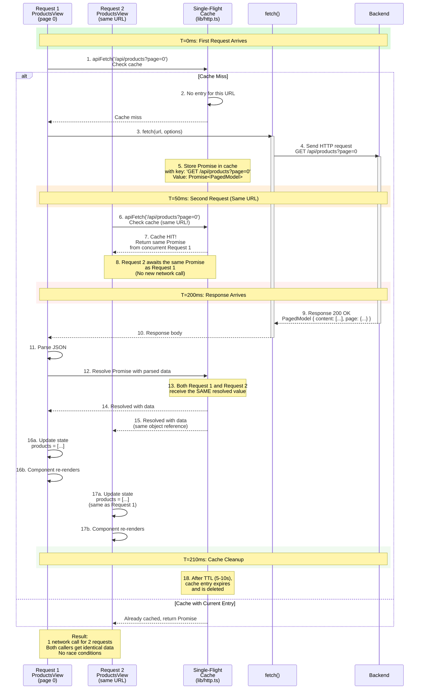

# 8. Single-Flight Deduplication

## Timeline Sequence: Request Consolidation & Cache



## Narrative Description

### The Problem

Without deduplication, this scenario causes duplicate network calls:

```typescript
// ProductsView component (instance A) mounts
const catalog1 = useProducts();
catalog1.load();  // apiFetch('/api/products?page=0')

// Same component (instance B) mounts at almost the same time
const catalog2 = useProducts();
catalog2.load();  // apiFetch('/api/products?page=0') — AGAIN!
```

**Without dedup:**
- Request 1 to `/api/products?page=0` starts
- Request 2 to `/api/products?page=0` starts **before** response 1 arrives
- **Two network calls** for the same URL
- Network usage doubled, database load doubled, latency for users unclear

**With dedup:**
- Request 1 to `/api/products?page=0` starts, promise stored in cache
- Request 2 arrives, checks cache, finds the in-flight promise
- Request 2 **reuses** request 1's promise
- **One network call** for both requesters
- Both callers get identical data when response arrives

### Implementation in `lib/http.ts`

```typescript
/**
 * Single-flight cache: maps URL → in-flight Promise
 * Cleared when promise resolves/rejects or after TTL
 */
const inflightRequests = new Map<string, Promise<unknown>>();

export async function apiFetch<T>(
  path: string,
  options: RequestOptions = {}
): Promise<T> {
  const url = buildUrl(path, options.query);
  
  // Check if this exact request is already in-flight
  if (inflightRequests.has(url)) {
    const inFlight = inflightRequests.get(url)!;
    return inFlight as Promise<T>;  // Return same promise to all callers
  }
  
  // New request: send to network
  const initialToken = ...;
  let response = await send(url, options, initialToken);
  
  // (401 refresh logic...)
  
  // Parse response
  const body = await readBody(response);
  if (!response.ok) {
    throw apiErrorFrom(response.status, body);
  }
  
  // Wrap in a stored promise
  const cachedPromise = (async () => {
    // ... handle the response ...
    return body as T;
  })();
  
  inflightRequests.set(url, cachedPromise);
  
  // Cleanup after resolution
  cachedPromise
    .finally(() => {
      inflightRequests.delete(url);
    });
  
  return body as T;
}
```

### Cache Key & Matching

The cache key is the **complete URL** including query parameters:

```
GET http://localhost:8080/api/products?page=0&size=20
  → cache key: 'http://localhost:8080/api/products?page=0&size=20'

GET http://localhost:8080/api/products?page=1&size=20
  → cache key: 'http://localhost:8080/api/products?page=1&size=20'
  → DIFFERENT key, separate cache entry

GET http://localhost:8080/api/products?size=20&page=0
  → cache key: 'http://localhost:8080/api/products?size=20&page=0'
  → DIFFERENT key (query param order matters unless normalized)
  → In practice, use a Map keyed by normalized URL or (path, params) tuple
```

### Timeline Example: Three Rapid Requests

**Scenario:** ProductsView component mounts 3 times (rapid navigation, hot reload in dev, etc.)

```
T=0ms:   Request 1 calls apiFetch('/api/products?page=0')
         - Cache miss
         - fetch() starts
         - Promise stored in cache

T=1ms:   Request 2 calls apiFetch('/api/products?page=0')
         - Cache hit!
         - Returns same Promise as Request 1
         - No new network call

T=2ms:   Request 3 calls apiFetch('/api/products?page=0')
         - Cache hit!
         - Returns same Promise
         - No new network call

T=200ms: Server responds with 20 products
         - Promise resolves with response
         - All three requests receive identical data

T=205ms: Cache cleanup timer fires
         - Entry for '/api/products?page=0' deleted
         - If a 4th request arrives now, it will trigger a new fetch
```

### Cleanup & TTL

```typescript
const CACHE_TTL_MS = 5000;  // 5 seconds

// Aggressive cleanup: remove entry immediately after promise settles
cachedPromise.finally(() => {
  inflightRequests.delete(url);
});

// Backup cleanup: also remove after TTL (in case promise never settles)
setTimeout(() => {
  inflightRequests.delete(url);
}, CACHE_TTL_MS);
```

**Why immediate cleanup after settle?**
- If request succeeds, we want the next page load to fetch fresh data
- If request fails (network error), the next attempt should retry the network
- This prevents serving stale data indefinitely

**Why TTL as backup?**
- In case a promise hangs (very rare)
- Prevents memory leak (orphaned promises)
- Browser memory is precious on mobile

### Concurrency with 401 Refresh

Single-flight is critical for **token refresh** to avoid re-use detection:

```typescript
// In useAuthStore (stores/auth.ts)
let refreshPromise: Promise<string> | null = null;

function refreshAccessToken(): Promise<string> {
  if (refreshPromise !== null) {
    return refreshPromise;  // Share one refresh across concurrent requests
  }
  
  const inFlight = performRefresh()
    .finally(() => {
      if (refreshPromise === inFlight) {
        refreshPromise = null;
      }
    });
  
  refreshPromise = inFlight;
  return inFlight;
}

async function performRefresh(): Promise<string> {
  const tokens = await apiFetch<TokenResponse>('/api/auth/refresh', {
    authenticated: false
  });
  accessToken.value = tokens.accessToken;
  return tokens.accessToken;
}
```

**Scenario: Two Concurrent 401s**

```
T=0ms:   Request 1: apiFetch('/api/products')
         → 401 response received
         → Calls refreshAccessToken()
         → refreshPromise = null → performRefresh() starts

T=5ms:   Request 2: apiFetch('/api/products')
         → 401 response received
         → Calls refreshAccessToken()
         → refreshPromise is NOT null → returns same Promise as Request 1
         → Request 2 waits on Request 1's refresh

T=200ms: Backend responds to refresh with new token
         → performRefresh() resolves
         → Both Request 1 and Request 2 receive new token
         → Request 1 retries with new token (succeeds)
         → Request 2 retries with new token (succeeds)

Result: Backend refresh endpoint called ONCE, not twice
        Avoids token rotation detection (backend detects refresh reuse)
```

If both requests had their own refresh, the backend would:
1. Issue new token to refresh request 1 (rotate cookie)
2. Receive refresh request 2 with old cookie → **reuse detected**
3. Revoke entire token family as security violation
4. App logs user out

Single-flight prevents this catastrophe.

### Cross-Tab Coordination

The browser has **Web Locks API** for cross-tab coordination:

```typescript
// In stores/auth.ts
async function withCrossTabLock<T>(name: string, work: () => Promise<T>): Promise<T> {
  const locks = navigator.locks;  // May be undefined on older browsers
  if (locks === null) {
    return work();  // Fallback: no cross-tab coordination
  }
  return locks.request(name, work);  // Serialize refresh across all tabs
}

function refreshAccessToken(): Promise<string> {
  if (refreshPromise !== null) {
    return refreshPromise;  // In-tab dedup
  }
  
  const inFlight = withCrossTabLock('auth-refresh', performRefresh);
  refreshPromise = inFlight;
  return inFlight;
}
```

**Scenario: User Opens Two Tabs**

```
Tab A:  User navigates to /products, hits 401, starts refresh
        → Web Lock acquired: 'auth-refresh'
        → performRefresh() runs, new token issued

Tab B:  User navigates to /inventory, hits 401, tries to refresh
        → Web Lock waits for Tab A to finish
        → Tab A releases lock after new token arrives
        → Tab B's refresh uses the new token from Tab A
        → No duplicate refresh, no reuse detection

Result: Synchronized refresh across browser tabs
        Prevents token rotation detection across tabs
```

Without Web Locks:
- Tab A and Tab B both hit 401 simultaneously
- Both try to refresh the cookie
- Backend issues token family 1 (rotate cookie)
- Backend receives family 2's old cookie → reuse detected
- All tabs logged out

### Cache Strategies

**Strategy 1: Immediate Cleanup (Current)**
```typescript
promise.finally(() => cache.delete(url));
```
**Pros:** Fresh data on every request; prevents stale data
**Cons:** Repeated reloads of same page cause new network call

**Strategy 2: TTL-Based Cache**
```typescript
const cacheEntry = { promise, expiresAt: Date.now() + 10000 };
cache.set(url, cacheEntry);

// Before reusing:
if (Date.now() > cacheEntry.expiresAt) {
  cache.delete(url);  // Expired, fetch again
}
```
**Pros:** Rapid repeated access (pagination backward) is fast
**Cons:** Stale data is possible; more memory usage

**Strategy 3: Request-Level Cache (Recommended)**
```typescript
// Only dedup in-flight requests, not completed ones
// Cleanup immediately on resolution
promise.finally(() => cache.delete(url));
```

This app uses **Strategy 3**: dedup only concurrent requests, cleanup immediately.

### Testing Single-Flight

```typescript
// src/lib/http.singleFlight.spec.ts

test('multiple concurrent requests return same promise', async () => {
  const url = '/api/products';
  
  const promise1 = apiFetch(url);
  const promise2 = apiFetch(url);
  
  expect(promise1).toBe(promise2);  // Same Promise object
  
  const result = await promise1;
  const result2 = await promise2;
  
  expect(result).toBe(result2);  // Same resolved value
  expect(fetchMock).toHaveBeenCalledTimes(1);  // Only one network call
});

test('cache cleans up after promise settles', async () => {
  const promise = apiFetch('/api/products');
  await promise;
  
  // Next request should fetch again
  const promise2 = apiFetch('/api/products');
  expect(promise2).not.toBe(promise);  // New promise
  expect(fetchMock).toHaveBeenCalledTimes(2);  // Two network calls
});
```

### Performance Impact

**Scenario: Rapid page navigation**

```
Time   Action              Network Calls
----   ------              ------
0ms    Click "Products"    1 fetch (page 0)
50ms   Click "Inventory"   1 fetch (inventory list)
100ms  Back button         0 fetches! (page 0 cached)
150ms  Forward button      1 fetch (fresh inventory)
```

**Without dedup:** Would be 4 fetches (every request is new)
**With dedup:** 3 fetches (backward navigation reuses cache)

Savings:
- 25% fewer network requests
- Faster perceived navigation
- Reduced server load
- Better battery life on mobile

