# 9. JWT Token Refresh Flow

## Sequence Diagram with Swimlanes: Stale Token → Refresh → Retry

```mermaid
sequenceDiagram
    actor User
    participant Browser as Browser / SPA<br/>admin-product-catalog
    participant Store as useAuthStore<br/>(Pinia)
    participant HTTP as apiFetch()<br/>lib/http.ts
    participant Gateway as API Gateway<br/>:8080
    participant AuthService as Auth Service<br/>:8081
    participant ProductService as Product Service<br/>:8082
    
    rect rgb(200, 240, 220)
        Note over User,ProductService: Phase 1: User Logged In, Access Token Expires
    end
    
    User->>Browser: 1. User logged in<br/>accessToken = "eyJhbG..."<br/>(valid for 15 min)
    
    Note over Browser: 2. Time passes...<br/>accessToken expires at T+15m
    
    User->>Browser: 3. User clicks "Products"
    Browser->>HTTP: 4. apiFetch('/api/products')<br/>options: { authenticated: true }
    
    HTTP->>Store: 5. getAccessToken()
    Store-->>HTTP: 6. Return expired token<br/>"eyJhbG..."
    
    HTTP->>HTTP: 7. Build request headers<br/>Authorization: Bearer eyJhbG...
    
    HTTP->>Gateway: 8. fetch('/api/products')<br/>headers: { Authorization: Bearer eyJhbG... }
    
    Gateway->>ProductService: 9. Forward request
    
    ProductService->>ProductService: 10. Validate token<br/>exp = 2025-11-08 14:00<br/>now = 2025-11-08 14:17<br/>EXPIRED!
    
    ProductService-->>Gateway: 11. Response 401<br/>WWW-Authenticate: Bearer<br/>ProblemDocument:<br/>{<br/>  code: 'AUTH_TOKEN_INVALID',<br/>  detail: 'Token has expired'<br/>}
    
    Gateway-->>HTTP: 12. 401 response
    
    rect rgb(255, 240, 220)
        Note over User,ProductService: Phase 2: Refresh Token Logic
    end
    
    HTTP->>HTTP: 13. Check status === 401<br/>&& authenticated<br/>&& retryablePath
    
    alt Retry Eligible
        HTTP->>Store: 14. Call refreshAccessToken()
        
        Store->>Store: 15. Check refreshPromise<br/>Is another refresh in-flight?
        
        Note over Store: Single-flight latch:<br/>refreshPromise = null<br/>→ No one else refreshing<br/>→ Start new refresh
        
        Store->>Store: 16. Set refreshPromise<br/>= performRefresh() promise
        
        Store->>Store: 17. Acquire Web Lock<br/>'auth-refresh'<br/>for cross-tab coordination
        
        Store->>HTTP: 18. Call apiFetch<br/>('/api/auth/refresh')<br/>authenticated: false<br/>(don't use old token)
        
        HTTP->>Gateway: 19. fetch('/api/auth/refresh')<br/>POST<br/>credentials: 'include'<br/>(HttpOnly refresh cookie rides along)
        
        Gateway->>AuthService: 20. Forward to Auth Service
        
        AuthService->>AuthService: 21. Validate refresh cookie<br/>rotation: 1<br/>family: xyz<br/>issued: 2 min ago<br/>VALID
        
        AuthService->>AuthService: 22. Rotate refresh cookie<br/>Create new rotation: 2<br/>New cookie family: xyz<br/>(same family, new rotation)
        
        AuthService-->>Gateway: 23. Response 200 OK<br/>Set-Cookie: refresh_token=...<br/>Path=/api/auth<br/>HttpOnly<br/>SameSite=Strict<br/><br/>Body:<br/>{<br/>  accessToken: "eyJhbG...",<br/>  tokenType: "Bearer",<br/>  expiresIn: 900<br/>}
        
        Gateway-->>HTTP: 24. Response 200<br/>with new token + cookie
        
        HTTP->>HTTP: 25. Parse response body
        
        Store->>Store: 26. accessToken.value =<br/>"eyJhbG..."<br/>(new token in memory)
        
        Store->>Store: 27. Release Web Lock<br/>clear refreshPromise = null
        
        HTTP-->>HTTP: 28. Return new token<br/>to caller
        
        rect rgb(220, 255, 240)
            Note over User,ProductService: Phase 3: Retry Original Request
        end
        
        HTTP->>Store: 29. getAccessToken()<br/>(again)
        Store-->>HTTP: 30. Return NEW token
        
        HTTP->>HTTP: 31. Build new request<br/>Authorization: Bearer eyJhbG...<br/>(new token)
        
        HTTP->>Gateway: 32. fetch('/api/products')<br/>headers: { Authorization: Bearer eyJhbG... }
        
        Gateway->>ProductService: 33. Forward request<br/>with new token
        
        ProductService->>ProductService: 34. Validate new token<br/>exp = 2025-11-08 14:17<br/>now = 2025-11-08 14:15<br/>VALID
        
        ProductService->>ProductService: 35. Fetch 20 products
        
        ProductService-->>Gateway: 36. Response 200 OK<br/>PagedModel {<br/>  content: [Product, ...],<br/>  page: { ... }<br/>}
        
        Gateway-->>HTTP: 37. 200 response + body
        
        HTTP->>HTTP: 38. Parse response
        
        HTTP-->>Browser: 39. Return PagedModel<br/>to original apiFetch caller
        
        Browser->>Browser: 40. Composable receives data<br/>useProducts().state = {<br/>  status: 'success',<br/>  products: [...] }<br/>}
        
        Browser-->>User: 41. Render product grid
        
    else Not Retry Eligible (401 from /auth/login, etc.)
        HTTP->>HTTP: Throw error immediately<br/>Don't try to refresh
    end
    
    rect rgb(240, 220, 250)
        Note over User,ProductService: Phase 4: Concurrent Requests (Same Timing)
    end
    
    Note over Browser,Store: If another request gets 401<br/>at T+50ms (while refresh<br/>in-flight from first 401):
    Note over Browser,Store: - First 401 started refresh<br/>- refreshPromise = pending<br/>- Second 401 checks refreshPromise<br/>- IS NOT NULL<br/>- Return same promise<br/>- Wait for first's refresh<br/>- Receive same new token<br/>- Both retry with new token
    
    Note over Browser,Store: Result: 1 refresh for 2 requests<br/>Prevents token rotation detection
```



## Narrative Description

### Access Token Structure

JWT access token issued by Auth Service:

```json
Header:
{
  "alg": "RS256",
  "typ": "JWT"
}

Payload:
{
  "sub": "user-id-123",
  "email": "user@example.com",
  "roles": ["CATALOG_MANAGER"],
  "auth_method": "password",
  "iat": 1730971200,
  "exp": 1730972100,
  "iss": "https://auth.example.com"
}
```

**Key Points:**
- `exp` (expiration timestamp) = issued_time + 900 seconds (15 minutes)
- Signed with Auth Service's **private key** (RS256)
- Every Product Service has Auth Service's **public key** to verify signature
- Token is **stateless** — Product Service doesn't need to call Auth Service to validate it

### Refresh Token (HttpOnly Cookie)

The browser receives an **HttpOnly Set-Cookie:**

```
Set-Cookie: refresh_token=<opaque_jwt>; 
  Path=/api/auth; 
  HttpOnly; 
  Secure; 
  SameSite=Strict; 
  Max-Age=604800
```

**Key Points:**
- Only sent to requests to paths starting with `/api/auth`
- **Cannot be read by JavaScript** (HttpOnly)
- **Cannot be stolen by XSS** (even if attacker runs code in the page)
- Only transmitted in HTTPS (Secure flag)
- **Rotates on every use** — Auth Service issues a new rotation number
- Reuse detection — if the same rotation is used twice, the whole family is revoked

### Phase 1: Request with Expired Token

1. User clicks "Products" after the 15-minute token expiration
2. `apiFetch()` reads the stale token from `useAuthStore` (it's still in memory, just expired)
3. Attaches it to the request: `Authorization: Bearer <expired_token>`
4. Product Service receives request, parses the JWT, checks `exp` field
5. Verification fails because `exp < now`
6. Response: **401 Unauthorized** with problem document

### Phase 2: Detect 401 and Trigger Refresh

```typescript
// lib/http.ts
if (response.status === 401 && authenticated && isRetryablePath(path)) {
  // This path supports retry (not /auth/login, etc.)
  // Try to get a new token
  refreshedToken = await authProvider.refreshAccessToken();
}
```

`apiFetch()` checks:
- Is status 401? **Yes**
- Is `authenticated: true`? **Yes** (default)
- Is this a retryable path (not `/api/auth/login`, `/api/auth/refresh`, etc.)? **Yes**

Proceed to refresh.

### Phase 3: Single-Flight Refresh (Critical)

```typescript
// stores/auth.ts
let refreshPromise: Promise<string> | null = null;

function refreshAccessToken(): Promise<string> {
  // Check if someone else is already refreshing
  if (refreshPromise !== null) {
    return refreshPromise;  // Return the in-flight promise, don't start another
  }
  
  const inFlight = performRefresh()
    .catch(error => {
      // Session-ending errors: clear state
      if (error instanceof ApiError && !error.isRefreshRace) {
        clearSession();
      }
      throw error;
    })
    .finally(() => {
      refreshPromise = null;  // Clear latch only if this is the current refresh
    });
  
  refreshPromise = inFlight;
  return inFlight;
}

async function performRefresh(): Promise<string> {
  // authenticated: false because we don't want to attach the stale bearer token
  // The refresh cookie is sent automatically by the browser (credentials: include)
  const tokens = await apiFetch<TokenResponse>('/api/auth/refresh', {
    method: 'POST',
    authenticated: false,
  });
  accessToken.value = tokens.accessToken;
  return tokens.accessToken;
}
```

**Why single-flight?**

If two requests hit 401 simultaneously (in different parts of the app):
- **Without dedup:** Both call `performRefresh()` → two POST /api/auth/refresh calls
- Backend issues new token for first call (rotates refresh cookie)
- Backend receives second call with **old cookie from rotation 1**
- Backend detects reuse → revokes entire token family → user logs out

- **With dedup:** Both share one `refreshAccessToken()` promise
- First 401 starts refresh
- Second 401 awaits the same promise
- Both get the same new token
- Both retry with new token
- No reuse detection

### Phase 4: Web Lock for Cross-Tab Coordination

```typescript
async function withCrossTabLock<T>(name: string, work: () => Promise<T>): Promise<T> {
  const locks = navigator.locks;
  if (locks === null) {
    return work();  // Fallback if unsupported
  }
  return locks.request(name, work);  // Serialize across tabs
}

// In refreshAccessToken:
const inFlight = withCrossTabLock('auth-refresh', performRefresh);
```

**Why cross-tab locking?**

If user has two tabs open and both hit 401:
- **Without Web Lock:** Both tabs' refresh cookies are in-flight simultaneously
- Tab A's refresh rotates the cookie
- Tab B's refresh with old cookie → reuse detected
- All tabs logged out

- **With Web Lock:** 
- Tab A acquires lock, starts refresh
- Tab B waits for lock
- Tab A finishes refresh, releases lock
- Tab B's refresh cookie is now stale too (rotated by Tab A)
- Tab B receives Auth Service's new rotation
- Both tabs stay logged in

### Phase 5: Refresh Endpoint

```
POST /api/auth/refresh
credentials: 'include'
(no Authorization header, HttpOnly refresh cookie rides along)

Response:
200 OK
{
  "accessToken": "eyJhbG...",
  "tokenType": "Bearer",
  "expiresIn": 900
}

Set-Cookie: refresh_token=<new_rotation>; ...
```

**Auth Service logic:**
1. Read refresh cookie (automatic from credentials: include)
2. Parse JWT: extract `family`, `rotation`, `issued_at`
3. Look up token rotation in database (for reuse detection)
4. Check if `rotation` was already used → if so, **revoke entire family** (stolen token attack)
5. If valid: issue new access token, increment rotation, set new cookie
6. Response: new token + new cookie

### Phase 6: Retry Original Request

```typescript
// lib/http.ts, after refresh succeeds:
response = await send(url, options, refreshedToken);
```

With the new token:
```
GET /api/products
Authorization: Bearer <new_token>
```

Product Service:
1. Parses new token
2. Checks `exp` — it's 15 minutes from now, still valid
3. Verifies signature with public key — matches
4. Grants access, returns 200 + products

### Phase 7: At-Most-Once Guarantee

Critical: **Only one retry per request**, no infinite retry loop.

```typescript
// lib/http.ts
let response = await send(...);
if (response.status === 401 && ...) {
  // Refresh and retry ONCE
  refreshedToken = await authProvider.refreshAccessToken();
  response = await send(..., refreshedToken);  // ONE retry
}
// If still 401 after refresh, throw error (don't retry again)
if (!response.ok) {
  throw apiErrorFrom(response.status, body);
}
```

**Why not retry multiple times?**
- If refresh succeeds but endpoint still returns 401 → user is truly not authorized (permission issue)
- Retrying would spin forever
- Fail-fast is better UX

### Session Recovery Codes

In `lib/problem.ts`, these 401 codes mean session is lost:

```typescript
get isSessionLost(): boolean {
  return (
    this.status === 401 &&
    (this.code === 'AUTH_REFRESH_INVALID' ||        // Refresh cookie expired
      this.code === 'AUTH_REFRESH_REUSE_DETECTED' ||  // Token family revoked
      this.code === 'UNAUTHENTICATED' ||              // No token at all
      this.code === 'AUTH_TOKEN_INVALID')             // Token tampered
  );
}
```

When session is lost:
1. Auth Store calls `clearSession()` (wipes token, user profile)
2. Router guard redirects to `/login`
3. User sees login form with message: "Your session has expired. Please sign in again."

### Scenario: Concurrent 401s (Two Components)

**Timeline:**
```
T=0ms:  ProductsView requests /api/products
        → Gets 401 (token expired)
        → Calls refreshAccessToken()
        → refreshPromise = pending
        → performRefresh() in-flight

T=5ms:  InventoryView requests /api/inventory
        → Gets 401 (same token)
        → Calls refreshAccessToken()
        → refreshPromise is NOT null
        → Returns same Promise as ProductsView
        → Waits for refresh to complete

T=200ms: Auth Service responds with new token
        → refreshAccessToken() resolves
        → Both ProductsView and InventoryView receive new token

        ProductsView retries /api/products with new token → 200 OK
        InventoryView retries /api/inventory with new token → 200 OK

        refreshPromise = null (cleared)
```

**Network calls:**
- 2 original requests (products, inventory)
- 1 refresh (shared between both)
- 2 retries
- **Total: 5 calls instead of 6**

### Testing Token Refresh

```typescript
// In tests:

test('expired token triggers refresh', async () => {
  const store = useAuthStore();
  store.accessToken = 'expired-token';
  
  fetchMock.mockResponseOnce(
    JSON.stringify({ error: 'token expired' }),
    { status: 401 }
  );
  fetchMock.mockResponseOnce(
    JSON.stringify({ accessToken: 'new-token' }),
    { status: 200 }
  );
  fetchMock.mockResponseOnce(
    JSON.stringify({ products: [...] }),
    { status: 200 }
  );
  
  const result = await apiFetch('/api/products');
  
  expect(result.products).toBeDefined();
  expect(store.accessToken).toBe('new-token');
  expect(fetchMock).toHaveBeenCalledTimes(3);
});

test('concurrent 401s share one refresh', async () => {
  const promise1 = apiFetch('/api/products');
  const promise2 = apiFetch('/api/inventory');
  
  // Both get 401
  // Should only trigger one refresh request
  await Promise.all([promise1, promise2]);
  
  expect(fetchMock).toHaveBeenCalledWith(
    expect.stringContaining('/auth/refresh'),
    expect.anything()
  );
  // Count refresh calls: should be 1, not 2
  const refreshCalls = fetchMock.mock.calls.filter(call =>
    call[0].includes('/auth/refresh')
  );
  expect(refreshCalls).toHaveLength(1);
});
```

