# 12. Hook (Composable) Dependencies & Pinia Store Relationships

## Dependency Graph: Composables → Stores → External Dependencies

```mermaid
graph TB
    subgraph External["External / HTTP Layer"]
        apiFetch["apiFetch()<br/>lib/http.ts<br/>(single-flight, auth, retry)"]
        problemParsing["RFC 9457<br/>Error Parsing<br/>lib/problem.ts"]
    end
    
    subgraph Stores["Pinia Stores<br/>(Centralized State)"]
        AuthStore["useAuthStore<br/>Session State<br/>- accessToken<br/>- user<br/>- isAuthenticated<br/>- canManageCatalog<br/>- refreshAccessToken()"]
    end
    
    subgraph Composables["Composables / Hooks<br/>(Data & Logic)"]
        useProducts["useProducts()<br/>Pagination List<br/>- state<br/>- page, totalPages<br/>- load()<br/>- goToPage()"]
        
        useProduct["useProduct(id)<br/>Single Product<br/>- product<br/>- isLoading<br/>- error"]
        
        useProductMutations["useProductMutations()<br/>Create/Update/Delete<br/>- createState<br/>- updateState<br/>- deleteState<br/>- create()<br/>- update()<br/>- delete()"]
        
        useInventory["useInventory()<br/>Stock List<br/>- state<br/>- page, totalPages<br/>- load()"]
        
        useInventoryMutations["useInventoryMutations()<br/>Stock Mutations<br/>- updateState<br/>- update()"]
        
        useTheme["useTheme()<br/>Theme State<br/>- theme<br/>- isDark<br/>- setTheme()<br/>- toggleTheme()"]
    end
    
    subgraph Pages["Page Components<br/>(Views)"]
        LoginView["LoginView.vue<br/>- calls: AuthStore.login()"]
        
        RegisterView["RegisterView.vue<br/>- calls: AuthStore.register()"]
        
        AuthCallbackView["AuthCallbackView.vue<br/>- calls: AuthStore.completeFederatedLogin()"]
        
        DashboardView["DashboardView.vue<br/>- reads: AuthStore.user"]
        
        ProductsView["ProductsView.vue<br/>- uses: useProducts()<br/>- uses: useProductMutations()<br/>- reads: AuthStore.canManageCatalog"]
        
        NewProductView["NewProductView.vue<br/>- uses: useProductMutations()"]
        
        InventoryView["InventoryView.vue<br/>- uses: useInventory()<br/>- uses: useInventoryMutations()"]
        
        SettingsView["SettingsView.vue<br/>- calls: AuthStore.logout()"]
    end
    
    subgraph SharedComponents["Shared Components"]
        AppShell["AppShell.vue<br/>- uses: useTheme()<br/>- reads: AuthStore.displayName"]
        
        ThemeToggle["ThemeToggle.vue<br/>- uses: useTheme()"]
        
        ProductFormModal["ProductFormModal.vue<br/>- uses: useProductMutations()"]
        
        InventoryFormModal["InventoryFormModal.vue<br/>- uses: useInventoryMutations()"]
        
        ProblemAlert["ProblemAlert.vue<br/>- displays: error.message<br/>- displays: error.correlationId"]
    end
    
    External --> Stores
    
    apiFetch --> AuthStore
    problemParsing --> apiFetch
    
    useProducts --> apiFetch
    useProducts --> AuthStore
    
    useProduct --> apiFetch
    useProduct --> AuthStore
    
    useProductMutations --> apiFetch
    useProductMutations --> AuthStore
    
    useInventory --> apiFetch
    useInventory --> AuthStore
    
    useInventoryMutations --> apiFetch
    useInventoryMutations --> AuthStore
    
    useTheme -.-> AuthStore
    
    LoginView --> AuthStore
    RegisterView --> AuthStore
    AuthCallbackView --> AuthStore
    DashboardView --> AuthStore
    ProductsView --> useProducts
    ProductsView --> useProductMutations
    ProductsView --> AuthStore
    NewProductView --> useProductMutations
    InventoryView --> useInventory
    InventoryView --> useInventoryMutations
    SettingsView --> AuthStore
    
    AppShell --> useTheme
    AppShell --> AuthStore
    ThemeToggle --> useTheme
    ProductFormModal --> useProductMutations
    InventoryFormModal --> useInventoryMutations
    ProblemAlert -.-> problemParsing
    
    classDef external fill:#fff3e0,stroke:#f57c00,stroke-width:2px
    classDef store fill:#fce4ec,stroke:#c2185b,stroke-width:2px
    classDef composable fill:#e8f5e9,stroke:#388e3c,stroke-width:2px
    classDef page fill:#e3f2fd,stroke:#1976d2,stroke-width:2px
    classDef component fill:#f3e5f5,stroke:#7b1fa2,stroke-width:2px
    
    class apiFetch,problemParsing external
    class AuthStore store
    class useProducts,useProduct,useProductMutations,useInventory,useInventoryMutations,useTheme composable
    class LoginView,RegisterView,AuthCallbackView,DashboardView,ProductsView,NewProductView,InventoryView,SettingsView page
    class AppShell,ThemeToggle,ProductFormModal,InventoryFormModal,ProblemAlert component
```



## Dependency Matrix: Which Components Use Which Composables & Stores

| Component/View | useProducts | useProduct | useProductMutations | useInventory | useInventoryMutations | useTheme | useAuthStore |
|---|---|---|---|---|---|---|---|
| **LoginView** | | | | | | | ✓ (login) |
| **RegisterView** | | | | | | | ✓ (register) |
| **AuthCallbackView** | | | | | | | ✓ (completeFederatedLogin) |
| **DashboardView** | | | | | | | ✓ (read user) |
| **ProductsView** | ✓ | | ✓ | | | | ✓ (canManageCatalog) |
| **NewProductView** | | | ✓ | | | | ✓ (canManageCatalog) |
| **InventoryView** | | | | ✓ | ✓ | | |
| **SettingsView** | | | | | | | ✓ (logout) |
| **AppShell** | | | | | | ✓ | ✓ (displayName) |
| **ThemeToggle** | | | | | | ✓ | |
| **ProductFormModal** | | | ✓ | | | | |
| **InventoryFormModal** | | | | | ✓ | | |
| **ProblemAlert** | | | | | | | |

## Composable Call Signature Reference

### useProducts()

```typescript
export interface UseProducts {
  readonly state: ShallowRef<ProductsState>;
  readonly page: Ref<number>;
  readonly size: number;
  readonly totalPages: ComputedRef<number>;
  readonly totalElements: ComputedRef<number>;
  readonly hasPrevious: ComputedRef<boolean>;
  readonly hasNext: ComputedRef<boolean>;
  load(pageNumber?: number): Promise<void>;
  goToPage(pageNumber: number): Promise<void>;
  nextPage(): Promise<void>;
  previousPage(): Promise<void>;
  reload(): Promise<void>;
}

// Usage
const catalog = useProducts(DEFAULT_PAGE_SIZE);
await catalog.load();
```

### useProduct(id)

```typescript
export interface UseProduct {
  readonly product: ShallowRef<Product | null>;
  readonly isLoading: Ref<boolean>;
  readonly error: Ref<string | null>;
  load(): Promise<void>;
}

// Usage
const productDetail = useProduct('product-id-123');
await productDetail.load();
```

### useProductMutations()

```typescript
export interface UseProductMutations {
  readonly createState: Ref<MutationState>;
  readonly updateState: Ref<MutationState>;
  readonly deleteState: Ref<MutationState>;
  create(payload: CreateProductRequest): Promise<Product>;
  update(id: string, payload: UpdateProductRequest): Promise<Product>;
  delete(id: string): Promise<void>;
}

type MutationState = 
  | { status: 'idle' }
  | { status: 'submitting' }
  | { status: 'success'; data: Product }
  | { status: 'error'; message: string; correlationId: string | null };

// Usage
const mutations = useProductMutations();
await mutations.create({ name: '...', sku: '...', ... });
```

### useInventory()

```typescript
export interface UseInventory {
  readonly state: ShallowRef<InventoryState>;
  readonly page: Ref<number>;
  readonly totalPages: ComputedRef<number>;
  load(pageNumber?: number): Promise<void>;
  goToPage(pageNumber: number): Promise<void>;
}

type InventoryState =
  | { status: 'loading' }
  | { status: 'error'; message: string }
  | { status: 'success'; inventory: Inventory[] };

// Usage
const inventory = useInventory();
await inventory.load();
```

### useInventoryMutations()

```typescript
export interface UseInventoryMutations {
  readonly updateState: Ref<MutationState>;
  update(id: string, payload: UpdateInventoryRequest): Promise<Inventory>;
}

// Usage
const mutations = useInventoryMutations();
await mutations.update('inventory-id', { quantity: 50, version: 3 });
```

### useTheme()

```typescript
export interface UseTheme {
  readonly theme: Ref<'catalogLight' | 'catalogDark'>;
  readonly isDark: ComputedRef<boolean>;
  setTheme(theme: ThemeName): void;
  toggleTheme(): void;
}

// Usage
const { theme, isDark, toggleTheme } = useTheme();
toggleTheme();  // Switch light ↔ dark
```

### useAuthStore()

```typescript
export interface AuthStore {
  accessToken: Ref<string | null>;
  user: Ref<UserResponse | null>;
  silentRefreshAttempted: Ref<boolean>;
  isAuthenticated: ComputedRef<boolean>;
  displayName: ComputedRef<string>;
  canManageCatalog: ComputedRef<boolean>;
  
  login(credentials: LoginRequest): Promise<void>;
  register(payload: RegisterRequest): Promise<UserResponse>;
  logout(): Promise<void>;
  refreshAccessToken(): Promise<string>;
  ensureSession(): Promise<boolean>;
  completeFederatedLogin(): Promise<void>;
  loadCurrentUser(): Promise<UserResponse>;
  clearSession(): void;
}

// Usage (as Pinia store)
const auth = useAuthStore();
await auth.login({ email: '...', password: '...' });
if (auth.canManageCatalog) { /* show edit button */ }
```

## Data Flow Examples

### Example 1: Fetch Products on Page Load

**ProductsView.vue**
```vue
<script setup>
import { onMounted } from 'vue';
import { useProducts } from '@/composables/useProducts';
import { useAuthStore } from '@/stores/auth';

const catalog = useProducts();  // Create composable instance
const auth = useAuthStore();    // Access auth store

onMounted(() => {
  catalog.load();  // Fetch page 0
});
</script>

<template>
  <div v-if="catalog.state.status === 'loading'">Loading...</div>
  <div v-else-if="catalog.state.status === 'error'">
    Error: {{ catalog.state.message }}
  </div>
  <div v-else>
    <ProductGrid :products="catalog.state.products" />
    <button 
      :disabled="!catalog.hasNext"
      @click="catalog.nextPage()"
    >
      Next
    </button>
  </div>
</template>
```

**Call Chain:**
1. `ProductsView` mounts → calls `useProducts()` composable
2. Composable calls `apiFetch('/api/products', { query: { page: 0 } })`
3. `apiFetch()` reads token from `useAuthStore.getAccessToken()`
4. Sends request with `Authorization: Bearer <token>`
5. Response → composable updates `state.value`
6. Vue re-renders ProductsView

### Example 2: Create Product with Authorization Check

**NewProductView.vue**
```vue
<script setup>
import { useProductMutations } from '@/composables/useProductMutations';
import { useAuthStore } from '@/stores/auth';

const mutations = useProductMutations();
const auth = useAuthStore();

// Route guard already checked canManageCatalog,
// but component can re-check for safety
if (!auth.canManageCatalog) {
  // Navigate away
}

async function submitForm(formData) {
  try {
    const newProduct = await mutations.create(formData);
    // Success → navigate to products list
  } catch (error) {
    // Error state is stored in mutations.createState
    console.error(mutations.createState.value);
  }
}
</script>
```

**Call Chain:**
1. User submits form → calls `mutations.create(payload)`
2. Composable calls `apiFetch('POST /api/products', { body: payload })`
3. `apiFetch()` reads token from store
4. Backend returns 201 + Product
5. Composable resolves promise with Product
6. Component catches and updates UI

### Example 3: Theme Toggle in Navigation

**ThemeToggle.vue**
```vue
<script setup>
import { useTheme } from '@/composables/useTheme';

const { isDark, toggleTheme } = useTheme();
</script>

<template>
  <button @click="toggleTheme" class="btn-icon">
    <SunIcon v-if="isDark" />
    <MoonIcon v-else />
  </button>
</template>
```

**Call Chain:**
1. User clicks toggle → calls `toggleTheme()`
2. Composable updates `theme.value`
3. Composable calls `document.documentElement.dataset.theme = 'catalogDark'`
4. Composable saves to localStorage
5. CSS automatically switches via `[data-theme]` selector
6. Components using `isDark` computed re-render

## Reactivity Model

### Ref (Reactive Variable)
```typescript
const page = ref<number>(0);
page.value = 1;  // Update, triggers reactivity
```

### ShallowRef (Optimized for Large Objects)
```typescript
const state = shallowRef<ProductsState>({ status: 'loading' });
state.value = { status: 'success', products: [...] };  // Replace wholesale
```

### ComputedRef (Derived State)
```typescript
const totalPages = computed(() => totalPages.value);
const hasPrevious = computed(() => page.value > 0);
```

When `page.value` changes → `hasPrevious` is recalculated → components re-render.

### Pinia Store (Global Reactive State)
```typescript
const auth = useAuthStore();
auth.accessToken = 'new-token';  // Any component reading auth.accessToken sees update
```

## No Circular Dependencies

Dependency flow is **strictly downward**:

```
Pages & Components
    ↓
Composables (hooks)
    ↓
Stores (Pinia)
    ↓
HTTP Layer (apiFetch)
```

**Never:**
- Store importing composable
- Page importing sibling page
- Composable importing component
- HTTP layer importing anything above it

This enables:
- Testability (mock store, test composable in isolation)
- Code splitting (lazy-load pages without dragging in stores)
- Reusability (composable works in any component)

## Testing Strategy

### Unit Test: Composable (useProducts)

```typescript
import { useProducts } from '@/composables/useProducts';
import { vi } from 'vitest';

vi.mock('@/lib/http');
vi.mock('@/stores/auth');

test('loads products on first call', async () => {
  const catalog = useProducts(20);
  expect(catalog.state.value.status).toBe('loading');
  
  // Mock API response
  vi.mocked(apiFetch).mockResolvedValue({
    content: [mockProduct1, mockProduct2],
    page: { number: 0, totalPages: 5 }
  });
  
  await catalog.load();
  
  expect(catalog.state.value.status).toBe('success');
  expect(catalog.state.value.products).toHaveLength(2);
});
```

### Integration Test: Page + Composable + Store

```typescript
import { mount } from '@vue/test-utils';
import ProductsView from '@/views/ProductsView.vue';

test('ProductsView fetches and displays products', async () => {
  const wrapper = mount(ProductsView, {
    global: {
      plugins: [createPinia()]
    }
  });
  
  expect(wrapper.text()).toContain('Loading...');
  
  await nextTick();
  await vi.runOnlyPendingTimersAsync();
  
  expect(wrapper.text()).toContain('Product 1');
  expect(wrapper.text()).toContain('Product 2');
});
```

## Performance Considerations

### Memo/Memoization (useCallback Equivalent)

Vue composables are already memoized by Vue's reactivity system:
- If dependencies haven't changed, Vue doesn't re-run the function
- No need for manual `useCallback` like React

### Computed Caching

```typescript
const hasPrevious = computed(() => page.value > 0);
```

This computed property is cached:
- Only recalculated when `page.value` changes
- Multiple accesses return the same value

### ShallowRef for Large Objects

```typescript
const state = shallowRef<ProductsState>(...);
```

ShallowRef prevents reactivity tracking of nested properties:
- `state.value = { ... }` triggers reactivity (replace whole object)
- `state.value.status = '...'` does NOT trigger reactivity (no deep tracking)
- Saves memory and CPU for large objects/arrays

## Summary

The architecture enforces a clear dependency hierarchy:

1. **Pages** are "containers" that orchestrate composables
2. **Composables** are reusable logic that call HTTP and read stores
3. **Stores** hold global state (auth, user)
4. **HTTP** is a pure side-effect layer (no dependencies on app logic)

This separation enables:
- ✓ Easy testing (mock at each boundary)
- ✓ Code reuse (composable shared across pages)
- ✓ Clear data flow (always downward)
- ✓ Performance optimization (lazy-load pages, defer composable creation)
- ✓ Maintainability (changing store doesn't break HTTP layer)

