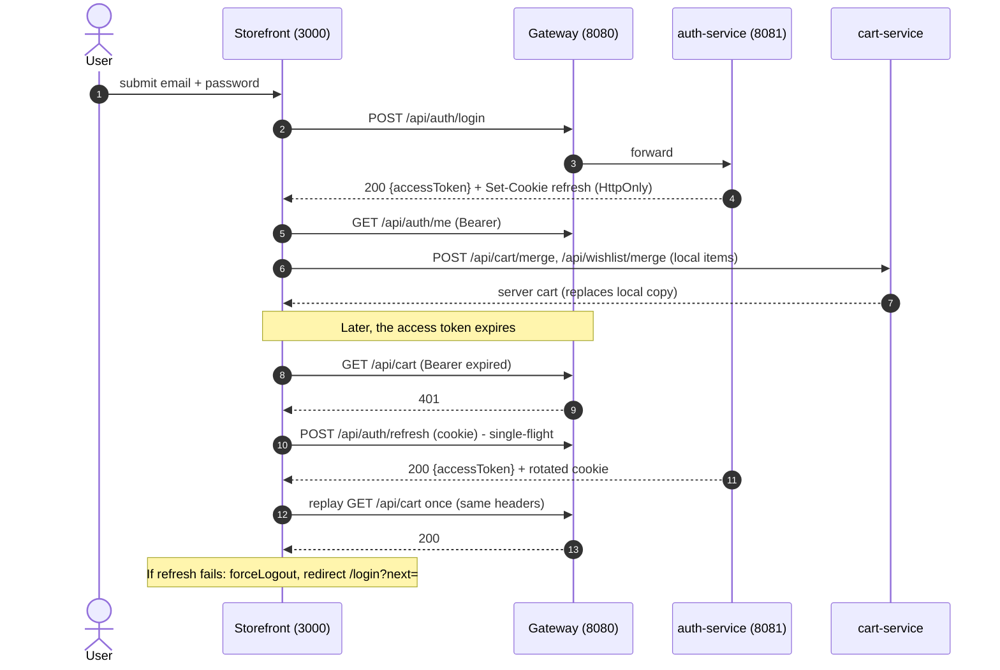
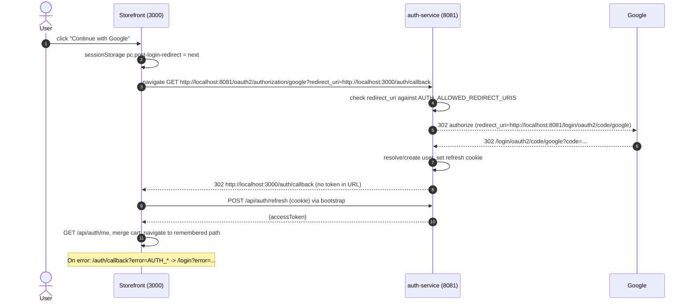

# 13. Storefront Login, Refresh and Google SSO

Source: `apps/product-catalog/src/lib/http.ts`, `stores/authStore.ts`, `services/authApi.ts`, `pages/AuthCallbackPage.tsx`, `lib/redirect.ts`.

The access token is held in memory only. The refresh token is an HttpOnly cookie sent via `credentials: 'include'`.

## Email/password login and silent refresh

## Google SSO

The flow starts directly at auth-service on 8081, not through the gateway (see DecisionLog D4).

