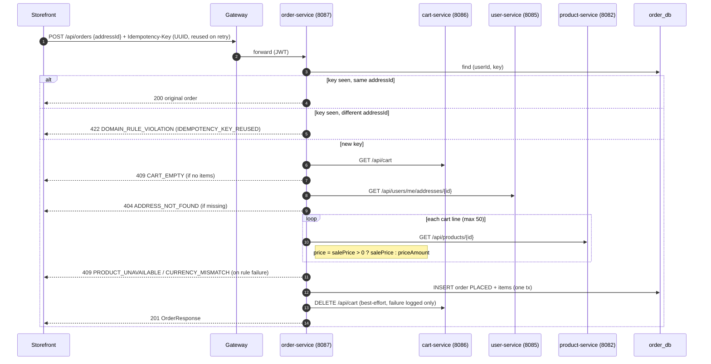

# 14. Checkout Sequence

Source: `services/order-service/order-service-app/.../service/OrderService.java`, `OrderStore.java`, `pages/CheckoutPage.tsx`.

All remote calls run sequentially on the request thread (bearer token relayed) with no DB transaction open. Only the insert is transactional.

Not in this flow (see techdebt): inventory reservation (TD-BE-01), payment (TD-BE-02), `order.events` (TD-BE-04).
