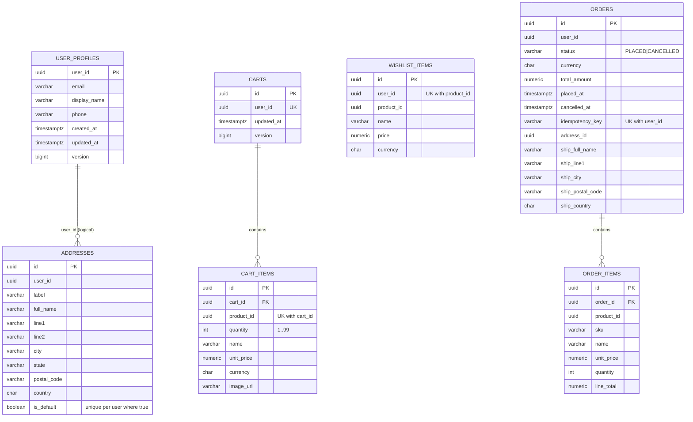

# 15. Customer Data ER (user_db, cart_db, order_db)

Source: `V1__user_baseline.sql`, `V1__cart_baseline.sql`, `V1__order_baseline.sql`. Each database is separate; `user_id` is the auth-service JWT `sub` and has no cross-database FK. `orders.orders.address_id` is a reference by value (the address is copied into `ship_*` columns).

Schemas: `users`, `cart`, `orders` (inside `user_db`, `cart_db`, `order_db`). Some columns omitted for brevity (`ship_phone`, `ship_line2`, `ship_state`, `image_url`, timestamps).
