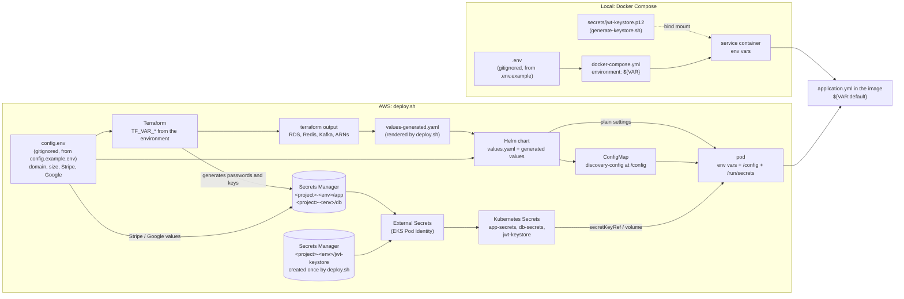

# 17. Configuration flow: how a setting reaches a running service

Last checked against the code: 2026-11-15.

One value, such as the Stripe secret key, takes a different route locally and on AWS. Both end as an
environment variable in the container; a packaged `application.yml` default is the fallback underneath.

## Precedence (highest wins)

1. Environment variable on the container (`.env` via Compose, or the Helm `env:` / Secrets).
2. The ConfigMap mounted at `/config` (AWS only; it carries the service-discovery map).
3. The packaged `application.yml` default.

## Reading the diagram

- **Plain settings** (ports, URLs, sizing, feature flags) travel `config.env` -> Helm -> pod.
- **Secrets** never pass through Helm values. Terraform generates them (or reads them from your
  `config.env` for Stripe and Google), stores them in Secrets Manager, and External Secrets copies them
  into Kubernetes Secrets that pods reference by name.
- **The JWT signing key** is created by `deploy.sh` directly in Secrets Manager, so the private key never
  enters Terraform state.
- Terraform state still contains the generated passwords and your Stripe/Google values: keep the state
  bucket private (it is, by default) and limit who can read it.

Related: [environment variable catalogue](../../reference/environment-variables.md),
[cloud setup](../../guides/cloud-setup.md), [deploy-aws](../../guides/deploy-aws.md).
