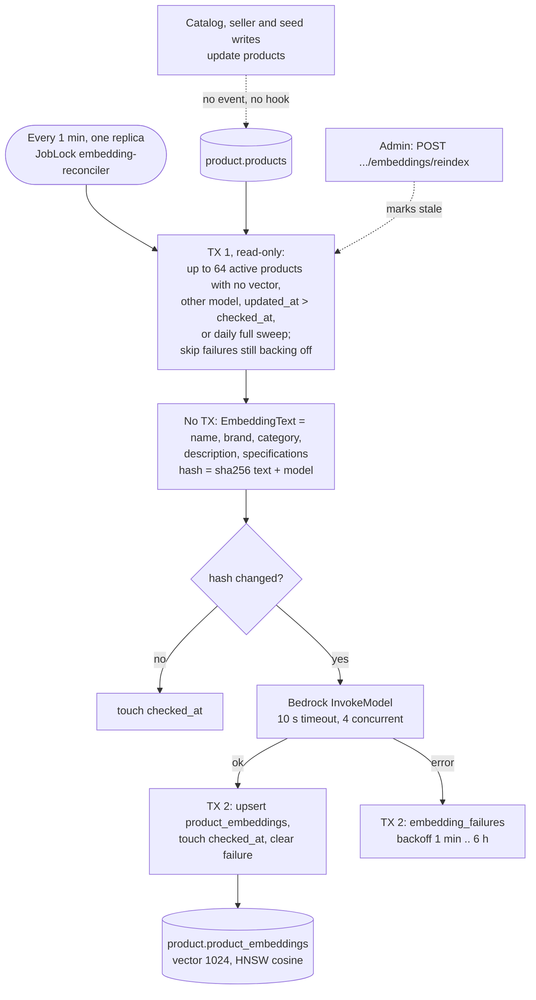

# 21. Product embedding pipeline (AI-1)

Last checked against the code: 2026-11-15. Source: `product/embedding/EmbeddingReconciler.java`, `EmbeddingRepository.java`,
`EmbeddingText.java`. Decision: [ADR 0006](../adr/0006-semantic-search-in-product-service.md).

## Rules that are not obvious
- Price, stock and ratings are deliberately not embedded: they change often and are filters, not meaning.
- Rating updates bump `products.updated_at`; the content hash makes those cheap no-ops.
- A category rename does not touch `products.updated_at`; the daily full sweep catches it.
- Up to 50 batches per run; an edit racing a run is corrected on the next run.
