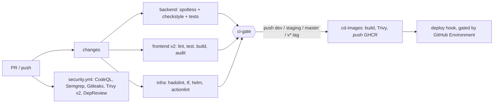

# CI/CD pipeline (GitHub Actions)

Built 2026-11-14. It replaced `.github/workflows/gradle.yml`. Infrastructure and Helm deployment: [deploy-aws.md](deploy-aws.md), [ADR 0004](../architecture/adr/0004-aws-eks-deployment.md).

## What it does

| Workflow | Triggers | Purpose |
|---|---|---|
| `ci.yml` | push / PR to `dev`, `staging`, `master`, `version_v1` | Change detection, then backend Gradle build, frontend matrix, infra lint, and the `ci-gate` check |
| `security.yml` | same, plus weekly (Mon 03:17 UTC) and manual | CodeQL, Semgrep, Gitleaks, Trivy fs, Trivy IaC, Dependency Review |
| `cd-images.yml` | push to `dev`, `staging`, `master`, tags `v*`, manual | Build, Trivy-scan and push 15 images to GHCR with per-environment tags, then run the environment-gated deploy hook |
| `promote.yml` | manual | Retag existing images dev -> staging or staging -> production with no rebuild (also the rollback path) |
| `.github/dependabot.yml` | weekly | Gradle, npm x2, Docker, Terraform, Actions updates |

## Environments (dev -> staging -> master)

| Branch | GitHub Environment | Image tags | Approval |
|---|---|---|---|
| `dev` | `dev` | `sha-<short>`, `dev` | none |
| `staging` | `staging` | `sha-<short>`, `staging` | optional reviewers |
| `master` / `v*` tag | `production` | `sha-<short>`, `latest` (or the tag) | required reviewers |

Normal flow: PR into `dev`, then PR `dev` -> `staging`, then PR `staging` -> `master`. Each push rebuilds and publishes.

Fast path and rollback: run **Promote** (Actions -> Promote -> Run workflow). It retags the exact images already tested, for example `staging -> production`, or a specific `sha-...` tag (the `source_tag` input) to roll back. It fails before changing anything if any of the 15 source images is missing.

### One-time GitHub setup (manual)

1. Settings -> Environments: create `dev`, `staging`, `production`. Add required reviewers to `production` (and optionally `staging`) and restrict each environment to its branch.
2. Create branches `dev` and `staging` from `master`; protect all three, requiring PRs and the `ci-gate` check.
3. Deploy is off: images are published only. To enable, implement [deploy/ci/deploy.sh](../../deploy/ci/deploy.sh), store credentials on the matching Environment, then set variable `DEPLOY_ENABLED=true`. Until implemented it fails loudly instead of pretending to deploy.

## Enforcement switch

Repository variable `CI_ENFORCE` (Settings -> Secrets and variables -> Actions -> Variables).

- Unset / anything else: lint, audit, scans, IaC checks and frontend type-check/tests **report but do not fail**.
- `true`: they fail the job.

Backend build+test and frontend build always fail on error. Flip to `true` once the baseline in the [baseline below](#baseline-to-clear-before-ci_enforcetrue) is clean.

## Branch protection (manual step)

Require status checks `ci-gate` (from CI) and, once enforced, the Security jobs. Do not require the individual path-filtered jobs: when skipped they never report.

## Free-tier caveats

- CodeQL SARIF upload and Dependency Review need a **public repo or GitHub Advanced Security**. Otherwise those steps fail softly; Semgrep SARIF is also kept as a downloadable artifact.
- Gitleaks runs as the open-source binary, not the `gitleaks-action` (which needs a license for organisation repos).
- Image publishing uses `GITHUB_TOKEN` to GHCR, so no secrets need configuring.

## Baseline to clear before `CI_ENFORCE=true`
1. ~~Database dumps committed in `db-snapshots/`~~: removed from the tree on 2026-11-14. They are still in git history; purging them (`git filter-repo`) and rotating the affected credentials is an open decision.
2. **admin-product-catalog**: 4 failing tests (`guards.spec.ts` redirect expectation; `auth.storage.spec.ts` x3, undefined mock in test setup).
3. **product-catalog**: 10 failing tests across `http.test.ts`, `AccountMenu`, `MicroInteractions`, `ProductGrid`; `tsc --noEmit` errors in `http.test.ts` (missing `getAuthToken` export) and `OverviewPage.test.tsx` (`OrderSummary` missing fields).
4. Dockerfile style warnings (unpinned `apk add`, missing `pipefail`, `ls | grep`) - non-blocking.
5. First Trivy / Semgrep / CodeQL results are unknown until the first run on GitHub.

## Future work
- Pin all Actions to commit SHAs (let Dependabot maintain them).
- Add JaCoCo coverage and SpotBugs to Gradle (SpotBugs on Java 25 needs verification).
- Branch protection / rulesets as code; `CODEOWNERS` (needs your GitHub handle).
- Optional ECR push through GitHub OIDC and a manually-approved `deploy` environment.
- SBOM generation (Trivy/Syft) and image signing (cosign keyless) on release tags.

## Changes

### Added
- `.github/workflows/ci.yml`, `security.yml`, `cd-images.yml`
- `.github/dependabot.yml`
- `.gitleaks.toml` (default rules plus fixture/placeholder allowlist)
- `apps/admin-product-catalog/eslint.config.js`, `lint` script, and dev deps `eslint`, `@eslint/js`, `typescript-eslint`, `eslint-plugin-vue`, `globals`

### Removed
- `.github/workflows/gradle.yml`. It triggered only on `master`, labelled JDK 17 while installing 25, and ran dependency submission on PRs. Its build and submission jobs live on in `ci.yml`.

### Modified
- `apps/product-catalog/src/stores/wishlistStore.ts`: replaced the unused `const seq = ++mutationSeq` with `mutationSeq += 1`. Behaviour is identical; it clears the only ESLint error in the app.

### Verified locally
- actionlint (1.7.4): clean.
- Gitleaks over full history: clean **with the default rules** after allowlisting one doc placeholder. The default rules missed the committed database dumps; custom rules added on 2026-11-14 find all 13 secrets in `5943ec7` ([runbook](runbooks/leaked-database-dump.md)).
- Both frontend `build` scripts pass; both ESLint runs have 0 errors.
- `terraform fmt -check`: clean.

### Not verified locally
- The Gradle `build` on JDK 25 (same command the old workflow ran), CodeQL, Semgrep, Trivy and the GHCR push: these only run on GitHub.

## Decisions

| # | Decision | Why | Alternative rejected |
|---|---|---|---|
| 1 | One `ci.yml` with change detection and a `ci-gate` job | Path-filtered separate workflows never report when skipped, which deadlocks required checks | Per-app workflows with `paths:` |
| 2 | `CI_ENFORCE` variable, report-only by default | Existing failures (frontend tests/type errors) would make day one red and teach people to ignore CI | Block everything immediately |
| 3 | Publish to GHCR, do not deploy | No secrets needed; production rollout stays the reviewed `deploy.sh` flow (immutable ECR tags, Terraform, Helm) | ECR via OIDC (needs AWS role setup); auto-deploy |
| 4 | Backend images via the shared Dockerfile with a cached `build` stage | One Gradle compile instead of 13 | Per-service Dockerfiles (13 full builds) |
| 5 | Scan the image before pushing | A vulnerable image is never published when enforcement is on | Scan after push |
| 6 | Gitleaks binary, Semgrep CE, Trivy | Free for any repo visibility and org type | SonarCloud (public repos only), gitleaks-action (license for orgs) |
| 7 | Actions pinned to major version tags, Dependabot updates them | SHAs could not be verified offline; guessing a SHA is worse than a tag | SHA pins (recommended hardening, see FutureWork) |
| 8 | Hadolint fails on `error` only | Existing Dockerfiles have dozens of style warnings (unpinned apk, pipefail) | `warning` threshold |
| 9 | Vue app gets a minimal ESLint flat config | It had no linter; parity with the React app's rule intent | Leave unlinted |
| 10 | Branch-per-environment (dev/staging/master) plus a no-rebuild Promote workflow | PRs give auditable history; Promote ships the exact tested bytes and doubles as rollback | Tag-only promotion |
| 11 | Deploy hook is a loud stub behind `DEPLOY_ENABLED` | No dev/staging infra exists (Terraform has only `envs/prod`); a silent no-op would give false confidence | Fake deploy step |
